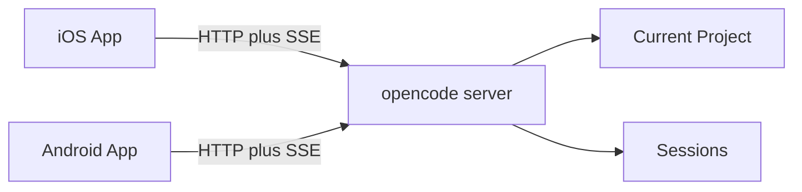

# opencode-mobile Context

`opencode-mobile` is a mobile client project for remotely controlling opencode
sessions from native iOS and Android apps.

The project documents product scope, feasibility, and native app architecture.
App shells exist under `android/` and `ios/OpenCode Mobile/`. Session list home
loads curated **added projects** and sessions via **Project Selection**;
**Session Repository** and **Message Repository** scope calls with `directory`;
Session Chat sends async prompts. Feature contracts live under
`docs/features/`.
OpenAPI fetch tooling and maintained sessions/messages specs exist; full `/doc`
codegen is not wired into app builds yet.
Release processes are not started.

## Bounded Context

The mobile client connects to an opencode server that is already running for a
development project. Calls can be scoped to an added project via `directory=`.

## Glossary

### opencode server

The HTTP server exposed by opencode. It provides the API used by the mobile
client to inspect and control sessions.

The server usually runs on the user's development machine. The user may reach
it through LAN, VPN, HTTPS, or a tunnel.

### Connection Profile

A saved mobile configuration for one reachable opencode server.

A Connection Profile includes the server base URL, username, password (stored in
platform secure storage), and an ordered list of **added project** worktree
paths the user chose to show on home. It represents how the mobile client reaches
opencode, not a user account. One Connection Profile is active at a time.

### Connection onboarding

The first-run screen shown when no Connection Profile is saved.

Connection onboarding explains that the app needs an opencode server and offers
a primary action to open the connection setup flow. It is not shown when a
profile exists but the server is temporarily unreachable.

### Added project

A development project worktree the user explicitly added to the home list for a
Connection Profile.

Adding a project is local curation only; it does not create a project on the
server. The app scopes API calls with that worktree path.

### current project

The project context the opencode server uses for a request.

When the mobile client sends `directory={worktree}` on API calls, **current
project** means that worktree. With no `directory` parameter, it means the
server process boot worktree (`GET /project/current` without a query).

### Terminal

A live shell on the connected opencode server for one **added project**.

Home opens one Terminal screen for the selected worktree. The app talks to
the server PTY over a foreground WebSocket. Leaving the screen or
backgrounding drops I/O and does not kill the process. Terminal is not a
session and is not part of Session Chat.
_Avoid_: PTY as a product word; SSH; TUI attach; session shell command.

### session

A conversation and work stream managed by opencode for the current project.

A session has a user-visible title. The mobile client can list sessions, create
sessions, rename sessions, archive sessions, delete sessions, fork sessions,
inspect their messages, send prompts, abort active work, review diffs, and
respond to permission requests.

### Session Todo List

The agent-owned, view-only task list for one **session**.

The model maintains the list while working; the mobile client reads it and does
not let the user check off or edit items. The Session Todo List is the
only user-facing surface for that data: `todowrite` tool parts stay hidden in
the Session Chat timeline. The client loads the list with `GET` when the session
is open, applies SSE `todo.updated` as a full-list replace while observing,
keeps the local cache when the session goes idle, and force-refetches when the
session becomes live again.

On mobile, the compact Session Todos entry is a floating pill over the top of
Session Chat, stacked with Syncing and Review Changes. Only Scroll to end stays
above the composer. While the Session Todo List sheet is open, Todos and Review
are hidden; Syncing may stay. A pending permission request takes priority over the Session Todo List
sheet: the sheet is dismissed or not opened while the user must approve or deny;
the pill may remain visible. The pill is visible whenever the list is
non-empty and not fully finished, including after the session goes idle —
matching TUI sidebar visibility. When every item is completed or cancelled
while the pill is already shown, it stays briefly visible then closes.
Opening a session whose list is already finished does not replay that hold.

The pill preview line prefers the first `in_progress` Session Todo, else the
first `pending`, else the last `completed`, else the first item. Progress on
the pill is `N/M` where `N` is the count of `completed` items and `M` is the
total list length; `cancelled` does not increment `N` but still counts as
finished for hide/close.
_Avoid_: Tasks, Plan, Checklist, user todo list.

### Session Todo

One item in a **Session Todo List**.

It has a brief description, a status (`pending`, `in_progress`, `completed`, or
`cancelled`), and a priority. List order is identity; there is no separate
server id per item. Mobile does not show or sort by priority.

In the Session Todo List sheet, the header is progress-first (“N of M
completed”), matching the pill’s completed-count / total rule. Status rows are
view-only: checked when completed, indeterminate when in progress,
strikethrough and muted when completed or cancelled, and slightly weaker when
pending — same semantics as the desktop dock, with native chrome.
_Avoid_: task, checklist item (as product terms).

### archive

A session lifecycle action that removes a session from the active list while
keeping it on the server.

Archive is distinct from **delete**. An archived session can still be fetched by
id; it is not permanently removed.
_Avoid_: hide, soft-delete, dismiss.

### archived session

A session that has been archived and is excluded from active session lists.

The mobile client does not currently browse or restore archived sessions.
_Avoid_: hidden session.

### delete (session)

A session lifecycle action that permanently removes a session and its associated
data, including child sessions.

Delete is distinct from **archive**.
_Avoid_: archive, remove (as a synonym when archive is meant).

### Session Repository

The mobile integration layer that performs session lifecycle operations against
the opencode server (list, create, update, archive, delete, fork, status, abort,
diff, permissions, and related session-scoped controls).

Distinct from a **session**: the repository is app infrastructure; the session
is the server-managed conversation for the current project.

### Message Repository

The mobile integration layer that reads and sends **messages** for a session
(list, get one, sync send, and asynchronous prompt send). Its read boundary also
exposes the observed raw and display-message timelines backed by
`MessageSync`, `InMemoryMessageStore`, and `DisplayMessagePipeline`.

Distinct from a **message**: the repository is app infrastructure; a message is
a single item in a session timeline.

### Command Repository

The mobile integration layer that lists **server commands** for the current
project and runs a chosen server command against a session.

Distinct from **Message Repository** (normal prompt send) and **Session
Repository** (session lifecycle and controls). Session Chat chooses command vs
prompt on send; it does not treat a server command as a message write.

### server command

A named command registered on the opencode server for the current project —
config commands, built-ins such as `init`/`review`, MCP prompts, and skills —
that the client lists and runs against a session instead of sending as a normal
prompt.

Distinct from **client slash actions** (Commands-sheet local actions) and from a
timeline message with role `command`.
_Avoid_: slash command (as the name for this concept); custom command (when
meaning the whole server catalog).

### client slash action

A curated local Session Chat action shown in the composer **Commands** sheet
(opened from the `/` circle button next to Attach). Selecting one runs client
behavior immediately (for example new session, fork, undo/redo, compact). It is
not listed from `GET /command` and is not submitted as `POST …/command`.

Distinct from **server command** (typed `/` suggestions and command send) and
from desktop/TUI builtins that mobile intentionally omits.
_Avoid_: slash command (ambiguous); builtin command (when meaning the mobile
allowlist).

### Agent Repository

The mobile integration layer that lists agents for the current project so
Session Chat can offer **selectable agents** in the composer mode picker and
**mentionable agents** under `@`.

Distinct from **Command Repository**. Mentions do not change which agent owns
the turn.

### mentionable agent

An agent from the server catalog that the user may `@` mention in the Session
Chat composer: not a primary turn-owning agent, and not hidden from `@`
autocomplete.

Distinct from the composer's selected turn-owning agent.
_Avoid_: subagent (as the product name for this concept).

### agent mention

A structured reference to a **mentionable agent** pending in the Session Chat
composer or sent on a prompt as an `agent` part.

In the composer it appears as inline `@name` text (not an Attachment chip). On
prompt send it becomes an `agent` part so the server can route task-tool work;
it may lead to a **child session**. It is not a shortcut for changing the
composer's selected agent/mode.
_Avoid_: @ mention (unqualified); subagent mention; treating it as an
Attachment.

### Live Store

A reactive observation layer above CRUD repositories.

A Live Store exposes ongoing updates through a platform stream (Kotlin `Flow`,
Swift `AsyncStream`). The Screen Model's collect is interest. While interested,
the store applies SSE patches when the **foreground event stream** is live, and
REST catch-up when it is dirty after a process gap or an explicit invalidate
such as pull-to-refresh. Screen Models collect Live Store streams for session
lists, status labels, permissions, and questions. They do not own catch-up
policy. The message timeline uses the equivalent synchronization boundary
behind **Message Repository** rather than a type named `MessageLiveStore`.
Mutations such as send, create, and delete still go through repositories
directly. Optimistic send and quiet refresh merge stay in the Screen Model.

Catch-up after background, path restore, and pull-to-refresh is
[reactive-data-layer](docs/features/reactive-data-layer/plan.md).

### Session Cache

Durable on-disk snapshots of server session data scoped to a Connection Profile
connection id (`baseUrl|username`) and an added project worktree.

Holds (1) last-known session list metadata per worktree and (2) domain message
history for sessions the user has opened in Session Chat. Read on cold start for
stale-while-revalidate; written after successful refresh and on debounced /
flushed updates while a session is open. **Live Store** and **MessageSync**
remain the in-memory reactive layers; **InMemoryMessageStore** remains the
working set during an active chat. Distinct from the composer
model-selection preference store (`SessionModelSelectionStore`).
_Avoid_: treating Session Cache as a second live source of truth; persisting
prepared markdown or DisplayMessage rows; conflating with model-selection
“session cache”.

### message

A user, assistant, or tool-related item inside a session.

Each message has a `role` (user/assistant), an ordered array of `parts`, and a
`text` projection of TextPart content for display. Tool calls and Attachments
are not flattened into `text` when Session Chat shows Tool Call Cards or
attachment rows. A message with no meaningful parts (empty prompt, system-only)
still has a `text` fallback.

### message part

A typed content unit within a message. Parts are ordered. The domain
model includes:

- **TextPart**: user prompt text or assistant response text. May carry
  `isStreaming: true` while delta chunks are still arriving. Model reasoning
  traces are a distinct part, not folded into this text.
- **ToolPart**: a named tool call inside a message, with a tool status,
  optional running title, optional error text, call id when the server
  provides one, opaque string-keyed input and metadata maps, and optional
  string output for later card chrome.
  _Avoid_: treating a preformatted status string as the tool part itself;
  modeling every server tool schema as its own domain type.
- **FilePart**: a user **Attachment** that arrived on the wire as a server
  `type: "file"` part with a `data:` URL (image, PDF, or text-like file).
  Shown on the user message as an attachment row (thumbnail or file card),
  not flattened into `text`.
  _Avoid_: upload; treating project `file://` mentions as FileParts in this
  slice; confusing with **file-change tool**.

Outbound **agent mention** parts on prompt send are domain-modeled for the
composer.

**ReasoningPart**: live and historical model thinking. Distinct from
TextPart. Session Chat should show it (TUI v2 parity).

Other wire types (`step-start`, `step-finish`, inbound `agent`, `subtask`,
`snapshot`, `patch`, `retry`, non-`data:` `file` mentions) stay adapter
concerns until a timeline mapping exists.

### Attachment

A device file the user includes with a prompt: image, PDF, or text-like
document.

An Attachment has two lifecycle states: **pending** in the Session Chat
composer (removable chips before send) and **sent** on a user message as a
**FilePart**. Pending bytes stay in an app-owned file. The prompt still carries
them as a data URL on the wire; there is no separate upload API. Files larger
than 20 MiB decoded are rejected at pick. The pending file is deleted when the
chip is removed, the model drops it, or send succeeds.
_Avoid_: upload; Attach context (legacy composer label for device files);
project `@` / `file://` context (different concept); **agent mention** (different
concept).

### timeline block

A Session Chat presentation unit inside one message timeline item: a text
block (Rendered Markdown from adjacent TextParts), a tool card block (Tool
Call Card from a visible ToolPart), a **tool group** block, or an attachment
row (FileParts on a user message).
_Avoid_: treating each block as its own top-level message; flattening tool
labels or attachment bytes into message `text` for Session Chat display.

### tool group

A Session Chat timeline block that summarizes consecutive visible ToolParts
as a single Tool Call Card. Title is `N tools`; subtitle is a family one-liner
in encounter order (`Edit · Write · 5 shells`). Status is the card’s status
dot only. Tap opens a tool group screen of member Tool Call Cards (same taps
as the timeline: Changes, shell sheet). Top-bar Back and the platform-native
Back gesture pop that screen and keep the chat timeline where it was.
**Collapse consecutive tool calls** is on by default. When it is off, only
consecutive context ToolParts (`read` / `glob` / `grep`) group inside one
message; when it is on, any consecutive visible tool families group except `task`
spawns, which never group so their child-session tap stays available. Sequential tool steps stored as adjacent
assistant messages also group when collapse is on. A visible text block, an
attachment, or a `task` tool breaks the group. Hidden tools, empty text, and
compaction markers do not.
_Avoid_: expanding each grouped tool inline; treating a group as multiple
timeline messages; painting a status-colored outline on the group card.

### file-change tool

An assistant ToolPart in the `edit` / `write` / `apply_patch` family that
changes project files. Session Chat shows it as a Tool Call Card with a verb
title, path or multi-file subtitle, and optional +/− counts. Tap opens the
owning-turn Changes flow (File Viewer deep-link when a single path is in the
snapshot; otherwise the Changed Files list).
_Avoid_: treating it as a Change Set; expanding an inline diff accordion in the
chat timeline; using a Bottom Sheet for the diff.

### child session

A session spawned from a parent session to carry out delegated work.

The parent timeline surfaces that work as a `task` ToolPart. Opening the card
navigates into the child session when a session id is available. A child
session has the same title and rename behavior as any other session. It cannot
be prompted from mobile; the composer shows the model and thinking effort used
and returns to the main session.
_Avoid_: subagent (informal/desktop slang for the same child session; also avoid
using subagent as the name for a **mentionable agent**).

### tool status

Where a ToolPart is in its lifecycle: `pending`, `running`, `completed`, or
`error`. Missing or unrecognized server status is treated as `pending`.

Session Chat shows status on the Tool Call Card. Compact emoji labels (for
example ⌛ / ⏳ / ✓ / ✕) are a legacy display formatter for non-card surfaces,
not stored on ToolPart.
_Avoid_: encoding status only as emoji or a display string.

### Rendered Markdown

Formatted display of message text that may include headings, lists, links,
tables, inline code, fenced code blocks, and fenced diff blocks.

Rendered Markdown is a display projection only. The source text remains raw
markdown for sending, copying, restoring to the composer, and repository/domain
state.

### Model Selection

The user's selected provider/model pair and optional server-provided Variant
for the next prompt.

The mobile client loads Model Selection options from the opencode server for the
current project. `Default` Variant is a mobile UI label meaning no explicit
variant is sent.

When a Model Selection already exists, changing it starts from models offered by
the selected Provider, with a way back to the Provider list.

### New Session Model Preference

The Model Selection explicitly chosen on this device as the starting choice for
new sessions in the same Connection Profile and Added Project.

It is not inferred from session history, merely opening a session, or activity
from another client.

### Thinking Effort

Legacy planning term for a reasoning-effort preference. In Session Chat, the
server-backed user-facing selector is **Variant**.

### permission request

A request from opencode for the user to approve or deny an action during a
session.

The mobile client may approve or deny a permission request. It does not
create persistent `remember` decisions from mobile.

### question request

A request from opencode for the user to answer one or more structured questions
during a session so the agent can continue.

The user answers with option labels (and optional custom text) or **dismisses**
the request. A question request is not a permission request and is not the same
as a completed `question` ToolPart in the timeline.
_Avoid_: treating it as a permission request; naming the live ask after the
tool alone; implying dismiss from navigation away.

### diff

The line-level representation of one file's changes inside a **Change Set**.

The mobile client may show diffs so the user can understand the result of remote
work. Diff viewing does not imply mobile file editing.

### Change Set

A collection of file diffs selected for review from one of three sources:

- **Last turn**: changes attributed to the latest user turn in the session.
- **Working tree**: current uncommitted changes in the project's Git working
  tree.
- **Main branch**: current branch changes relative to its default branch.

**Main branch** is available only when the server reports that the project uses
Git and the current branch differs from the default branch. A Change Set is a
read-only review projection; it does not imply mobile file editing or patch
application.

### Session Context

A session-scoped inspection view for the model context and message accounting
behind a **session**.

Session Context shows provider and model labels, context limit, token usage,
message counts, cost, approximate input-token breakdown, and raw message rows.
It is opened from the context usage control in Session Chat. It is a snapshot
that can be manually refreshed, not a live-updating timeline.

### foreground event stream

The live server-sent event connection used while the mobile app is open and
active.

The app uses this stream to update session state in the foreground. When the app
reconnects, it refreshes state instead of relying on guaranteed background
delivery.

### OC-2 theme

A desktop-compatible theme file format (JSON) used by OpenCode clients.

Each theme defines `light` and `dark` variants with palette seeds and optional
token overrides. Mobile apps resolve seeds into semantic color tokens at
runtime. Users pick bundled desktop presets or import custom OC-2 JSON in
Settings.

### Design System

The shared visual and interaction language for both native apps.

The Design System defines semantic tokens, typography roles, reusable
components, component states, and intentional platform differences. SwiftUI and
Android Material 3 may expose different platform APIs, but they should preserve
the same product meaning.

### Component Collection

The set of reusable Design System components available to feature screens.

The Component Collection is built and kept in sync across iOS and Android before
feature screens depend on reusable UI. Each component should have documented
intent, supported variants, states, and platform differences.

### Component Gallery

A developer-only in-app inspection surface for the Component Collection and
Design System foundations.

The Component Gallery is allowed to be the temporary app entry point during
design-system work. It lists gallery entries and opens a dedicated screen per
entry with consistent controls for reviewing themes, states, variants, and
platform behavior. It is not part of user-facing product navigation.

### Feature Slice

A user-facing capability developed across both native apps as one coordinated
unit of work.

A Feature Slice includes shared product intent, platform implementations,
feature documentation, and any Parity Gaps that remain while the apps are being
brought into sync.

### Screen Model

The feature-level object that prepares state and handles user actions for a
screen.

A Screen Model exposes an immutable view of the screen's state and explicit
actions or events. The concept is shared across platforms even though each app
uses its native implementation tools.

### Parity Gap

A documented difference between the iOS and Android apps.

A Parity Gap may describe behavior, state, copy, visual semantics, token
mapping, accessibility behavior, error handling, or missing implementation. It
records the shared intent, current platform states, reason, next action, and
whether the difference is intentional or temporary.
