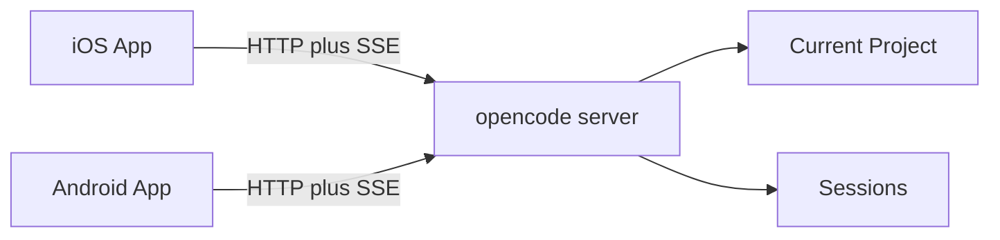

# opencode-mobile Context

`opencode-mobile` is a mobile client project for remotely controlling opencode
sessions from native iOS and Android apps.

The project documents product scope, feasibility, and native app architecture.
App shells exist under `android/` and `ios/OpenCode Mobile/`. Session list home
loads curated **added projects** and sessions via **Project Selection**;
**Session Repository** and **Message Repository** scope calls with `directory`;
Session Chat sends async prompts (see `docs/features/project-selection/`,
`docs/features/session-repository/`, `docs/features/message-repository/`).
OpenAPI fetch tooling and maintained sessions/messages specs exist; full `/doc`
codegen is not wired into app builds yet.
Release processes are not started.

## Bounded Context

The mobile client connects to an opencode server that is already running for a
development project. In v1, the mobile client operates inside that server's
current project context and does not switch projects remotely.

## Glossary

### opencode server

The HTTP server exposed by opencode. It provides the API used by the mobile
client to inspect and control sessions.

For v1, the server is expected to run on the user's development machine. The
user may reach it through LAN, VPN, HTTPS, or a tunnel, but the mobile client
does not provide that transport.

### Connection Profile

A saved mobile configuration for one reachable opencode server.

A Connection Profile includes the server base URL, username, password (stored in
platform secure storage), and an ordered list of **added project** worktree
paths the user chose to show on home. It represents how the mobile client reaches
opencode, not a user account. v1 supports one active Connection Profile at a
time.

### Connection onboarding

The first-run screen shown when no Connection Profile is saved.

Connection onboarding explains that the app needs an opencode server and offers
a primary action to open the connection setup flow. It is not shown when a
profile exists but the server is temporarily unreachable.

### Added project

A development project worktree the user explicitly added to the home list for a
Connection Profile.

Adding a project is local curation only; it does not create a project on the
server. The app scopes API calls with that worktree path.

### current project

The project context the opencode server uses for a request.

When the mobile client sends `directory={worktree}` on API calls, **current
project** means that worktree. With no `directory` parameter, it means the
server process boot worktree (`GET /project/current` without a query).

### session

A conversation and work stream managed by opencode for the current project.

The mobile client can list sessions, create sessions, rename sessions, delete
sessions, fork sessions, inspect their messages, send prompts, abort active
work, review diffs, and respond to permission requests.

### Session Repository

The mobile integration layer that performs session lifecycle operations against
the opencode server (list, create, update, delete, fork, status, abort, diff,
permissions, and related session-scoped controls).

Distinct from a **session**: the repository is app infrastructure; the session
is the server-managed conversation for the current project.

### Message Repository

The mobile integration layer that reads and sends **messages** for a session
(list, get one, sync send, and asynchronous prompt send).

Distinct from a **message**: the repository is app infrastructure; a message is
a single item in a session timeline.

### Live Store

A reactive observation layer above CRUD repositories that keeps screen data fresh
while the **foreground event stream** is active.

A Live Store listens for relevant server-sent events, applies debounced REST
refresh policy, and exposes ongoing updates through platform streams (for
example Kotlin `Flow` or Swift `AsyncStream`). Screen Models collect Live Store
streams for timelines, session lists, and status labels. Mutations such as
send, create, and delete still go through repositories directly. Optimistic send
and quiet refresh merge stay in the Screen Model.

### message

A user, assistant, command, or tool-related item inside a session.

The mobile client treats messages as the main way to understand what happened in
a session and as the vehicle for sending new prompts.

### Model Selection

The user's selected provider/model pair and optional server-provided Variant
for the next prompt.

The mobile client loads Model Selection options from the opencode server for the
current project. `Default` Variant is a mobile UI label meaning no explicit
variant is sent.

### Thinking Effort

Legacy planning term for a reasoning-effort preference. In Session Chat, the
server-backed user-facing selector is **Variant**.

### permission request

A request from opencode for the user to approve or deny an action during a
session.

The mobile client may approve or deny a permission request in v1, but it should
not create persistent `remember` decisions from mobile.

### diff

The set of file changes associated with a session or message.

The mobile client may show diffs so the user can understand the result of remote
work. In v1, diff viewing does not imply mobile file editing.

### foreground event stream

The live server-sent event connection used while the mobile app is open and
active.

The app uses this stream to update session state in the foreground. When the app
reconnects, it refreshes state instead of relying on guaranteed background
delivery.

### Design System

The shared visual and interaction language for both native apps.

The Design System defines semantic tokens, typography roles, reusable
components, component states, and intentional platform differences. SwiftUI and
Android Material 3 may expose different platform APIs, but they should preserve
the same product meaning.

### Component Collection

The set of reusable Design System components available to feature screens.

The Component Collection is built and kept in sync across iOS and Android before
feature screens depend on reusable UI. Each component should have documented
intent, supported variants, states, and platform differences.

### Component Gallery

A developer-only in-app inspection surface for the Component Collection and
Design System foundations.

The Component Gallery is allowed to be the temporary app entry point during
design-system work. It lists gallery entries and opens a dedicated screen per
entry with consistent controls for reviewing themes, states, variants, and
platform behavior. It is not part of the v1 user-facing product navigation.

### Feature Slice

A user-facing capability developed across both native apps as one coordinated
unit of work.

A Feature Slice includes shared product intent, platform implementations,
feature documentation, and any Parity Gaps that remain while the apps are being
brought into sync.

### Screen Model

The feature-level object that prepares state and handles user actions for a
screen.

A Screen Model exposes an immutable view of the screen's state and explicit
actions or events. The concept is shared across platforms even though each app
uses its native implementation tools.

### Parity Gap

A documented difference between the iOS and Android apps.

A Parity Gap may describe behavior, state, copy, visual semantics, token
mapping, accessibility behavior, error handling, or missing implementation. It
records the shared intent, current platform states, reason, next action, and
whether the difference is intentional or temporary.

## Deferred Concepts

These concepts are intentionally outside the v1 context:

- mobile IDE;
- mobile terminal remote;
- app-managed tunnel or relay;
- account system;
- push notification service;
- multi-project manager;
- direct remote admin console for shell, config, auth, or MCP management.
