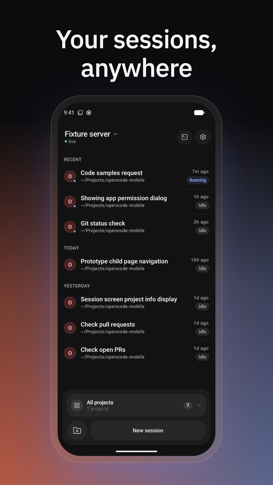
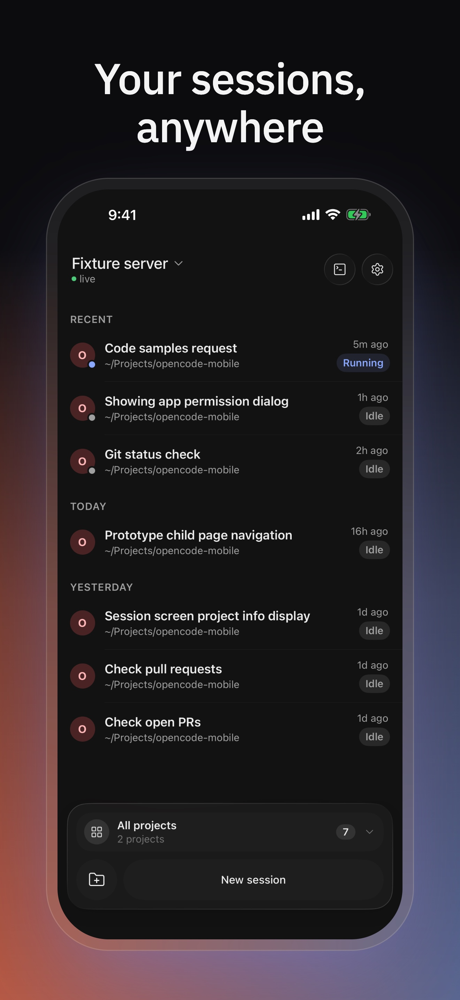

# OpenCode Mobile

Native iOS and Android apps for driving [opencode](https://github.com/sst/opencode)
sessions from your phone. Start a session, follow it live, answer permission
prompts and questions, and review changes while opencode runs on your own
machine.

OpenCode Mobile is an unofficial client. It is not affiliated with or endorsed
by the opencode project or its authors.

| Android | iOS |
|:---:|:---:|
|  |  |

## Get the app

- **Android:** [Google Play](https://play.google.com/store/apps/details?id=dev.opencode.mobile)
- **iOS:** [App Store](https://apps.apple.com/app/id6799246544)

## Connect to your opencode server

The app talks to an opencode server you run; it does not host anything for
you. See the official [server docs](https://opencode.ai/docs/server/) for
details.

1. In your project, start the headless server with a password and keep it
   running:

   ```bash
   OPENCODE_SERVER_PASSWORD=<your-password> opencode serve
   ```

   The username is `opencode` unless you set `OPENCODE_SERVER_USERNAME`.
2. Make the server reachable from your phone. We recommend
   [Tailscale](https://tailscale.com): install it on the machine and the
   phone, then use the machine's Tailscale IP or MagicDNS name. A LAN, VPN,
   HTTPS endpoint, or another tunnel you manage also works.
3. In the app, enter the server URL and password. The app checks the server's
   health before it saves the connection.

Do not expose the server over plain HTTP on the public internet. The password is
sent with every request, and the server can run commands on your machine.

The app supports both current opencode server protocols and only keeps a live
connection while it is open.

## Build from source

### Requirements

- **Android:** JDK 17 and the Android SDK (compile SDK 37). The optional
  `:screenshot` module needs JDK 21; see [android/README.md](android/README.md).
- **iOS:** Xcode with the iOS 17.5+ simulator.
- **Repo scripts:** Node.js (`npm install` at the repository root).

### Android

```bash
cd android
./gradlew :app:assembleDebug
./gradlew :app:testDebugUnitTest
./gradlew ktlintCheck
```

### iOS

Open `ios/OpenCode Mobile/OpenCode Mobile.xcodeproj` in Xcode, or build from the
command line:

```bash
cd "ios/OpenCode Mobile"
xcodebuild build \
  -project "OpenCode Mobile.xcodeproj" \
  -scheme "OpenCode Mobile" \
  -destination 'generic/platform=iOS Simulator' \
  CODE_SIGNING_ALLOWED=NO
```

Builds from source never include Firebase. Crash reporting and analytics are
only in the store builds.

### Repo scripts

```bash
npm install
npm run icons:sync      # regenerate the shared Lucide icons
npm run themes:sync     # copy bundled theme presets into the app bundles
npm run themes:check    # verify the shared, iOS, and Android preset copies match
npm run api:sync        # fetch the OpenAPI spec and regenerate the API clients
```

## Repository layout

| Path | Purpose |
|---|---|
| `android/` | Kotlin, Jetpack Compose, Material 3 app |
| `ios/OpenCode Mobile/` | SwiftUI app |
| `shared/` | Code and assets both apps use (Markdown core, themes, terminal) |
| `docs/` | Architecture and design-system reference |
| `scripts/` | Icon, theme, and OpenAPI tooling |
| `.agents/skills/` | Skills for AI coding agents |

- [CONTEXT.md](CONTEXT.md): product vocabulary
- [docs/architecture.md](docs/architecture.md): how the apps are structured
- [docs/design-system/](docs/design-system/): the shared design system

## Contributing

Issues and pull requests are welcome. Read [CONTRIBUTING.md](CONTRIBUTING.md)
first; your first pull request asks you to accept the
[Contributor License Agreement](CLA.md). Report security problems privately as
described in [SECURITY.md](SECURITY.md).

If you work with an AI coding agent, point it at [AGENTS.md](AGENTS.md). Run
`./scripts/sync-agent-links.sh` after cloning if the `.claude/` or `.cursor/`
skill links are missing.

## License

Copyright (C) 2026 Ivan Fenenko.

The source code is licensed under the [GNU General Public License v3.0](LICENSE),
with an additional permission to link with the Firebase SDKs and Google Play
services libraries; see [NOTICE](NOTICE). Third-party components keep their own
licenses; see [THIRD_PARTY_NOTICES.md](THIRD_PARTY_NOTICES.md).

The app icon and store graphics are not covered by the GPL; all rights
reserved. A fork that you distribute must use its own icon, store graphics,
application id, and bundle id.
