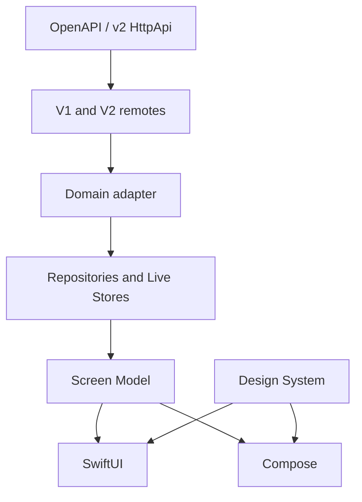

# Native App Architecture

Two native apps: SwiftUI on iOS, Kotlin + Jetpack Compose + Material 3 on
Android. Same product language, feature boundaries, design-system meaning,
and server integration. Separate implementations.

Both server protocols stay supported: classic unprefixed **v1** and `/api/*`
**v2**. Detect on connect; remotes hide the split. Live Session Chat *UX*
tracks official TUI v2 on opencode **`beta`**, not `dev`/`main`. That does
not drop v1 servers.

## Layout

- [`android/`](../android/) — Compose, Material 3
- [`ios/OpenCode Mobile/`](../ios/OpenCode%20Mobile/)
- Checks and builds: [`ci-pr-gating`](features/ci-pr-gating/)
- Android Play internal + Firebase: [`android-release-distribution`](features/android-release-distribution/)
- iOS TestFlight internal + Firebase: [`ios-release-distribution`](features/ios-release-distribution/)



## Server API

Detect `v1` | `v2` on connect (`/global/health` then `/api/health`). Route
under remotes. Feature code uses domain types, not wire schemas. Changing
one protocol must leave the other working (same Screen Models, both remotes,
both health/event paths). Both protocols must carry relevant live events
over SSE; do not ship a heartbeat-only or REST-only live path.

OpenAPI (`/doc` or v2 `/openapi.json`) is the contract. Generated clients
are optional; if used they stay behind the adapter.

## Domain

Adapter maps wire → `ConnectionProfile`, `Session`, `Message`,
`PermissionRequest`, `Diff`, `ForegroundEventStream`. Reasoning is a
distinct message part.

Repositories speak product operations: list sessions, send a prompt, abort,
answer a permission. Dual remotes hide path and envelope differences.

## DI

Screen Models depend on repository protocols only.

- Android: Hilt (`@HiltViewModel`, feature modules)
- iOS: Factory (`AppContainer`)

## Screen Models

One immutable UI state, explicit actions, product-language errors.

- iOS: Observation, MainActor async tasks
- Android: ViewModel, StateFlow, coroutines

Composite `FeatureUiState`. Regional enums only when a region’s modes are
mutually exclusive. Persistent chrome stays on the composite root.

### Session Chat

`SessionChatViewModel` is a facade. `SessionChatTimeline`,
`SessionChatComposer`, `SessionInfo`, `SessionChatReviewChanges`,
`SessionChatCommands`, and `SessionChatInbox` own behavior. New logic goes
in a region, not the facade. See
[session-chat/decisions.md](features/session-chat/decisions.md).

Home (`MainScreenViewModel` / `ProjectListHomeViewModel`) is the same
shape: `HomeSessionActions` owns the long-press sheet, rename / fork
dialogs, archive, and delete. The facade logs analytics and composes
home list state.

## Design system

Screens use the Component Collection. Missing reusable UI is added through
`design-system-component` before the feature depends on it. Feature-local
layout is fine when it is not a reusable concept.

## Source layout

iOS: `UI/<Feature>/` (filesystem-synchronized Xcode groups).

```text
UI/SessionChat  UI/Main  UI/Connection  UI/Settings  UI/Root
Components/  Domain/  Data/  DI/  Theme/  Network/
```

`Domain/Message` internals: `Remote/`, `Store/`, `Pipeline/`,
`Attachment/`. Product types (`Message`, `MessageRepository`,
`FollowUpDelivery`) stay at the `Message` root.

Android: `dev.opencode.mobile.ui.<feature>/` (`sessionchat`, `main`,
`connection`, `settings`, `root`, `components`). Same Message folders
under `domain/message/` (`remote`, `store`, `pipeline`, `attachment`);
package stays `domain.message`.

## Persistence

Secrets: iOS Keychain, Android Keystore-backed storage.

App-owned data: SwiftData / Room when needed. Session Cache is
stale-while-revalidate for home lists and chat reopen. The live message
store stays in-memory (`InMemoryMessageStore`).

## Data layer

Screen Models observe Live Stores and Message Repository, mutate through
repositories, and mark a store dirty for pull-to-refresh. Process
lifecycle and Device network path adapters publish world signals. Those
signals start and stop the foreground event stream and mark stores stale.
REST catch-up after a gap lives inside `MessageSync` and the Live Stores.
Contract:
[reactive-data-layer](features/reactive-data-layer/plan.md).

## Foreground events

One app-wide stream while foregrounded. Keep both protocols and both v1
event paths: `GET /global/event` and instance `GET /event`, plus v2
`GET /api/event`. Official desktop uses `/global/event` for v1; instance
`/event` is the directory-scoped bus that carries `session.created`,
`message.*`, status, permissions, and questions. Both protocols must
deliver those events over SSE — heartbeat-only is not acceptable. Stop
after a short background grace. 45s idle timeout then reconnect. REST is
history / reconnect authority, not a substitute for missing SSE. Live
Session Chat UX tracks TUI v2.

`EventDomainAdapter` projects v2 `session.*` / `session.next.*` (including
inbox and reasoning) into the v1 product vocabulary. `MessageSync` merges
message/part events incrementally. In-flight REST must not overwrite a
newer store revision. Which REST runs after background or path restore is
the store's job; see [reactive-data-layer](features/reactive-data-layer/).

## Logging

Log method/path, status, SSE state, event type/session id. Never log
credentials, prompts, or bodies. Tags filterable in Console / logcat.

## Parity

Feature work is a synchronized slice on both apps. Differences go in
`parity-gaps.md` or `docs/design-system/divergences.md`.
