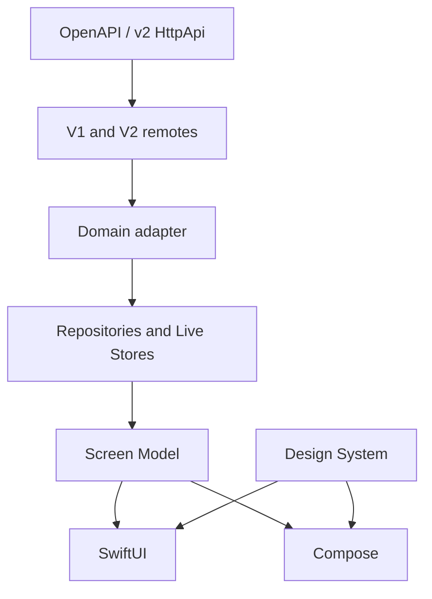

# Native App Architecture

Two native apps: SwiftUI on iOS, Kotlin + Jetpack Compose + Material 3 on
Android. Same product language, feature boundaries, design-system meaning,
and server integration. Separate implementations.

Live Session Chat tracks official TUI v2. Dual-stack HTTP talks to classic
unprefixed APIs and `/api/*`.

## Layout

- [`android/`](../android/) — Compose, Material 3
- [`ios/OpenCode Mobile/`](../ios/OpenCode%20Mobile/)
- Checks and builds: [`ci-pr-gating`](features/ci-pr-gating/)
- Android Play internal + Firebase: [`android-release-distribution`](features/android-release-distribution/)
- iOS TestFlight internal + Firebase: [`ios-release-distribution`](features/ios-release-distribution/)



## Server API

Detect `v1` | `v2` on connect (`/global/health` then `/api/health`). Route
under remotes. Feature code uses domain types, not wire schemas.

OpenAPI (`/doc` or v2 `/openapi.json`) is the contract. Generated clients
are optional; if used they stay behind the adapter.

## Domain

Adapter maps wire → `ConnectionProfile`, `Session`, `Message`,
`PermissionRequest`, `Diff`, `ForegroundEventStream`. Reasoning is a
distinct message part.

Repositories speak product operations: list sessions, send a prompt, abort,
answer a permission. Dual remotes hide path and envelope differences.

## DI

Screen Models depend on repository protocols only.

- Android: Hilt (`@HiltViewModel`, feature modules)
- iOS: Factory (`AppContainer`)

## Screen Models

One immutable UI state, explicit actions, product-language errors.

- iOS: Observation, MainActor async tasks
- Android: ViewModel, StateFlow, coroutines

Composite `FeatureUiState`. Regional enums only when a region’s modes are
mutually exclusive. Persistent chrome stays on the composite root.

### Session Chat

`SessionChatViewModel` is a facade. `SessionChatTimeline`,
`SessionChatComposer`, and `SessionInfo` own behavior. New logic goes in a
region, not the facade. See
[session-chat/decisions.md](features/session-chat/decisions.md).

## Design system

Screens use the Component Collection. Missing reusable UI is added through
`design-system-component` before the feature depends on it. Feature-local
layout is fine when it is not a reusable concept.

## Source layout

iOS: `UI/<Feature>/` (filesystem-synchronized Xcode groups).

```text
UI/SessionChat  UI/Main  UI/Connection  UI/Settings  UI/Root
Components/  Domain/  Data/  DI/  Theme/  Network/
```

Android: `dev.opencode.mobile.ui.<feature>/` (`sessionchat`, `main`,
`connection`, `settings`, `root`, `components`).

## Persistence

Secrets: iOS Keychain, Android Keystore-backed storage.

App-owned data: SwiftData / Room when needed. Session Cache is
stale-while-revalidate for home lists and chat reopen. The live message
store stays in-memory (`InMemoryMessageStore`).

## Foreground events

One app-wide stream while foregrounded. Path is `/global/event` or
`/api/event` by protocol. Stop after a short background grace. 45s idle
timeout then reconnect. Refresh from REST after reconnect.

`EventDomainAdapter` projects v2 `session.*` / `session.next.*` (including
inbox and reasoning) into the v1 product vocabulary. `MessageSync` merges
message/part events incrementally. REST is authoritative for history,
idle, and reconnect. In-flight REST must not overwrite a newer store
revision.

## Logging

Log method/path, status, SSE state, event type/session id. Never log
credentials, prompts, or bodies. Tags filterable in Console / logcat.

## Parity

Feature work is a synchronized slice on both apps. Differences go in
`parity-gaps.md` or `docs/design-system/divergences.md`.
