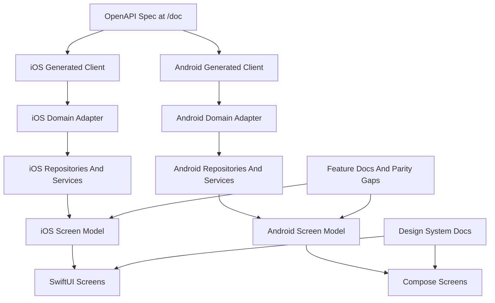

# Native App Architecture

`opencode-mobile` will be implemented as two native apps: SwiftUI on iOS and
Kotlin with Jetpack Compose plus Material 3 on Android.

The apps should feel native on each platform while sharing the same product
language, feature boundaries, design-system meaning, and server integration
model. This document defines the intended architecture as native implementation
progresses.

## Current Boundary

Native app projects exist: [`android/`](../android/) (Compose, Material 3) and
[`ios/OpenCode Mobile/`](../ios/OpenCode%20Mobile/) (SwiftUI; `.xcodeproj` at
`ios/OpenCode Mobile/OpenCode Mobile.xcodeproj`). Do not run OpenAPI client
generators or wire CI/release pipelines until a later decision explicitly starts
that work.

The v1 app remains a foreground session-control client for one reachable,
password-protected opencode server's current project.

## Layer Shape

## Server API Boundary

The opencode OpenAPI 3.1 spec at `/doc` is the source of truth for server
contracts.

Preferred future client-generation defaults are:

- iOS: Swift OpenAPI Generator, if it fits the server contract and deployment
  target.
- Android: OpenAPI Generator with a Kotlin/Ktor-style client, or an equivalent
  Kotlin generator that produces maintainable coroutine-friendly APIs.

These generator choices are provisional. The stable rule is that generated types
must be wrapped in a domain adapter before feature code uses them.

## Domain Adapter

The domain adapter maps raw server schemas into app domain terms such as
`ConnectionProfile`, `Session`, `Message`, `PermissionRequest`, `Diff`, and
`ForegroundEventStream`.

Feature code should not depend directly on generated response names, transport
types, or schema quirks. If the server contract changes, the adapter absorbs the
change where practical and keeps product language stable.

## Repositories And Services

Repositories and services coordinate API calls, local persistence, foreground
event streams, and domain mapping. They should expose operations in product
terms, such as listing sessions, sending an asynchronous prompt, aborting work,
or responding to a permission request.

Keep these boundaries small until implementation proves a broader abstraction is
needed.

## Dependency Injection

Use platform DI frameworks so UI and Screen Models do not construct repositories
inline.

- **Android:** Dagger Hilt — `@HiltAndroidApp`, feature modules (`NetworkModule`,
  `SessionModule`, `MessageModule`), `@HiltViewModel` for Screen Models,
  `hiltViewModel()` in Compose.
- **iOS:** Factory — `AppContainer` registers `ServerConnection`, API clients,
  adapters, and repository implementations; views resolve ViewModels from the
  container.

Screen Models depend on repository **protocols** only. Concrete wiring lives in
DI modules.

## Screen Models

Each feature screen should have a Screen Model that exposes:

- one immutable UI state value;
- explicit user actions or events;
- async loading, refresh, and mutation behavior;
- error states expressed in product language.

On iOS, use SwiftUI-native patterns such as Observation and MainActor async
tasks where they fit. On Android, use ViewModel with StateFlow and coroutines.
The framework details differ, but the conceptual contract should remain aligned.

## Design System Dependency

Screens compose the shared Component Collection. If a feature needs a new
reusable primitive, component, semantic variant, or token role, add it through
the design-system component workflow before the feature screen depends on it.

Feature-local layout is allowed when it is specific to one screen and does not
create a reusable design-system concept.

## Persistence

Connection Profile secrets must be stored in native secure storage:

- iOS: Keychain.
- Android: Keystore-backed storage.

Use structured persistence for app-owned non-secret data when a feature needs
durable local state:

- iOS default: SwiftData.
- Android default: Room.

Do not introduce local persistence solely to cache foreground session state
unless the product behavior requires it.

## Foreground Events

Use server-sent events only while the app is foregrounded. After reconnect,
refresh current project, session list, session status, messages, diffs, and
permission requests from the server instead of relying on guaranteed background
delivery.

## Cross-App Parity

Feature work should proceed as a synchronized Feature Slice across both native
apps. Differences between iOS and Android are acceptable only when they are
documented as Parity Gaps or intentional platform divergences.
