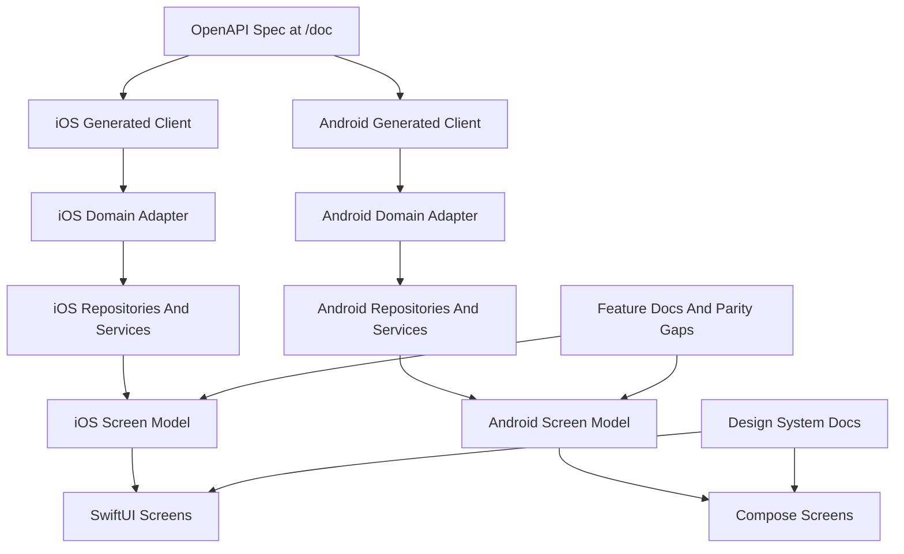

# Native App Architecture

`opencode-mobile` will be implemented as two native apps: SwiftUI on iOS and
Kotlin with Jetpack Compose plus Material 3 on Android.

The apps should feel native on each platform while sharing the same product
language, feature boundaries, design-system meaning, and server integration
model. This document defines the intended architecture as native implementation
progresses.

## Current Boundary

Native app projects exist: [`android/`](../android/) (Compose, Material 3) and
[`ios/OpenCode Mobile/`](../ios/OpenCode%20Mobile/) (SwiftUI; `.xcodeproj` at
`ios/OpenCode Mobile/OpenCode Mobile.xcodeproj`). PR Checks and manual Build
workflows already exist ([`ci-pr-gating`](features/ci-pr-gating/)). Android
release distribution (Firebase Test Lab + Play internal track) is planned under
[`android-release-distribution`](features/android-release-distribution/); iOS
App Store / TestFlight remains deferred until an Apple Developer account exists.

The v1 app remains a foreground session-control client for one reachable,
password-protected opencode server's current project.

## Layer Shape



## Server API Boundary

The opencode OpenAPI 3.1 spec at `/doc` is the source of truth for server
contracts.

Preferred future client-generation defaults are:

- iOS: Swift OpenAPI Generator, if it fits the server contract and deployment
  target.
- Android: OpenAPI Generator with a Kotlin/Ktor-style client, or an equivalent
  Kotlin generator that produces maintainable coroutine-friendly APIs.

These generator choices are provisional. The stable rule is that generated types
must be wrapped in a domain adapter before feature code uses them.

## Domain Adapter

The domain adapter maps raw server schemas into app domain terms such as
`ConnectionProfile`, `Session`, `Message`, `PermissionRequest`, `Diff`, and
`ForegroundEventStream`.

Feature code should not depend directly on generated response names, transport
types, or schema quirks. If the server contract changes, the adapter absorbs the
change where practical and keeps product language stable.

## Repositories And Services

Repositories and services coordinate API calls, local persistence, foreground
event streams, and domain mapping. They should expose operations in product
terms, such as listing sessions, sending an asynchronous prompt, aborting work,
or responding to a permission request.

Keep these boundaries small until implementation proves a broader abstraction is
needed.

## Dependency Injection

Use platform DI frameworks so UI and Screen Models do not construct repositories
inline.

- **Android:** Dagger Hilt — `@HiltAndroidApp`, feature modules (`NetworkModule`,
  `SessionModule`, `MessageModule`), `@HiltViewModel` for Screen Models,
  `hiltViewModel()` in Compose.
- **iOS:** Factory — `AppContainer` registers `ServerConnection`, API clients,
  adapters, and repository implementations; views resolve ViewModels from the
  container.

Screen Models depend on repository **protocols** only. Concrete wiring lives in
DI modules.

## Screen Models

Each feature screen should have a Screen Model that exposes:

- one immutable UI state value;
- explicit user actions or events;
- async loading, refresh, and mutation behavior;
- error states expressed in product language.

On iOS, use SwiftUI-native patterns such as Observation and MainActor async
tasks where they fit. On Android, use ViewModel with StateFlow and coroutines.
The framework details differ, but the conceptual contract should remain aligned.

### Screen Model state shape

Expose one composite snapshot per screen. Name the root value `FeatureUiState`
on both platforms.

Default shape:

- **Composite root** — a struct or data class holding every field the view reads.
  Do not split live metadata across extra ViewModel properties.
- **Regional enums** — small enums for one UI region whose modes are mutually
  exclusive, such as `SessionChatTimelineState` for the message list area.
- **Nested sub-states or flat fields** — either is fine inside the root. Group
  related fields when a cluster will grow; keep simple scalars flat.
- **Orthogonal flags** — connection status, send/refresh/abort activity, and
  non-blocking errors stay separate fields instead of new root enum cases.

Reserve a top-level sealed interface or enum for screens whose layouts are
genuinely disjoint end to end, such as home `Disconnected` vs `Loaded`. Even
then, keep one rich loaded shape rather than many shallow cases.

When extending a screen:

1. Add a field with a safe default when layout is unchanged.
2. Add a nested sub-state when grouping several related fields.
3. Add a regional enum case only when that region's UI is mutually exclusive.
4. Split to a new screen when the work is a different user task.

Avoid root screen-phase enums when persistent chrome stays visible while only
one region changes. Avoid helper sprawl such as `isSendingFromCurrentState()`;
that usually means the root should be composite.

### Session Chat facade (high-risk)

Session Chat is the reference implementation of a **regional Screen Model**:
`SessionChatTimeline`, `SessionChatComposer`, and `SessionInfo` own behavior;
`SessionChatViewModel` coordinates and merges state only.

Treat edits to `SessionChatViewModel` as architectural decisions, not routine
feature work. Before changing it:

1. Put new logic in the owning region.
2. Keep the facade to `bind()`, `mergeUiState()`, and explicit cross-region
   callbacks.
3. Do not add repository dependencies, caches, or store I/O to the facade.
4. Document boundary changes in `docs/features/session-chat/decisions.md`.

See [Session Chat decisions](features/session-chat/decisions.md#keep-sessionchatviewmodel-as-a-thin-facade)
for the full allow/deny list and region ownership table.

## Design System Dependency

Screens compose the shared Component Collection. If a feature needs a new
reusable primitive, component, semantic variant, or token role, add it through
the design-system component workflow before the feature screen depends on it.

Feature-local layout is allowed when it is specific to one screen and does not
create a reusable design-system concept.

## iOS Source Layout

Feature screens and screen models live under `UI/<Feature>/` inside the app
target (`ios/OpenCode Mobile/OpenCode Mobile/`). This mirrors Android's
`dev.opencode.mobile/ui/<feature>/` convention.

```text
OpenCode Mobile/
├── UI/
│   ├── SessionChat/       # SessionChatView, SessionChatViewModel
│   ├── SessionContext/    # SessionContextView, SessionContextViewModel
│   ├── Main/              # ProjectListHomeView, connection banner
│   ├── Connection/        # onboarding + setup sheet
│   ├── Settings/          # SettingsView
│   ├── Root/              # AppRootView, AppRootViewModel
│   └── Markdown/          # parser + rendered-markdown mapper
├── Components/            # design-system primitives
├── ComponentGallery/
├── Domain/
├── Data/
├── DI/
├── Theme/                 # presets, resolver, OpenCodeColors, typography
├── Network/
├── Icons/
└── OpenCode_MobileApp.swift
```

New feature work should add a folder under `UI/` rather than placing views at
the app target root. Shared non-feature UI helpers belong under the relevant
`UI/` subfolder (for example `UI/Main/` for shell chrome).

The Xcode project uses filesystem-synchronized groups, so moving files on disk
is sufficient — no manual `project.pbxproj` path edits are required for
in-target moves.

## Android Source Layout

Feature screens live under `android/app/src/main/java/dev/opencode/mobile/ui/`:

```text
ui/
├── sessionchat/
├── sessioncontext/
├── main/
├── connection/
├── settings/
├── root/
├── components/
├── componentgallery/
└── markdown/
```

## Persistence

Connection Profile secrets must be stored in native secure storage:

- iOS: Keychain.
- Android: Keystore-backed storage.

Use structured persistence for app-owned non-secret data when a feature needs
durable local state:

- iOS default: SwiftData.
- Android default: Room.

Do not introduce local persistence solely to cache foreground session state
unless the product behavior requires it.

## Foreground Events

Use server-sent events only while the app is foregrounded. After reconnect,
refresh current project, session list, session status, messages, diffs, and
permission requests from the server instead of relying on guaranteed background
delivery.

Message timelines are the exception to refresh-only handling while connected:
`MessageSync` incrementally merges ordered message/part events into an in-memory
store for responsive streaming text. REST remains authoritative for initial
history and reconnect/finalization. Stable REST part identities let later
mutations preserve sibling parts locally; an in-flight REST result must not
replace a newer store revision.

## Operational Logging

Native networking and live-update work should leave useful platform logs as it
is implemented. Log API request method/path, response status, failures,
foreground SSE connection state, and SSE event type/session id at stable tags
that can be filtered in Console or `adb logcat`.

Do not log credentials, authorization headers, prompt bodies, message bodies, or
full response bodies. If a feature adds a new stream, repository, or mutation
path, add lightweight diagnostic logs in the same change so manual test reports
can reconstruct what happened.

For local debugging:

- Android: `adb logcat -v threadtime | rg "OpencodeApi|OpencodeSse|SessionChat"`
- iOS simulator live stream: `xcrun simctl spawn booted log stream --style compact --predicate 'subsystem == "dev.opencode.mobile"'`
- iOS simulator recent history: `xcrun simctl spawn booted log show --last 10m --style compact --predicate 'subsystem == "dev.opencode.mobile"'`

## Cross-App Parity

Feature work should proceed as a synchronized Feature Slice across both native
apps. Differences between iOS and Android are acceptable only when they are
documented as Parity Gaps or intentional platform divergences.
