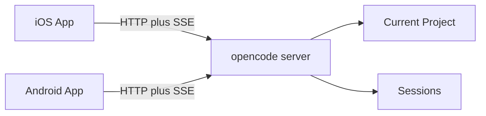

# opencode-mobile Feasibility

This document checks whether the documented opencode server API is sufficient
for the planned v1 mobile client.

Source reviewed: <https://opencode.ai/docs/server/>

## Feasibility Summary

The planned v1 is feasible as a client-only native mobile product if it is
limited to foreground session control for one reachable opencode server.

The documented server API supports the core needs:

- health checking a server;
- listing the current project;
- listing, creating, updating, deleting, and forking sessions;
- reading session messages;
- sending prompts synchronously or asynchronously;
- streaming server events;
- checking session status;
- aborting active work;
- responding to permission requests;
- reading session diffs;
- protecting the server with Basic Auth.

The API also exposes many capabilities that are intentionally not part of v1,
including shell commands, file search, file reads, config changes, provider auth,
MCP management, and TUI control.

## Target Architecture

## Supported V1 Use Cases

### Connect To A Server

Relevant APIs:

- `GET /global/health`
- `GET /project/current`
- `GET /doc`

A mobile Connection Profile can store a base URL and credentials, then call the
health endpoint to verify the server is reachable. The OpenAPI spec at `/doc`
should be treated as the source of truth for future typed clients.

### Manage Sessions

Relevant APIs:

- `GET /session`
- `POST /session`
- `GET /session/:id`
- `PATCH /session/:id`
- `DELETE /session/:id`
- `GET /session/:id/children`
- `POST /session/:id/fork`

These endpoints support the planned session list, create, rename, delete, and
fork behavior.

### Read And Send Messages

Relevant APIs:

- `GET /session/:id/message`
- `GET /session/:id/message/:messageID`
- `POST /session/:id/message`
- `POST /session/:id/prompt_async`

The mobile client should prefer asynchronous prompt sending for normal use so it
can submit work without holding a request open for the full model response.

### Track Activity

Relevant APIs:

- `GET /event`
- `GET /global/event`
- `GET /session/status`

The server exposes server-sent events. For v1, the mobile client should consume
events only while foregrounded, then refresh session state after reconnect.

### Stop Work

Relevant API:

- `POST /session/:id/abort`

This supports a mobile stop action for active sessions.

### Handle Permission Requests

Relevant API:

- `POST /session/:id/permissions/:permissionID`

The mobile client can approve or deny permission requests. V1 should not expose
persistent `remember` decisions from mobile, even though the server request body
supports `remember`.

### Inspect Diffs

Relevant API:

- `GET /session/:id/diff`

Diffs are feasible for reviewing the result of remote work. V1 diff viewing does
not imply mobile file editing.

## Security Posture

The opencode server can be protected by setting `OPENCODE_SERVER_PASSWORD`, with
the username defaulting to `opencode` unless `OPENCODE_SERVER_USERNAME` is set.

For v1:

- require password-protected server access;
- store credentials using native secure storage in future apps;
- do not recommend exposing plain HTTP directly to the public internet;
- treat LAN, VPN, HTTPS, or tunneling as user-managed transport;
- do not introduce a relay, account system, or app-managed tunnel.

## Deferred Areas

### Multi-Project Management

The docs show `GET /project` and `GET /project/current`, but no documented API
for switching the current project or launching a server for another project.
Because of that, v1 should operate within the server's current project context.

### TUI Remote Control

The server exposes `/tui/*` endpoints for manipulating an already-running
terminal UI, such as appending or submitting prompts. These are not the primary
mobile integration surface. They can be revisited later as optional compatibility
for users who keep the TUI open.

### Mobile IDE Features

The server exposes file search, file content, file status, shell execution, and
workspace tooling endpoints. These are powerful but would turn the app into a
mobile IDE or remote admin console. They are out of scope for v1.

### Provider, Auth, Config, And MCP Administration

Provider auth, config mutation, auth credential setting, and MCP management are
available through the server API, but mobile administration of these areas is
not needed for the session-control v1 and carries higher risk.

### Background Updates And Push Notifications

Reliable background behavior and push notifications would require platform
specific background handling or a relay/backend service. V1 should avoid those
requirements and use foreground SSE plus refresh-on-reconnect.

### Pairing And Discovery

Manual Connection Profiles are sufficient for v1. QR pairing and mDNS discovery
can later improve setup, but they are not required for feasibility.

## API Client Strategy

Future iOS and Android apps should use the OpenAPI 3.1 spec as the source of
truth. Where practical, generate or derive typed Swift and Kotlin clients, then
wrap them in a small domain layer built around mobile product terms:

- `ConnectionProfile`
- `Session`
- `Message`
- `PermissionRequest`
- `Diff`
- `ForegroundEventStream`

This keeps the app language stable while allowing the generated API layer to
track opencode server schema changes.

## Conclusion

The project is feasible as a focused native mobile companion for opencode
session control. The success condition for v1 is not feature parity with the TUI
or a mobile IDE; it is reliable foreground control of sessions on a reachable,
password-protected opencode server.
