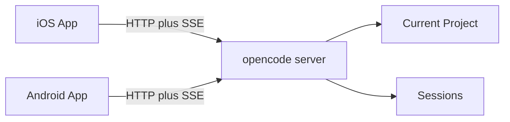

# opencode-mobile Feasibility

Server API evidence for the native apps. Session control shipped. This file
does not cap product scope.

Sources: <https://opencode.ai/docs/server/>, v2 HttpApi (`/api/*`), and the
running dual-stack clients.

## Summary

The apps talk to a user-managed opencode server over HTTP and SSE. Both
unprefixed (classic) and `/api/*` (v2) surfaces exist. Detect protocol on
connect; Session Chat live UX tracks official TUI v2.

## What the server already exposes

Used today:

- health: `GET /global/health`, `GET /api/health`
- events: `GET /global/event`, `GET /api/event`
- project: `GET /project`, `GET /project/current`, plus `directory=` scoping
- sessions: list / create / get / update / delete / fork
- messages: history + async prompt (`prompt_async` or `POST /api/session/{id}/prompt`)
- status, abort / interrupt
- permissions and questions (v2 also forms)
- session diffs (v1 path; v2 last-turn is capability-gated)

Also published, not a forbid list: shell, file search/read, config, provider
auth, MCP, PTY, TUI control. Use them when a feature needs them.

## Security

Require `OPENCODE_SERVER_PASSWORD` (username `opencode` unless configured).
Store credentials in Keychain / Keystore. Do not treat plain public HTTP as
safe. Transport (LAN, VPN, HTTPS, tunnel) is user-managed.

## Multi-project on one server

There is no `POST /project/switch`. Clients send `directory={worktree}` on
scoped session/message calls. Catalog and health stay unscoped.

## API client strategy

OpenAPI 3.1 (`/doc` or v2 `/openapi.json`) is the contract. Generated clients
stay behind a small domain adapter (`ConnectionProfile`, `Session`, `Message`,
`PermissionRequest`, `Diff`, `ForegroundEventStream`).
