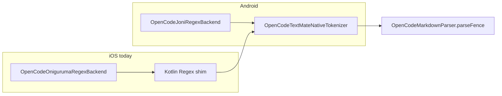
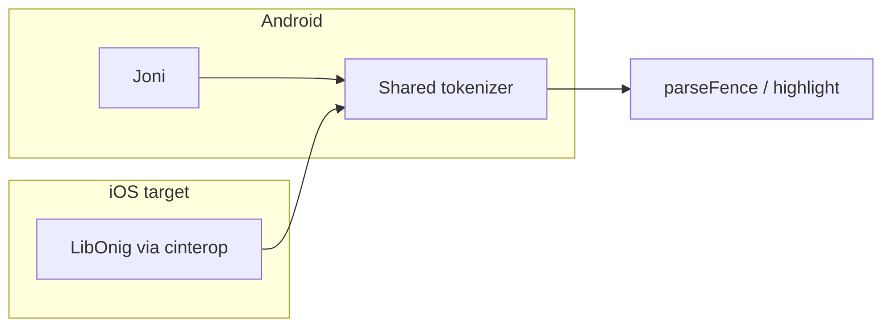

# iOS Oniguruma Backend

## Summary

Replace the temporary iOS TextMate regex shim (`OpenCodeOnigurumaRegexBackend` →
Kotlin `Regex`) with a real **Oniguruma-compatible** backend inside
`shared/markdown-core`, mirroring what Android already has through Joni.

This slice closes the largest **correctness and performance** gap between iOS and
Android in markdown highlighting. It does **not** include removing the iOS JSON
bridge or cold-open virtualization — those stay separate follow-ups.

## User Goal

Session Chat on iPad and iPhone should syntax-highlight fenced code with the same
TextMate fidelity and similar speed as Android, without `HighlighterBackendFallback`
on the production path.

## In Scope

- Native **libonig** integration for Kotlin/Native (`iosArm64`, `iosSimulatorArm64`,
  `iosX64`) via **cinterop**.
- New `OpenCodeTextMateRegexBackend` implementation in `iosMain` with:
  - pattern compile cache;
  - UTF-8 search with Kotlin `String` ↔ byte index mapping (same contract as Joni);
  - capture groups mapped to `TextMateRegexMatch`.
- Wire `OpenCodePlatformMarkdownHighlighter` to the native backend.
- KMP tests proving parity with existing Joni regression fixtures.
- iOS app builds through the existing `embedAndSignAppleFrameworkForXcode` Xcode
  build phase.
- Documentation updates under `native-rendered-markdown` and this feature slice.

## Out Of Scope

- Removing `OpenCodeMarkdownJson` / Swift JSON decode boundary.
- Collapsed-code-block / preview-only parsing on cold open.
- Swift-side highlighter or SwiftPM-only wrappers (tokenizer stays in KMP).
- New grammar languages beyond the bundled pack.
- Changing Android Joni path.

## Current State



| | Android | iOS |
| --- | --- | --- |
| Backend | Joni (Oniguruma port on JVM) | Kotlin `Regex` shim |
| `isOnigurumaCompatible` | `true` | `false` |
| Diagnostic | none | `HighlighterBackendFallback` |
| Reference | `OpenCodeJoniRegexBackend.kt` | `OpenCodeOnigurumaRegexBackend.kt` |

## Target State



Production iOS uses a backend where `isOnigurumaCompatible == true` and
`backendDiagnostics()` is empty.

## Recommended Approach

### 1. Vendor libonig in-repo

- Add `shared/markdown-core/native/oniguruma/` as a **git submodule** or pinned
  vendor snapshot of [kkos/oniguruma](https://github.com/kkos/oniguruma) (BSD).
- Build a **static library per iOS Konan target** from Gradle (not a separate
  Swift package) so `OpenCodeMarkdownCore.framework` remains self-contained for
  the Xcode embed script.

### 2. Kotlin/Native cinterop

- Add `shared/markdown-core/src/nativeInterop/cinterop/oniguruma.def`:

  ```text
  headers = oniguruma.h
  headerFilter = oniguruma.h
  staticLibraries = libonig.a
  libraryPaths = ...
  compilerOpts = -DONIG_STATIC
  ```

- Register cinterop on all three iOS targets in `shared/markdown-core/build.gradle.kts`.

### 3. Implement `OpenCodeLibOnigRegexBackend` in `iosMain`

Port the behavior of `OpenCodeJoniRegexBackend`, not the Joni API:

| Concern | Joni (Android) | libonig (iOS) |
| --- | --- | --- |
| Compile | `org.joni.Regex` + RUBY syntax | `onig_new` + `ONIG_OPTION_MULTILINE` |
| Search | `matcher.search(startByte, endByte)` | `onig_search` / `onig_match` |
| Caching | `ConcurrentHashMap` + compile lock | equivalent in `iosMain` |
| Index map | `Utf8IndexMap` | **reuse same algorithm** (move to `commonMain` if practical) |
| stderr noise | suppressed during compile | not expected; still guard compile path |

Keep `OpenCodeOnigurumaRegexBackend` (Kotlin Regex shim) in `commonMain` for
**common tests** only until the native backend passes the same regression suite;
then stop using it on the iOS production path.

### 4. Wire platform highlighter

In `OpenCodePlatformMarkdownHighlighter.kt`:

```kotlin
OpenCodeTextMateNativeTokenizer(OpenCodeLibOnigRegexBackend)
```

### 5. Verify Xcode embed pipeline

The iOS app already runs:

```bash
./gradlew :markdown-core:embedAndSignAppleFrameworkForXcode
```

Confirm the linked static `libonig` survives framework embedding and device
install (arm64 device + simulator).

## Phased Delivery

### Phase 0 — Spike (1–2 days)

- [ ] Submodule/vendor libonig.
- [ ] Minimal cinterop + `onig_version()` callable from `iosMain`.
- [ ] One hard-coded pattern match test in KMP (`iosSimulatorArm64` test or small
      `iosTest` source set).

**Exit:** `OpenCodeMarkdownCore` builds from Xcode for simulator and device.

### Phase 1 — Backend port (3–5 days)

- [ ] `OpenCodeLibOnigRegexBackend` with compile cache and `find()`.
- [ ] Extract shared `Utf8IndexMap` (or duplicate with tests) from Joni backend.
- [ ] Unit tests mirroring `OpenCodeJoniRegexBackendAndroidTest` scope:
  - Oniguruma compatibility flag;
  - `\G` anchoring patterns used by bundled grammars;
  - capture groups;
  - multiline patterns.

**Exit:** `OpenCodeLibOnigRegexBackend` passes backend contract tests on iOS Konan.

### Phase 2 — Highlighter regression (2–3 days)

- [ ] Run `OpenCodeBackendHighlighterRegressionTest` fixtures against libonig.
- [ ] Run `JavascriptRegressionOpenRuleInvariantTest` and HttpClient/withCache
      snippets on iOS backend (today: Joni + hybrid only).
- [ ] Enable at least one active Shiki golden subset (`diff` or `json`) on an
      **iOS-native-backend** test target (new test class or parameterized backend).

**Exit:** No `HighlighterBackendFallback` in production iOS parse path; span
invariants hold.

### Phase 3 — App integration & measurement (1–2 days)

- [ ] Build and run on iPad (device) and simulator.
- [ ] Compare Session Chat cold open on Big Session:
  - `markdown_preparation` probe duration vs hybrid baseline.
- [ ] Update `docs/features/native-rendered-markdown/parity-gaps.md` (TextMate
      highlighter gap → resolved or narrowed).

**Exit:** Measurable improvement or parity with Android parser-ms on the 20-msg /
3,000-line fixture; Big Session cold path improves materially.

### Phase 4 — Cleanup (1 day)

- [ ] Remove hybrid backend from iOS production wiring.
- [x] Rename/clarify types (`OpenCodeOnigurumaRegexBackend` shim →
      `OpenCodeKotlinRegexHybridTextMateBackend` + deprecated typealias).
- [ ] Revisit ignored full Shiki golden gate (`@Ignore` removal) as a follow-up
      decision, not a blocker for shipping libonig.

## Success Criteria

| Metric | Before (hybrid) | Target |
| --- | --- | --- |
| `HighlighterBackendFallback` on iOS parse | always | never on production path |
| `isOnigurumaCompatible` | `false` | `true` |
| Backend regression fixtures | hybrid passes subset | libonig passes **≥ Joni parity** |
| 20-msg / 3k-line parser path | ~958 ms parser-bridge (historical) | closer to Android ~77 ms parser component* |
| Big Session cold markdown prep | ~24 s | significant reduction** |

\* JSON bridge still included in iOS measurement until removed.  
\** Full block tokenization may still dominate until virtualization ships.

## Risks And Mitigations

| Risk | Mitigation |
| --- | --- |
| cinterop + static link breaks Xcode embed | Phase 0 spike on device early; CI `compileKotlinIos*` job |
| Framework size growth | libonig is small (~few hundred KB static); measure before/after |
| UTF-16 / emoji index bugs | Reuse Joni `Utf8IndexMap`; add emoji fixture from SwiftOniguruma tests |
| Gradle native build complexity | Pin oniguruma version; script `scripts/build-oniguruma-ios.sh` |
| Subtle Oniguruma vs Joni differences | Treat Joni tests as oracle; add diff when they disagree |

## Alternatives Considered

| Option | Why not primary |
| --- | --- |
| SwiftPM SwiftOnig / SwiftOniguruma | Tokenizer is in KMP; would require Kotlin→Swift FFI for every `find()` |
| Keep Kotlin Regex shim | Already proven slow and incorrect; temporary by design |
| Port Joni to Kotlin/Native | Heavier than binding libonig directly |

## Dependencies

- Existing shared tokenizer (`OpenCodeTextMateNativeTokenizer`).
- Bundled grammar pack under `shared/markdown-core/src/commonMain/resources/`.
- Xcode Gradle embed script in `OpenCode Mobile.xcodeproj`.
- Android Joni backend as behavioral reference (`OpenCodeJoniRegexBackend.kt`).

## Test Plan

- KMP: backend unit tests (`iosTest` or simulator compile tests).
- KMP: `OpenCodeBackendHighlighterRegressionTest` with libonig parameter.
- KMP: active Shiki golden subset on iOS backend.
- iOS: `OpenCodeRenderedMarkdownDetectorTests` / JSON bridge decode test (unchanged).
- Manual: Big Session cold open on iPad; verify probes and visual highlighting.
- Manual: warm revisit still fast (cache unchanged).

## Related Docs

- `docs/features/native-rendered-markdown/plan.md` — highlighter gate (step 3).
- `docs/features/native-rendered-markdown/parity-gaps.md` — TextMate highlighter gap.
