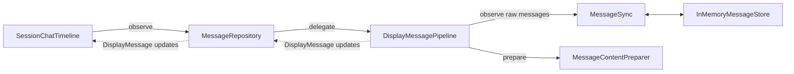
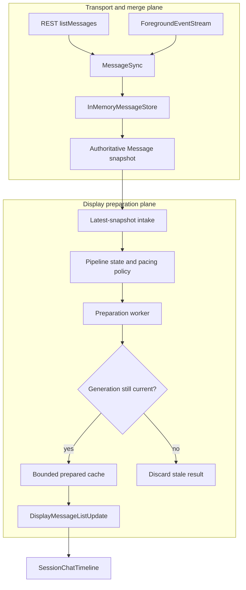
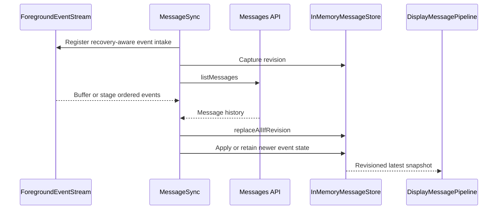
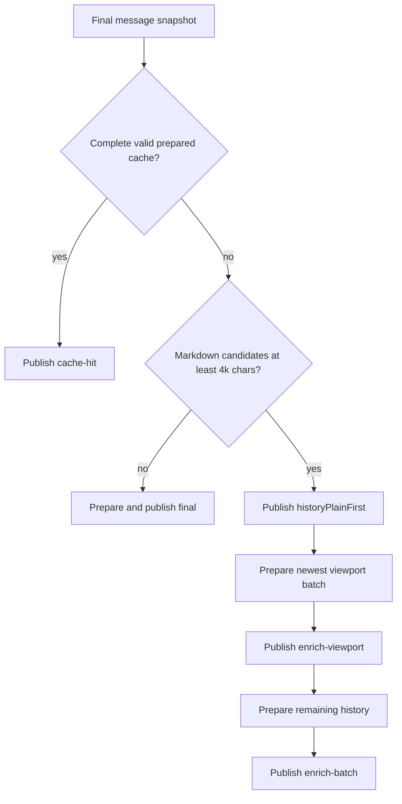
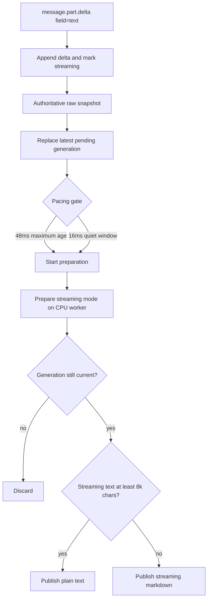

# Assistant message pipeline architecture

How Session Chat turns server messages into timeline rows for **full load**
(history open) and **part streaming** (live assistant text).

This document describes the **implemented** cross-platform assistant-message
pipeline. The hardening plan and acceptance ledger live in
[pipeline-hardening-plan.md](./pipeline-hardening-plan.md). Feature scope and
durable decisions remain canonical in [plan.md](./plan.md) and
[decisions.md](./decisions.md). Intentional platform mechanism differences are
recorded in [parity-gaps.md](./parity-gaps.md).

## Architectural goals

The pipeline must:

- preserve every accepted SSE text delta until it is merged or an explicit
  authoritative-recovery path takes over;
- reject stale REST snapshots using store revisions;
- keep snapshot intake responsive while markdown preparation is running;
- publish prepared snapshots monotonically so older work cannot overwrite newer
  messages or cache entries;
- show usable history before expensive markdown work finishes;
- keep streaming cadence responsive without parsing every token event;
- perform parsing, tokenization, and large structural transforms away from the
  UI executor;
- bound retained prepared content and buffered event work; and
- expose one display-message stream with equivalent observable behavior on iOS
  and Android.

## External seam

Session Chat depends on `MessageRepository.observeDisplayMessages` and
`refreshDisplayMessages`. The repository delegates display behavior to one deep
`DisplayMessagePipeline` module. Timeline callers do not choose debounce,
preparation, caching, or finalization strategies.

`MessageSync` owns transport merge policy. `DisplayMessagePipeline` owns display
policy. `MessageContentPreparer` owns markdown parsing and highlighting.
`SessionChatTimeline` owns structural row conversion and optimistic-row merge.

## Data flow

The pipeline has two cooperating planes.

Snapshot intake and preparation are separate. Intake records the newest
snapshot and advances its generation without waiting for synchronous parser
work. A completed preparation may update caches or publish only when its
generation is still current.

## Pipeline model

Each accepted raw snapshot is represented internally by:

| Field | Meaning |
| --- | --- |
| `generation` | Monotonically increasing observation-local identifier |
| `messages` | Immutable raw message snapshot |
| `receivedAt` | Monotonic time used by the pacing policy |
| `containsStreamingText` | Whether any text part is currently streaming |
| `source` | Optional diagnostic origin: initial load, SSE patch, poll, reconnect, idle, or explicit refresh |

Preparation uses a closed mode instead of independent boolean flags:

| Mode | Behavior | Updates prepared cache |
| --- | --- | --- |
| `streaming` | Prepare the latest streaming snapshot; use plain text above the streaming limit | Yes |
| `historyPlainFirst` | Publish usable history without starting missing markdown parses | No full replace; merge existing docs only |
| `historyEnrichment` | Prepare missing history markdown newest-first | Yes |
| `finalPlaceholder` | Reuse the last streaming document when source text still matches | Yes |
| `final` | Prepare authoritative finalized markdown | Yes |

The mode is internal to the pipeline. Callers receive only
`DisplayMessageListUpdate`. The cache-commit policy is locked in
[decisions.md](./decisions.md#pipeline-hardening--preparation-modes-phase-3).

## State transitions

| State | Input | Action | Next state |
| --- | --- | --- | --- |
| `loading` | Initial snapshot | Cache hit, final preparation, or plain-first publish | `stable` or `enriching` |
| `loading` | Load failure | Cancel pending work and publish `loadFailed` | `failed` |
| `stable` | Streaming snapshot | Record latest generation and start pacing gate | `streaming` |
| `streaming` | New streaming snapshot | Replace pending snapshot; reschedule quiet gate | `streaming` |
| `streaming` | Streaming clears | Invalidate streaming work; publish an eligible placeholder; schedule final preparation | `finalizing` |
| `finalizing` | Newer snapshot | Discard older completed work and evaluate the newer snapshot | state implied by snapshot |
| `enriching` | Newer live snapshot | Invalidate remaining enrichment immediately | state implied by snapshot |
| any active state | Observation ends | Cancel scheduling and drop unpublished work | `terminated` |

`finalPlaceholder` is opportunistic. Timeline coalescing may replace it with the
final frame before SwiftUI or Compose renders it.

## 1. Full load

### Transport to store

Foreground events are registered before the initial REST request so early part
events are not lost. The request captures a store revision. Its response may
replace the store only if that revision is still current.

Event intake must have an explicit capacity and overflow-recovery policy. It
must not silently discard text deltas. If capacity is exceeded, the sync layer
marks the session as needing authoritative recovery and prevents the stale
initial REST response from becoming authoritative.

### Display preparation

Both platforms publish at most two enrichment frames after the
plain-first frame:

1. the newest messages needed for the initial viewport, constrained by message
   count and character budget; and
2. the remaining prepared history.

A newer live snapshot invalidates both batches. Completed stale work is
discarded by the generation guard.

## 2. Part streaming

Text deltas patch the in-memory store incrementally. Timeline polling pauses
while any text part is streaming so a lagging REST response cannot clear and
reprint the reply.

The 16 ms quiet window and 48 ms maximum batch age are pacing defaults, not
ordering guarantees. The generation check is the ordering guarantee.

### Finalization

When streaming clears:

1. invalidate any pending or in-flight streaming generation;
2. reuse the last streaming document as `finalPlaceholder` only when message
   identity and source text still match;
3. schedule `final` preparation on the CPU worker;
4. publish the result only if its generation remains current; and
5. resume polling once the store no longer contains streaming text.

If `session.idle` reconciliation fails, the store clears streaming flags and
the watchdog may recover through a later revision-gated REST response.

## Ordering and cancellation guarantees

- Generations increase in raw-snapshot acceptance order.
- Only the current generation may mutate the prepared cache.
- Only the current generation may publish a prepared snapshot.
- Cancelling a task is not assumed to interrupt synchronous TextMate work.
  Cancellation prevents its result from being committed.
- Enrichment is lower priority than live streaming and finalization.
- Observation teardown drops pending work. There is no UI-visible teardown
  flush contract.
- A load failure cancels pending debounce and enrichment work before publishing
  `loadFailed`.

## Execution contexts

These are execution contexts, not guaranteed operating-system threads.

| Responsibility | iOS | Android |
| --- | --- | --- |
| Pipeline state, generation, cache decisions | `@MainActor` | Observation scope on `LiveStoreScope` / `Dispatchers.Default` |
| REST and SSE transport | `URLSession` | OkHttp / Ktor |
| Markdown parse and highlight | `Task.detached(priority: .userInitiated)` with a post-await generation check | `withContext(Dispatchers.Default)` with a post-work generation check |
| Store atomicity | `MainActor` confinement | Per-store synchronization |
| Timeline structural conversion | MainActor with cooperative yields | Worker dispatcher, then Main `StateFlow` publish |
| UI rendering | SwiftUI on MainActor | Compose on Main |

Platform mechanisms may differ, but ordering, publish-count, recovery, and
boundedness guarantees are shared.

## Cache and buffer policy

- The markdown document cache remains bounded and keyed by message identity,
  source hash, source length, and streaming state.
- The iOS warm prepared-history cache is keyed by connection profile, directory,
  and session ID, and bounded by a `512_000`-character text-cost budget and an
  `8`-session entry cap (LRU eviction). Eviction also covers session deletion,
  connection/profile reset, and memory pressure.
- Android may add a warm prepared-history cache only if measurement shows it is
  needed; instant usable history remains the shared product requirement.
- Per-observation event staging is capped at `4_096` events. Overflow marks
  authoritative recovery required and never silently continues with missing
  deltas.
- Cache eviction affects performance only. It must not affect raw message
  correctness.

## Failure behavior

| Failure | Required behavior |
| --- | --- |
| Initial REST failure | Publish `loadFailed`; retain no pending display work |
| Explicit refresh failure | Return the error to the caller; keep last good timeline |
| Parser failure | Publish safe plain text for the current generation and record the failure without message content |
| SSE disconnect | Keep last good snapshot and revision-gate reconnect reload |
| Idle reconciliation failure | Clear streaming flags and allow watchdog recovery |
| Event-intake overflow | Mark authoritative recovery required; never silently continue with missing deltas |

## Observability

Logs must not include message text. Production and test seams already record:

- snapshot source and generation;
- preparation mode;
- debounce or maximum-batch trigger;
- accepted versus discarded generation;
- preparation duration and character count;
- cache hit, miss, and eviction counts;
- enrichment batch number and message count;
- buffer high-water mark and overflow recovery; and
- timeline structural-apply duration.

Phase 6 verification treats those fields as the measurement surface for time to
first usable history, streaming publish age, preparation duration, enrichment
frame count, and retained cache cost.

## Platform differences

Observable publish ordering, preparation modes, enrichment batch counts, and
overflow recovery match across platforms. Remaining intentional differences:

- iOS retains a bounded warm prepared-history cache across leave/reopen;
  Android rebuilds prepared state per observation (LazyColumn already avoids
  row wipe).
- Store atomicity and timeline structural conversion use platform-native
  executors (`MainActor` vs synchronized store / worker→Main).

See [parity-gaps.md](./parity-gaps.md).

## Source and verification map

### iOS

- [`MessageSync.swift`](../../../ios/OpenCode%20Mobile/OpenCode%20Mobile/Domain/Message/MessageSync.swift)
- [`DisplayMessagePipeline.swift`](../../../ios/OpenCode%20Mobile/OpenCode%20Mobile/Domain/Message/DisplayMessagePipeline.swift)
- [`MessageContentPreparer.swift`](../../../ios/OpenCode%20Mobile/OpenCode%20Mobile/Domain/Message/MessageContentPreparer.swift)
- [`DefaultForegroundEventStream.swift`](../../../ios/OpenCode%20Mobile/OpenCode%20Mobile/Domain/Event/DefaultForegroundEventStream.swift)
- [`SessionChatTimeline.swift`](../../../ios/OpenCode%20Mobile/OpenCode%20Mobile/UI/SessionChat/Region/SessionChatTimeline.swift)
- [`MessageSyncTests.swift`](../../../ios/OpenCode%20Mobile/OpenCode%20MobileTests/MessageSyncTests.swift)
- [`DisplayMessagePipelinePacingTests.swift`](../../../ios/OpenCode%20Mobile/OpenCode%20MobileTests/DisplayMessagePipelinePacingTests.swift)
- [`DisplayMessagePipelineWarmReopenTests.swift`](../../../ios/OpenCode%20Mobile/OpenCode%20MobileTests/DisplayMessagePipelineWarmReopenTests.swift)
- [`DisplayMessagePipelineCharacterizationTests.swift`](../../../ios/OpenCode%20Mobile/OpenCode%20MobileTests/DisplayMessagePipelineCharacterizationTests.swift)
- [`PreparedHistoryCacheTests.swift`](../../../ios/OpenCode%20Mobile/OpenCode%20MobileTests/PreparedHistoryCacheTests.swift)
- [`MessageEventStaging.swift`](../../../ios/OpenCode%20Mobile/OpenCode%20Mobile/Domain/Message/MessageEventStaging.swift)
- [`PreparedHistoryCache.swift`](../../../ios/OpenCode%20Mobile/OpenCode%20Mobile/Domain/Message/PreparedHistoryCache.swift)

### Android

- [`MessageSync.kt`](../../../android/app/src/main/java/dev/opencode/mobile/domain/message/MessageSync.kt)
- [`DisplayMessagePipeline.kt`](../../../android/app/src/main/java/dev/opencode/mobile/domain/message/DisplayMessagePipeline.kt)
- [`MessageContentPreparer.kt`](../../../android/app/src/main/java/dev/opencode/mobile/domain/message/MessageContentPreparer.kt)
- [`LiveStoreScope.kt`](../../../android/app/src/main/java/dev/opencode/mobile/domain/live/LiveStoreScope.kt)
- [`SessionChatTimeline.kt`](../../../android/app/src/main/java/dev/opencode/mobile/ui/sessionchat/region/SessionChatTimeline.kt)
- [`LiveStoreTest.kt`](../../../android/app/src/test/java/dev/opencode/mobile/domain/live/LiveStoreTest.kt)
- [`DisplayMessagePipelinePacingTest.kt`](../../../android/app/src/test/java/dev/opencode/mobile/domain/message/DisplayMessagePipelinePacingTest.kt)
- [`DisplayMessagePipelineCharacterizationTest.kt`](../../../android/app/src/test/java/dev/opencode/mobile/domain/message/DisplayMessagePipelineCharacterizationTest.kt)
- [`MessageContentPreparerTest.kt`](../../../android/app/src/test/java/dev/opencode/mobile/domain/message/MessageContentPreparerTest.kt)
- [`MessageEventStaging.kt`](../../../android/app/src/main/java/dev/opencode/mobile/domain/message/MessageEventStaging.kt)
