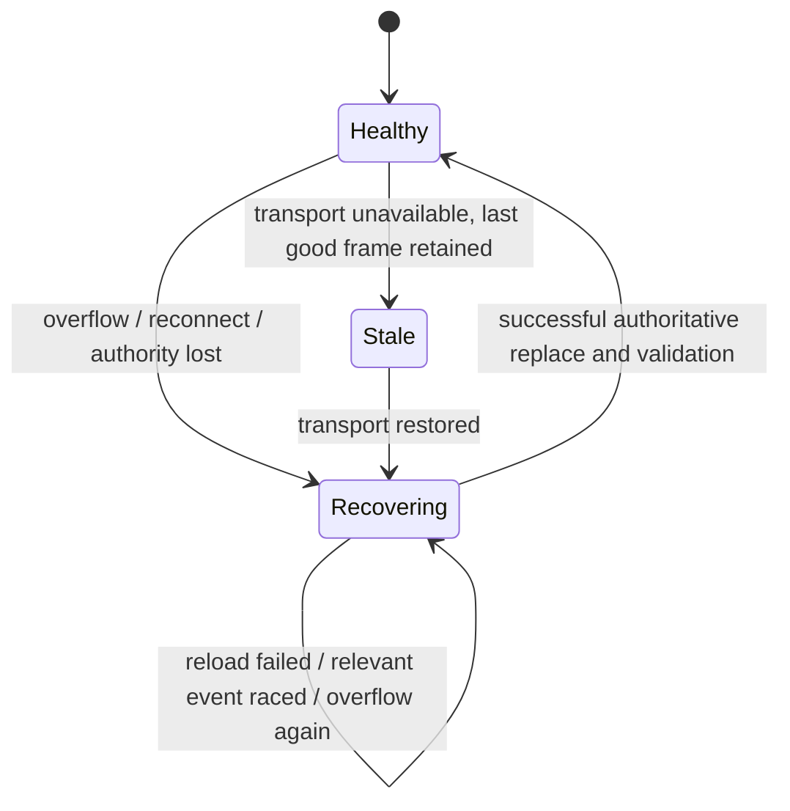

# Message display and rendering reliability hardening plan

## Status

Phase 1–7a complete. This plan is closed. Phase 7b remains deferred.

This is a follow-up to the completed
[assistant-message pipeline hardening](./pipeline-hardening-plan.md). That work
made preparation latest-wins and bounded. This plan hardens the wider path from
foreground events through store reduction, display preparation, timeline
projection, native rendering, and scroll anchoring.

The implemented starting point is documented in:

- [assistant-message-pipeline.md](./assistant-message-pipeline.md); and
- [message-display-rendering-pipeline.md](./message-display-rendering-pipeline.md).

This Markdown file is the source of truth.

## Objective

Make foreground message display fast, reliable, and flexible under:

- dense server-sent event streams;
- long assistant responses and large histories;
- interleaved message parts such as text → tool → text;
- plain-first Markdown enrichment and syntax highlighting;
- reconnect, overflow, and authoritative REST recovery;
- active user scrolling and dynamic row-height changes; and
- optimistic sends, explicit refresh, session switching, and teardown.

The pipeline must show current plain text promptly, enrich it without blocking
or regressing content, preserve stable identity below the message level, and
converge to server authority after recoverable failures.

## User-visible outcome

- Live assistant text remains fluid during dense SSE traffic and expensive
  Markdown work.
- A Markdown parse failure or slow highlighter never hides otherwise available
  text.
- Text, tool, attachment, and grouped-tool blocks retain identity while one
  part changes.
- Reconnect or intake overflow keeps the last good timeline visible and
  remains visibly recoverable until authoritative state is restored.
- Scrolling away from the end remains stable while rows append or restyle.
- Auto-follow settles at the exact end only while the user has armed it.
- Opening a long history produces usable rows before optional decoration and
  never performs history-wide work for each incoming delta.

## In scope

- Foreground event routing, per-session filtering, staging, and recovery state.
- Revision-aware message/part reduction and stable part identity.
- Incremental change sets between store, preparation, and presentation.
- Independent plain-text and Markdown-decoration publication lanes.
- Stable presentation-block identity and per-text-block prepared Markdown.
- Pure incremental row projection and explicit layout revisions.
- Screen Model publication and native timeline application.
- View-owned auto-follow, visible-anchor preservation, and styling deferral.
- Deterministic cross-platform fixtures, fault injection, performance budgets,
  observability, and focused verification.

## Out of scope

- Persistent message storage, offline mode, or pagination.
- Background SSE execution, push notifications, or guaranteed background sync.
- A shared cross-platform UI/runtime or instruction-by-instruction native
  symmetry.
- Server protocol changes. Server-side event sequence or resume tokens are a
  desirable future capability, but this plan must remain correct without them.
- Replacing the native Markdown renderers or design-system components solely
  for visual redesign.
- Moving scroll position or viewport geometry into the Screen Model.
- App-managed tunnels, relays, account systems, or other v1 scope expansion.

## Evaluation summary

The current architecture has good seams: the repository owns message access,
preparation is outside the UI, the timeline region owns row projection, the
Screen Model composes regions, and native views own viewport geometry.

The remaining structural risks are:

1. **Recovery is not closed-loop.** Overflow recovery can appear complete even
   when the authoritative REST reload failed, and events received while
   recovering are not represented by a durable recovery requirement.
2. **The hot path can still be history-wide.** A small part delta can lead to a
   complete snapshot reconstruction, fingerprint, preparation pass, row
   projection, equality check, and list apply.
3. **Text visibility is too coupled to decoration.** Whole-message Markdown
   preparation can delay text and cannot correctly decorate multiple
   interleaved text blocks.
4. **Identity stops at the message.** Positional block identity and whole-row
   invalidation make renderer-local state and scroll layout more fragile.
5. **UI work is inferred rather than declared.** The hosts scan rows or derive
   signatures to discover changes that the reducer and projector already knew.
6. **iOS ownership concentrates work on `MainActor`.** Event fan-out, staging,
   store mutation, snapshot reconstruction, and row projection need a measured,
   explicit executor boundary.

These are architectural risks, not claims that every path currently fails.
Phase 1 records a reproducible baseline before behavior changes.

## Target architecture

### Preserve the external repository seam

Session Chat continues to learn one message repository interface:

```text
observeDisplayMessages(sessionKey) -> display frame stream
refreshDisplayMessages(sessionKey) -> result
prepareOptimisticUserMessage(input) -> optimistic display message
```

`sessionKey` means connection profile + directory + session ID. Recovery,
event ordering, reduction, scheduling, decoration, caching, and invalidation
remain implementation details.

### Deepen the implementation

Introduce a deep internal `SessionMessageEngine` behind the repository seam.
It replaces the orchestration currently spread across `MessageSync`,
`InMemoryMessageStore`, and `DisplayMessagePipeline`; it must not become a
permanent wrapper around all three.

```mermaid
flowchart LR
  Events["Foreground SSE"] --> Router["Typed event router"]
  REST["Messages REST"] --> Recovery["Recovery controller"]
  Router --> Recovery
  Recovery --> Reducer["Single-writer session reducer"]
  Reducer --> Change["Session change set"]
  Change --> Text["Fast text lane"]
  Change --> Decorate["Markdown decoration lane"]
  Text --> Display["Incremental display frame"]
  Decorate --> Display
  Display --> Projector["Pure row projector"]
  Projector --> Timeline["Incremental timeline frame"]
  Timeline --> Screen["Screen Model"]
  Screen --> Host["Native timeline host"]
  Host --> Scroll["View-owned scroll transaction"]
```



The engine may have internal seams for its REST adapter, event source,
monotonic clock, and Markdown preparer. Those seams are private to the
implementation and its interface-level tests.

### Core data contracts

#### Session change set

Every accepted reducer transaction returns `Changed(changeSet)` or `NoChange`.
Only `Changed` advances the session revision.

```text
SessionChangeSet
  sessionRevision
  insertedMessageIDs
  changedMessageIDs
  removedMessageIDs
  changedPartIDsByMessage
  streamingStateChangedIDs
  structuralChange
```

The change set is an invalidation description, not a second mutable state
store. Consumers read immutable, structurally shared state at the referenced
revision.

#### Display frame

The display layer publishes:

```text
DisplayFrame
  sessionKey
  frameRevision
  sourceRevision
  syncHealth: healthy | recovering(reason) | stale(reason)
  messages
  changeSet
```

Plain block content is authoritative for the frame. Markdown decoration is
optional and identified by block ID + content revision. A stale decoration may
be discarded without changing text or sync health.

#### Timeline frame

The pure projector publishes:

```text
TimelineFrame
  frameRevision
  rows
  insertedRowIDs
  changedRowIDs
  removedRowIDs
  layoutChangedRowIDs
```

Rows and blocks are immutable and structurally shared. Each height-affecting
row change advances a cheap `layoutRevision`; hosts do not rediscover it with a
history-wide equality or signature scan.

### Stable block model

Every presentation block receives a stable identity:

- server part ID for a direct part;
- part ID plus deterministic segment identity when a part yields several
  blocks; and
- a deterministic identity derived from the member part IDs for a collapsed
  tool group.

Each text block carries:

- `blockID`;
- current plain source;
- `contentRevision`;
- streaming/final state; and
- optional Markdown decoration for the same `contentRevision`.

This supports text → tool → text, per-block Markdown updates, renderer-local
state reuse, and precise invalidation.

### Two publication lanes

The **text lane** is correctness-critical:

- accepts the newest reducer revision;
- coalesces only within a frame-bounded quiet/max window;
- publishes plain source independently of Markdown availability; and
- prioritizes finalization and explicit operations.

The **decoration lane** is disposable enrichment:

- parses only changed text blocks;
- is keyed by block ID + content revision + rendering environment;
- runs off the UI executor;
- adapts its cadence to backlog and visibility;
- drops stale completions before any cache or frame mutation; and
- may fail safely while the plain source remains visible.

### Closed-loop recovery

Recovery is a state machine, not a one-shot reload:



Without server event sequence IDs, append deltas cannot be replayed exactly
across an unknown REST snapshot boundary. Therefore a relevant event racing an
authoritative reload keeps the observation in recovery and schedules another
revision-aware reconcile. The last good frame remains visible; recovery is not
reported healthy until a successful authority window closes. `session.idle`
and watchdog reconciliation remain convergence opportunities.

## Reliability invariants

1. SSE subscription precedes initial REST loading.
2. Every accepted event is either applied exactly once to the active session
   revision or represented by a continuing authoritative-recovery requirement.
3. Recovery becomes healthy only after a successful authoritative replace and
   validation; failure, racing events, or repeated overflow keep it recovering.
4. Session, display, and timeline revisions never regress.
5. `NoChange` mutations do not advance revisions or publish frames.
6. Plain text publication never depends on Markdown success, highlighter
   availability, or decoration backlog.
7. A decoration commits only when block ID, content revision, session key,
   connection epoch, and rendering environment still match.
8. REST replacement preserves stable part IDs and sibling text/tool/file parts.
9. Observation rebinding, teardown, or connection-epoch change prevents late
   work from publishing into another session.
10. Event queues, pending changes, prepared documents, and native-render caches
    have both count and estimated-byte/cost limits.
11. Recoverable errors retain the last good frame.
12. User scroll intent overrides programmatic anchoring.

## Performance contract

Phase 1 records reference devices, fixtures, and current measurements, then
locks final budgets. The provisional gates are:

| Concern | Provisional gate |
| --- | --- |
| Dense streaming latency | SSE receipt → visible plain text p95 ≤ 50 ms on the reference trace |
| UI executor work | Frame application p95 ≤ 4 ms; no parsing, highlighting, full-history projection, or event routing on the UI executor |
| Publication rate | At most one text frame per display interval; a continuously changing stream publishes at least every 50 ms |
| Delta complexity | One changed part performs work proportional to that message/part and visible apply set, not total history |
| Long-history opening | First usable plain frame precedes Markdown enrichment and does not wait for all rows to parse |
| Decoration | Stale decoration commit count is zero; parse failure leaves current plain text visible |
| Memory/backpressure | Every queue/cache has measured high-water logs plus count and cost bounds |
| Unarmed scrolling | Incoming/apply/restyle preserves the visible anchor ID and offset within native rounding |
| Armed scrolling | Append and height changes settle at the exact end after layout |

The final numbers may change from baseline evidence, but the qualitative gates
— boundedness, no per-delta history scan, no UI-thread parsing, and text
independence — are not optional.

## Implementation phases

### Phase 1 — Recovery correctness and deterministic baseline

Status: **Complete**. Depends on: none.

1. Add content-free timestamps for event accepted, reducer committed, display
   frame published, timeline frame committed, first visible plain paint, and
   styled paint completion.
2. Build deterministic event traces for cold history, dense streaming,
   multipart updates, finalization, reconnect, overflow, session switch, and
   active scrolling.
3. Add controllable clocks, REST adapters, event sources, and fault injection
   behind internal seams.
4. Replace the overflow boolean with explicit `healthy`, `recovering`, and
   `stale` states.
5. Keep recovery required after REST failure, relevant events racing the
   request, or repeated overflow; add bounded retry/backoff.
6. Retain the last good display frame throughout recovery.
7. Use the complete session key for all observation, recovery, pending-work,
   and cache ownership.

Expected result: failed or raced recovery cannot report success, and the
current latency/cost profile is reproducible without wall-clock sleeps.

Phase 1 baseline lock (provisional budgets unchanged; fixtures named):

| Budget concern | Fixture / reference |
| --- | --- |
| Dense streaming latency | Characterization dense-delta suite (`denseStreamingMaxBatchPublishesProgressively`); reference: iPhone 17 Pro sim / JVM unit host |
| Publication cadence | Same dense-delta fixture; assert ≥2 progressive frames before final |
| Recovery / fault matrix | `MessageSyncTests` / `MessageSyncTest`: overflow during REST, failed reconnect keeps last frame, raced authority, profile-key isolation |
| Memory/backpressure | Existing 4,096 staging capacity overflow → recovering (count bound; byte cost deferred to Phase 2) |

`stale(transportUnavailable)` is defined and assertable; entering it from a live
transport drop is completed with Phase 2 ingress/epoch work. Phase 1 closes
recovery correctness for overflow, reload failure, and raced authority.

Phase gate:

- both platforms pass the same recovery/fault matrix;
- all provisional performance budgets have a named fixture and reference
  device; and
- no product-visible platform gap is introduced.

### Phase 2 — Event ingress and executor hardening

Status: **Complete**. Depends on: Phase 1.

1. Route and filter typed events before per-session staging.
2. Separate global consumers such as permission/status handling from message
   session intake.
3. Replace unbounded/default buffering with bounded count + estimated-byte
   queues and explicit high-water telemetry.
4. Use a deque/ring structure for FIFO operations; avoid array-head removal.
5. Add a connection epoch to invalidate work from a prior foreground stream.
6. On iOS, move event fan-out, staging, recovery coordination, and raw reduction
   off `MainActor`; publish immutable frames back to MainActor.
7. On Android, verify equivalent dispatcher confinement and prevent accidental
   Main dispatcher work in ingress/reduction.

Expected result: dense events cannot grow memory without limit or monopolize
the UI executor, and unrelated session/global events do not amplify message
work.

Phase gate:

- queue count/cost limits and overflow behavior are tested;
- event ordering is preserved within a connection epoch;
- stale-epoch work cannot publish; and
- UI executor traces contain no event routing or raw store reduction.

Gate result: passed on both platforms (`MessageSyncTests` /
`MessageEventStagingTests`, `MessageSyncTest`).

### Phase 3 — Incremental single-writer reducer

Status: **Complete**. Depends on: Phase 2.

1. Introduce the single-writer per-session reducer inside
   `SessionMessageEngine`.
2. Return `Changed(changeSet)` / `NoChange`; advance revisions only for actual
   mutations.
3. Preserve normalized messages and ordered parts with structural sharing.
4. Replace repeated whole-history fingerprints with revision/change-set
   invalidation.
5. Accumulate streaming chunks without copying the full response on each tiny
   delta; flatten only at publication/preparation boundaries.
6. Reconstruct only changed messages/parts while preserving sibling parts and
   source order.
7. Migrate tests to the engine interface and remove superseded shallow-module
   tests once their behavior is covered.

Expected result: one part delta performs bounded local work and emits an exact
change set without changing repository behavior.

Phase gate:

- reducer property tests cover ordering, idempotent full-part updates,
  multipart preservation, deletion, finalization, and revision monotonicity;
- dense streaming shows no per-delta full-history fingerprint/rebuild; and
- old orchestration is being replaced, not retained as a second pipeline.

Gate result: passed on both platforms (`SessionMessageEngineTest(s)`,
`MessageSyncTest(s)`). Live SSE publish uses change-set rules + frame splice;
poll/REST fingerprints remain until later revision-gate work.

### Phase 4 — Independent text and Markdown lanes

Status: **Complete**. Depends on: Phase 3. Decisions locked in
[decisions.md](./decisions.md#message-display-rendering-hardening--phase-4-lanes).

**MUST**

1. Publish changed plain text from the fast lane at the existing 16/48
   frame-bounded cadence, always independent of decoration.
2. Schedule Markdown on a disposable decoration lane (message-scoped interim
   identity until Phase 5 `blockID`).
3. Key pending decoration / commit reject by session, message, text hash/length,
   streaming flag, and generation; keep preparer LRU free of generation.
4. Prioritize streaming/finalization, then heuristic newest-first viewport
   (`3` messages / `12_000` chars), then remaining history. No host/Screen Model
   viewport.
5. Bound pending decoration: `128` jobs and `512_000` char-cost; drop lowest
   priority under pressure; keep preparer LRU `32`; leave iOS warm cache alone.
6. Optionally pass live `SessionChangeSet` as an internal sync→pipeline hint;
   poll/REST keep full-list fallback. Keep
   `DisplayMessageListUpdate` / `DisplayMessage` publish shape.
7. On failure, timeout, cancellation, or overload, keep current plain text and
   allow later decoration retry. Blocked preparer must not delay or erase plain.

**DEFER** to later phases: `DisplayFrame` / `syncHealth` UI / `changeSet` on the
frame; real `blockID` and per-block markdown; host-fed viewport; absorbing
Sync/Pipeline into the engine.

Expected result: text remains responsive regardless of parser/highlighter
latency, while Markdown catches up without stale replacement.

Phase 4 closeout:

- Streaming text lane always publishes plain `DisplayMessage` frames at 16/48
  without awaiting `MessageContentPreparer`.
- Decoration lane is disposable, generation- and text-identity-gated, skips
  `≥ 8_000`-char streaming candidates, and uses a bounded backlog
  (`128` / `512_000`).
- Characterization: blocked preparer cannot delay plain streaming; large
  streaming skips decoration until finalization; backlog drop/replace covered;
  prior pacing suites remain green on both platforms.
- Optional live `SessionChangeSet` hint remains available for a later touch;
  publish shape stays `DisplayMessageListUpdate` / `DisplayMessage`.

Phase gate:

- deliberately blocked and failed preparers do not delay or erase plain text;
- generation/content-revision tests reject every stale completion;
- publication cadence meets the locked streaming budget; and
- decoration backlog and caches remain bounded.

### Phase 5 — Stable blocks and incremental row projection

Status: **Complete**. Depends on: Phase 4. Decisions locked in
[decisions.md](./decisions.md#message-display-rendering-hardening--phase-5-blocks--projector).

**MUST**

1. Preserve stable part identity into every presentation block (`blockID` from
   ordered merged part IDs / tool-group member IDs; incomplete REST without
   part IDs stays on recovery).
2. Attach Markdown to each text block inside internal `DisplayFrame`; remove
   the `singleTextBlock` view gate.
3. Extract pure native `(DisplayFrame, optimisticInputs) → TimelineFrame`
   projectors; keep public `DisplayMessageListUpdate` list-shaped.
4. Recompute only changed rows and structurally share unchanged rows/blocks
   (iOS return-previous + declared changed IDs until Phase 6).
5. Publish explicit per-row `contentRevision` (text hash + length) and
   `layoutRevision`, plus frame-level changed/layout ID sets.
6. Re-key decoration to `blockID` + `contentRevision` (+ generation reject).
7. Run both projectors against shared checked-in parity fixtures while keeping
   native implementations.

**DEFER** to Phase 6+: host apply of declared IDs only; removing
`layoutSignature` / list-wide Equatable scans; scroll transactions;
`syncHealth` UI; public `DisplayFrame` observation shape.

Expected result: interleaved text/tool/attachment messages render Markdown in
the correct positions and unchanged block/native state survives nearby
streaming updates.

Phase 5 closeout:

- Stable `blockID`s on every presentation block (`PresentationBlockId` /
  `buildOrFallback`); missing part IDs stay on recovery/fallback.
- Internal `DisplayFrame` → `TimelineFrame` projectors with optimistic inputs,
  per-row `contentRevision` / `layoutRevision`, and changed/layout ID sets.
- Per-text-block Markdown via `BlockDecorationCache` + `prepareTextBlock`;
  `singleTextBlock` view gate removed; `DisplayMessage.renderedMarkdown` is
  sole-text bridge only.
- Decoration jobs / preparer LRU keyed by `sessionKey` + `blockID` +
  `contentRevision` + `isStreaming` (generation reject only).
- Public observation remains `DisplayMessageListUpdate` / `DisplayMessage`.
- Focused block, projector, decoration, and pipeline suites green on both
  platforms. Host scan removal and scroll transactions remain Phase 6.

Phase gate:

- fixtures cover text → tool → text, text → attachment → text, tool grouping,
  hidden tools, optimistic reconciliation, reconnect, and plain → decorated;
- stable IDs survive enrichment and streaming; and
- unchanged rows retain object/value identity appropriate to each platform.

### Phase 6 — Incremental UI frames and scroll transactions

Status: **Complete**. Depends on: Phase 5. Decisions locked in
[decisions.md](./decisions.md#message-display-rendering-hardening--phase-6-ui-frames--scroll).

**MUST**

1. Put `timelineFrame` on UiState; reuse the current frame when composer /
   session-info / review / command republish (no O(n) remap solely from those).
2. Apply declared `inserted` / `changed` / `removed` / `layoutChanged` IDs
   directly; treat `inserted ∪ layoutChanged` as layout-affecting.
3. Remove Android history-wide `layoutSignature` and iOS list-wide Equatable
   discovery from the live path.
4. View-owned scroll transactions (separate apply + auto-follow effects):
   - armed: apply → await layout → settle at exact end;
   - unarmed: capture visible anchor ID + offset → apply → restore;
   - dragging/decelerating: user wins; disposable live/decorative may coalesce
     (iOS cell coalesce; Android newest-immutable — intentional parity-gap).
5. Preserve required load/refresh/post-send completions while coalescing only
   disposable live/decorative work.
6. Keep paint deferral renderer-local and revision-gated.

**DEFER** to Phase 7: public `DisplayFrame` observation; `syncHealth` UI;
absorbing Sync/Pipeline; soak/delete of superseded scan paths; forcing Android
drag coalesce to match iOS.

Expected result: native hosts apply only declared changes, scrolling is stable
through append/restyle, and unrelated Screen Model updates do not remap the
timeline.

Phase 6 closeout:

- `timelineFrame` on UiState; reused when only composer / session-info / review /
  command republish.
- Hosts apply declared IDs; live path no longer uses Android history-wide
  `layoutSignature` or iOS list-wide Equatable discovery.
- Layout-affecting follow uses `inserted ∪ layoutChanged`.
- Unarmed visible-anchor ID+offset capture/restore on both platforms
  (view-owned); armed end-follow unchanged via declared-ID effects.
- Android drag apply remains newest-immutable (intentional parity-gap).
- Public observation stays list-shaped; `syncHealth` UI still deferred.
- Focused UiState reuse, declared-ID host, projector, auto-follow, and
  visible-anchor suites green on both platforms.

Phase gate:

- host tests cover append, height growth, keyboard/viewport shrink, scroll-away,
  scroll-to-end, active drag, and plain → decorated height changes;
- required completion callbacks remain ordered and lossless; and
- UI executor work meets the locked frame-application budget.

### Phase 7 — Soak, replacement closeout, and documentation

Status: **Complete** (7a). Depends on: Phases 1–6. Decisions locked in
[decisions.md](./decisions.md#message-display-rendering-hardening--phase-7-soak--closeout).

Split: **7a** closes this plan (soak + docs + dead-path hygiene). **7b** parks
public `DisplayFrame` observation, Sync/Pipeline absorption, fingerprint→revision
gates, optional change-set hint, and optional `syncHealth` UI.

**MUST (7a)**

1. Run the named soak matrix on both platforms (unit/characterization +
   MessageSync fault coverage is gate-sufficient; no new soak CI required).
2. Verify count/cost bounds and recovery convergence under those shared names.
3. Delete unused probe markers (`TimelineFrameCommitted`,
   `FirstVisiblePlainPaint`) and any residual live-path scan helpers/tests.
4. Drop unwired optional `SessionChangeSet`→pipeline hint from implemented claims.
5. Flip architecture docs from stale target language to implemented (especially
   `message-display-rendering-pipeline.md`).
6. Record intentional gaps in `parity-gaps.md` (list-shaped public observe;
   engine facade; poll fingerprints; Android drag coalesce; sole-text bridge).

**DEFER (7b):** public `DisplayFrame`; Sync/Pipeline absorption; fingerprint
retirement; `syncHealth` UI; forcing Android drag coalesce; device p95 CI.

Expected result: this plan closes honestly under the architecture Phases 1–6
shipped, with evidence-backed soak names and docs that match code.

Phase 7a closeout:

- Shared soak matrix documented in
  [phase-7a-soak-matrix.md](./phase-7a-soak-matrix.md); scenarios 1–3 and 8
  full on both platforms; 4–7 partial (documented gaps, gate-sufficient under
  unit/characterization + MessageSync fault coverage).
- Unused probe markers `TimelineFrameCommitted` / `FirstVisiblePlainPaint`
  deleted on both platforms.
- Optional `SessionChangeSet`→pipeline hint dropped from implemented claims
  (never wired; parked in 7b).
- Architecture docs flipped to implemented language
  (`message-display-rendering-pipeline`, `assistant-message-pipeline`,
  `parity-gaps`, `plan` prepare path).
- Intentional gaps recorded: list-shaped public observe, engine facade, poll
  fingerprints, sole-text bridge, Android drag coalesce, syncHealth assert-only.
- Android and iOS soak-mapped suites green (Android focused unit suite;
  iOS 81 tests across characterization/sync/scroll/host suites).

Phase 7b (deferred): see
[message-display-rendering-7b-plan.md](./message-display-rendering-7b-plan.md).
Architecture items (public `DisplayFrame`, Sync/Pipeline absorption,
fingerprint→revision gates, change-set hint, `syncHealth` UI, device p95 CI)
are **parked** with reopen triggers. The only scheduled 7b work is soak
**coverage debt** (scenarios 4–7 → full).

Phase gate:

- all reliability invariants and locked performance gates pass;
- both native apps pass focused domain, repository, timeline, renderer, and
  scroll suites;
- no obsolete parallel pipeline remains; and
- progress, decisions, parity, architecture, Markdown plan, and HTML status
  agree.

## Cross-platform implementation map

| Concern | Android | iOS | Shared contract |
| --- | --- | --- | --- |
| Engine confinement | Coroutine scope + dedicated dispatcher/mutex as measurement supports | Dedicated actor/executor; immutable MainActor publication | Single writer per session |
| Event queues | Bounded channel/deque with count + cost | Bounded async queue/deque with count + cost | Ordered per epoch; explicit overflow |
| Display state | Immutable Kotlin values / `Flow` | Immutable `Sendable` values / `AsyncSequence` | Monotonic revisions and change sets |
| Markdown work | `Dispatchers.Default` with serialized mutable highlighter access | Detached/native worker with `nonisolated` parser path | Optional, revision-keyed decoration |
| Row projection | Pure worker function | Pure `Sendable` worker function when safe types are isolated | Same fixtures and block rules |
| Native apply | Compose stable keys and immutable rows | Diffable changed-ID apply | Apply declared row changes only |
| Scroll | Reverse-layout `LazyColumn` | Diffable `UICollectionView` | Armed end-follow; unarmed anchor preservation |

Mechanisms may differ where native frameworks differ. Observable ordering,
identity, error, recovery, scroll, and responsiveness contracts must agree.

## Verification strategy

### Interface-level engine tests

- initial subscribe-before-REST;
- revision-gated replace;
- dense ordered deltas;
- REST-seeded multipart preservation;
- ignored non-text/reasoning deltas;
- final full-part update and idle finalization;
- reload failure and repeated recovery;
- event racing recovery;
- connection-epoch change and teardown;
- queue overflow by count and cost;
- memory pressure and cache eviction; and
- session-key collision prevention.

### Projector and presentation tests

- stable ordering and tie-breaks;
- per-block identity;
- adjacent-text and tool-group identity;
- interleaved block Markdown;
- optimistic → authoritative reconciliation;
- changed-row/layout-revision accuracy;
- Screen Model timeline reuse; and
- stale frame rejection.

### Native host and scroll tests

- first plain paint before decoration;
- changed-ID-only application;
- armed append and height-growth follow;
- unarmed visible-anchor preservation;
- user drag winning over incoming frames;
- exact-end scroll action;
- keyboard/viewport resizing; and
- plain → decorated layout change.

### Performance and fault tests

- deterministic synthetic SSE traces with recorded event sizes/rates;
- long histories with realistic block/Markdown distributions;
- slow, failing, and non-cancellable Markdown adapters;
- REST timeout/failure/reconnect loops;
- repeated overflow and memory pressure; and
- rapid bind/unbind across connection profile + directory + session.

Tests should assert observable outcomes through the engine, projector, and host
interfaces. Once those suites cover the behavior, delete unit tests that reach
through the new interfaces to superseded shallow implementations.

## Risks and mitigations

| Risk | Mitigation |
| --- | --- |
| Sustained deltas prevent a quiet authoritative REST window | Remain recovering, keep last good frame, retry with bounded backoff, and use idle/watchdog convergence; pursue server sequence/resume tokens separately |
| Engine extraction becomes another wrapper layer | Migrate behavior phase-by-phase and delete superseded orchestration/tests at each gate |
| iOS actor migration exposes non-`Sendable` parser or UI types | Keep raw/reducer state value-based; isolate parser/native decoration adapters; publish immutable frames on MainActor |
| Chunk accumulation breaks Unicode or final text equivalence | Use language-native string-safe chunks and property-test flattening against sequential append |
| Dual lanes create plain/decorated height jumps | Publish explicit layout changes and execute one native scroll transaction |
| Stable block identity changes during grouping | Derive group identity from ordered member part IDs and test transitions explicitly |
| Shared fixtures accidentally force identical native mechanics | Share inputs and observable outcomes only, not platform implementation details |
| Performance budgets are hardware-sensitive | Lock reference devices/fixtures in Phase 1 and report distributions, not isolated best cases |
| Byte estimates understate native rendered memory | Combine count/cost limits with memory-pressure eviction and high-water measurement |

## Acceptance criteria

### Reliability

- [ ] Recovery never reports healthy after a failed/raced authoritative reload.
- [ ] Relevant work from an old session or connection epoch cannot publish.
- [ ] REST + SSE reconciliation preserves ordered sibling parts and stable IDs.
- [ ] Revisions are monotonic and no-op mutations do not republish.
- [ ] Every queue/cache has an explicit count and cost bound.
- [ ] Recoverable failures retain the last good timeline and eventually
  converge when authority is available.

### Responsiveness

- [x] Plain text publication is independent of Markdown preparation.
- [ ] A part delta performs no history-wide fingerprint, projection, equality,
  or layout-signature scan.
- [ ] Event routing, reduction, parsing, highlighting, and full projection stay
  off the UI executor.
- [ ] Locked streaming, frame-application, and first-usable-history budgets
  pass on both reference platforms.
- [x] Stale decoration never mutates cache or visible state.

### Rendering and scrolling

- [x] Every row and structural block has stable identity.
- [x] Markdown can decorate every eligible interleaved text block.
- [x] Native hosts apply explicit inserted/changed/removed/layout-changed IDs.
- [x] Unarmed scrolling preserves the visible anchor through append/restyle.
- [x] Armed scrolling settles at exact end after layout.
- [ ] Active user scrolling takes priority over optional paint/enrichment work.

### Architecture and parity

- [x] The repository remains the small external message seam.
- [ ] One deep engine replaces, rather than wraps indefinitely, the old hot-path
  orchestration.
- [ ] Engine/projector interfaces are the primary test surfaces.
- [ ] Shared fixtures validate observable parity without shared UI code.
- [ ] Any remaining product-visible divergence is recorded in
  `parity-gaps.md`.

## Documentation ledger

- `message-display-rendering-hardening-plan.md` — canonical phased plan,
  invariants, gates, and acceptance criteria.
- `assistant-message-pipeline.md` — implemented store/preparation starting
  architecture; update during implementation.
- `message-display-rendering-pipeline.md` — implemented presentation/rendering
  starting architecture; update during implementation.
- `plan.md` — feature-wide scope and links.
- `progress.md` — planning status and implementation frontier.
- `decisions.md` — unchanged for planning; record choices when implementation
  locks them.
- `parity-gaps.md` — unchanged for planning; update only for an observable
  temporary or intentional divergence.

When a phase starts or finishes, update this plan and
`progress.md` in the same change. Markdown remains the source of truth.
