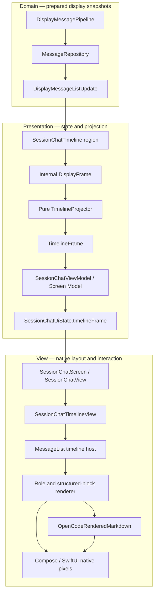

# Message Display And Rendering Pipeline

## Status

Implemented architecture as shipped through Phases 1–6 of
[message-display-rendering-hardening-plan.md](./message-display-rendering-hardening-plan.md)
(Phase 7a documentation flip).

## Scope And Boundary

This document starts at the presentation handoff from
`DisplayMessagePipeline` and ends at native pixels, interactions, and timeline
scroll behavior. The store, SSE/REST merge, markdown parsing, highlighting, and
prepared-document cache are documented in
[assistant-message-pipeline.md](./assistant-message-pipeline.md).

The boundary is deliberate:

- the domain layer publishes complete list-shaped `DisplayMessageListUpdate`
  snapshots (intentional; public `DisplayFrame` observation is won’t-do under
  [Phase 7b](./message-display-rendering-7b-plan.md));
- the timeline region builds an internal `DisplayFrame`, runs a pure
  `(DisplayFrame, optimisticInputs) → TimelineFrame` projector, and adapts rows
  into Screen Model state;
- `SessionChatUiState` holds `timelineFrame` and reuses it when non-timeline
  regions republish;
- views choose native components for each row and block; and
- the timeline host applies declared ID sets, owns viewport geometry,
  auto-follow, and renderer-local paint deferral.

No view parses markdown, mutates domain messages, or decides REST/SSE
reconciliation. `syncHealth` stays assert-only inside `MessageSync` (no UI).

## Shared Architecture

The same conceptual modules exist on both platforms. Their interfaces are
snapshots and explicit actions rather than shared framework types.

## State Ownership

| State | Owner | Contract |
| --- | --- | --- |
| Raw and prepared message snapshots | `MessageRepository` / `DisplayMessagePipeline` | Complete, ordered-by-source display snapshot or load failure; per-block Markdown via `BlockDecorationCache` |
| Internal display handoff | Timeline region | `DisplayFrame` (messages + per-block plain / optional Markdown); not the public observation shape |
| Timeline loading, empty, ready, error, refresh, and optimistic-send state | `SessionChatTimeline` + pure projector | `TimelineFrame` (rows, `frameRevision`, declared ID sets) plus last usable timeline state |
| Whole-screen state | `SessionChatViewModel` | One immutable `SessionChatUiState` including `timelineFrame`; reuse frame when composer / session-info / review / command change |
| Scroll position, pinned state, scroll-to-end visibility | Timeline view/host | View-local geometry; never persisted in the Screen Model |
| Deferred native text styling | `OpenCodeRenderedMarkdown` and the iOS assistant bubble | Renderer-local, revision-gated; does not republish or replace a timeline row |
| Sync recovery health | `MessageSync` | Assert-only `syncHealth`; not on UiState |

This split keeps the Screen Model testable without UI geometry and prevents
scroll updates or late native span construction from feeding back into the
domain pipeline.

## Snapshot Application And Row Projection

`SessionChatTimeline` owns observation lifecycle, coalescing, and optimistic
input supply. Deterministic projection is a pure
`(DisplayFrame, optimisticInputs) → TimelineFrame` function
(`TimelineProjector` / `SessionChatTimelineProjector`).

For every accepted snapshot the region:

1. builds / updates an internal `DisplayFrame` from prepared display messages
   (attaching per-block Markdown from `BlockDecorationCache` when present);
2. runs the pure projector with unresolved optimistic rows;
3. adapts `TimelineFrame` rows into Screen Model timeline state; and
4. publishes loading, empty, ready, or error without discarding the last good
   timeline on recoverable refresh failure.

Projector rules include sorting, structural blocks with stable `blockID`s,
streaming markdown reuse when identity/text still match, empty-row removal, and
per-row `contentRevision` / `layoutRevision` plus declared
`inserted` / `changed` / `removed` / `layoutChanged` ID sets.

### Required Versus Coalescible Work

Live repository emissions are complete visual snapshots. If projection is
busy, intermediate live snapshots may be replaced by the newest one.

Explicit load, refresh, and post-send applications are required operations.
They must complete in order because callers are waiting for their state or
completion callback. Android represents this distinction with a required FIFO
queue plus one latest live frame. iOS awaits explicit operations directly and
uses one latest pending slot for observation frames.

Lifecycle identity is connection directory + session. Rebinding or leaving the
screen cancels old observation/apply work, and stale work cannot publish into a
new session.

## Structural Block Rules

Both `SessionChatTimelineBlocks` implementations preserve server part order and
apply the same presentation rules:

- adjacent text parts merge with a newline (merged `blockID` = ordered join of
  contributing part IDs);
- file parts remain attachments in their original position;
- tool parts render only for assistant messages;
- `todowrite` is hidden;
- pending/running question tools are hidden while their dedicated question UI
  owns the interaction;
- consecutive read/glob/grep tools collapse into one group when there are at
  least two (group `blockID` from ordered member part IDs); and
- supported tools expose native cards and actions for details, child sessions,
  or change review.

Markdown decoration is per text block (`blockID` + `contentRevision`) via
`BlockDecorationCache`. Views paint a prepared document from the text block when
present. `DisplayMessage.renderedMarkdown` remains only as a residual sole-text
bridge for migration callers; it is not the decoration home for new work. There
is no `singleTextBlock` gate on the live paint path.

## Screen Model Composition

The platform ViewModels are coordinators, not message renderers. Each composes
the same region modules:

- timeline (`timelineFrame` + loading/empty/ready/error);
- composer;
- session information;
- review changes; and
- commands.

Region changes produce one `SessionChatUiState`. When only composer /
session-info / review / command change, the ViewModel reuses the current
`timelineFrame` object/value. It does not remap markdown blocks, measure rows,
own scroll position, or decide whether a cell is visible.

The screen binds one session identity and forwards explicit user actions.
Android exposes the state as `StateFlow`; iOS exposes an `@Observable`
MainActor model. Both views read a value snapshot and send actions back.

## View And Native Rendering

`SessionChatTimelineView` switches on the timeline state:

| State | View |
| --- | --- |
| Loading | Centered progress indicator |
| Empty | Empty-session guidance |
| Error | Load error while refresh failures can retain the previous ready state |
| Ready | Native message-list host with optional refresh, scroll-to-end, and review overlays |

Ready rows use stable message IDs and select rendering by role:

- user → `OpenCodeOutgoingMessage`, trailing and width constrained;
- assistant → ordered text, attachment, tool-card, and tool-group components
  (Compose/SwiftUI child keys use presentation `blockID`);
- command/tool/unknown → a conservative fallback bubble.

Plain bubbles open message actions on tap. Markdown bubbles use long press so
links remain independently tappable. Rendered markdown accepts only `http` and
`https` links.

`OpenCodeRenderedMarkdown` consumes an already prepared native markdown
document. It materializes paragraphs, headings, quotes, lists, fenced code,
diffs, tables, links, and thematic breaks with platform-native text/layout
objects. It never invokes the markdown parser.

Large code and diff **token coloring** may still stage on both platforms:

- streaming format-always always attaches code-block chrome when a fence is
  detectable (OPE-92); disposable semantic color catch-up may still defer for
  very large streaming fences until Final when TextMate is off;
- finalized code/diff native attributed text of at least 2,000 characters is
  constructed away from the UI executor and replaces the plain-color
  placeholder when ready; and
- on iOS, an assistant message with prepared markdown and at least 3,000
  characters additionally paints plain text for one frame (plus a 32 ms
  settling delay) before hosting the markdown tree. This protects initial
  `UICollectionView` cell configuration and is not a second pipeline publish.

## Scroll And Layout Ownership

Auto-follow is a reusable view concern, separate from Session Chat state.

Shared behavior:

- initial ready content snaps to the end without animation;
- pinned geometry arms follow and a deliberate user scroll away disarms it;
- while armed, message append, content-height growth, and viewport shrink keep
  the exact end anchored after layout;
- while unarmed, hosts capture visible anchor row ID + offset before apply and
  restore within native rounding after layout-affecting frames;
- the scroll-to-end action re-arms and settles at the exact end; and
- active user dragging/deceleration always wins over programmatic correction.

Hosts apply only declared `inserted` / `changed` / `removed` / `layoutChanged`
IDs from `TimelineFrame`. Layout-affecting work uses
`insertedRowIDs ∪ layoutChangedRowIDs`. There is no live-path Android
history-wide `layoutSignature` and no iOS list-wide Equatable discovery.

Android uses a reverse-layout `LazyColumn`. Its bottom anchor is the first
layout item (index `0`), followed by the reversed message sequence. While the
user drags, Compose reads the newest immutable frame (intentional
newest-immutable parity gap vs iOS).

iOS uses a `UICollectionView` hosted through
`UIViewControllerRepresentable`. The last message is the visual bottom item.
Diffable snapshots reconfigure declared changed IDs without insert animations.
While the user is actively scrolling, incoming view applies coalesce to the
latest snapshot and flush after the gesture. Content-size observation anchors
growth synchronously when follow is armed; it avoids forcing full layout of
tall off-screen markdown cells.

Short histories are bottom-aligned on both platforms.

## Platform Execution Model

| Responsibility | Android | iOS |
| --- | --- | --- |
| Observe display snapshots | `Flow.conflate()` in the timeline region | Observation task with one latest pending update |
| Structural row projection | Worker dispatcher → pure projector → `StateFlow` | MainActor pure projector with cooperative yields |
| Required load/refresh/send apply | FIFO-required apply queue | Direct awaited MainActor operation |
| Whole-screen publication | Combined region `StateFlow` (`timelineFrame` reuse) | Region `onChange` callbacks publish `@Observable` state |
| Host apply | Declared IDs only; reverse `LazyColumn` | Declared IDs into diffable `UICollectionView` |
| Drag / live apply | Newest-immutable Compose state | Cell-apply coalesce until gesture ends |
| Large finalized code/diff styling | `Dispatchers.Default` | Detached utility task after capturing the native color palette |
| UI | Compose Main | SwiftUI/UIKit MainActor |

These are platform-native mechanisms for the same product contract. They are
not required to have instruction-by-instruction symmetry. See
[parity-gaps.md](./parity-gaps.md).

## Platform Walkthroughs

### Android

1. `SessionChatScreen` binds the session and collects
   `SessionChatViewModel.uiState` with lifecycle awareness.
2. `SessionChatViewModel` combines region `StateFlow`s into
   `SessionChatUiState`, reusing `timelineFrame` when non-timeline regions
   change.
3. `SessionChatTimeline` observes display snapshots, builds `DisplayFrame`,
   runs `TimelineProjector` with optimistic inputs, then publishes
   `SessionChatTimelineRegionState`.
4. `SessionChatTimelineView` renders the state and creates the message-list
   timeline handle.
5. The reverse `LazyColumn` applies declared IDs; role and block renderers
   select design-system components keyed by `blockID`.
6. `OpenCodeRenderedMarkdown` turns the prepared document into Compose text and
   layout primitives, deferring large annotation construction.

### iOS

1. `SessionChatView` owns an `@State` `SessionChatViewModel`, starts observation
   on task, and stops it when the screen leaves.
2. `SessionChatViewModel` receives region callbacks and publishes one
   `SessionChatUiState` on MainActor, reusing `timelineFrame` when appropriate.
3. `SessionChatTimeline` optionally paints a warm prepared snapshot, observes
   live display updates, coalesces them, builds `DisplayFrame`, and runs
   `SessionChatTimelineProjector`.
4. `SessionChatTimelineView` renders the state and owns
   `TimelineScrollController`.
5. `MessageListTimelineHost` applies declared-ID diffable snapshots to a
   self-sizing `UICollectionView` whose cells host SwiftUI row views.
6. `OpenCodeRenderedMarkdown` turns the prepared document into SwiftUI and
   attributed-text primitives, deferring large native styling and, for a large
   assistant bubble, the first markdown-tree paint.

## Invariants

- A row is a value snapshot; views never mutate it.
- Message identity is the stable list/cell identity; presentation blocks use
  stable `blockID`s.
- Live frames may coalesce only because each frame is a complete visual
  snapshot.
- Explicit operation completion is never lost through live-frame coalescing.
- Optimistic rows survive quiet live refresh until authoritative reconciliation.
- Prepared markdown is reused only when block/message identity and source still
  match; stale decoration commits are generation-rejected.
- Hosts apply declared ID sets only; no live-path history-wide layout signature
  or list-wide Equatable discovery.
- Scroll state is view-local and user intent overrides auto-follow.
- Native paint deferral may change styling after first paint, but must not
  reorder, replace, or duplicate a message.
- Both platforms preserve block order and expose the same message/tool actions.
- Public observation remains list-shaped; `syncHealth` is not shown in UI.

## Evaluation

The implemented architecture has the right primary boundaries:

- domain preparation is outside the UI (dual-lane text + decoration);
- the timeline region + pure projector separate lifecycle from deterministic
  row policy;
- the Screen Model exposes one state (`timelineFrame`) and explicit actions;
- rendering stays component-first and platform-native with per-block Markdown;
- hosts consume declared layout/content IDs; and
- viewport state is isolated from business and message state.

The latest-only policy is also placed at safe seams: only complete live
snapshots and non-required cell applies coalesce. Explicit operations and
optimistic reconciliation remain lossless.

Remaining follow-up is Phase **7b**
([message-display-rendering-7b-plan.md](./message-display-rendering-7b-plan.md)):
ship soak **coverage debt** (scenarios 4–7 → full). Architecture items (public
`DisplayFrame`, Sync/Pipeline absorption, fingerprint→revision, change-set hint,
`syncHealth` UI) are **parked** with reopen triggers — not unfinished Phase 5/6
host work. Intentional mechanism gaps stay in
[parity-gaps.md](./parity-gaps.md).

## Phase 7b Follow-Ups

Canonical plan:
[message-display-rendering-7b-plan.md](./message-display-rendering-7b-plan.md).

**Ship under 7b**

- Soak coverage debt: matrix scenarios 4–7 (repeated overflow, parser failure,
  rapid A→B→A, related pressure) → **full** on both platforms.

**Parked (reopen triggers only — not scheduled tickets)**

- public observation flip to `DisplayFrame` (+ optional `syncHealth` /
  `changeSet` on that shape);
- absorbing `MessageSync` + `DisplayMessagePipeline` into
  `SessionMessageEngine`;
- replacing poll/REST fingerprints with revision gates;
- wiring the optional `SessionChangeSet` → pipeline decoration hint;
- optional `syncHealth` banner/chip UI;
- deleting the sole-text `DisplayMessage.renderedMarkdown` bridge once no
  caller needs it;
- device p95 / soak CI;
- optional iOS projection off MainActor if measurement requires it; and
- richer first-usable / styled-paint probe markers if soak CI needs wall-clock
  spans.

## Source And Verification Map

### Android

- [`SessionChatScreen.kt`](../../../android/app/src/main/java/dev/opencode/mobile/ui/sessionchat/SessionChatScreen.kt)
- [`SessionChatViewModel.kt`](../../../android/app/src/main/java/dev/opencode/mobile/ui/sessionchat/SessionChatViewModel.kt)
- [`SessionChatTimeline.kt`](../../../android/app/src/main/java/dev/opencode/mobile/ui/sessionchat/region/SessionChatTimeline.kt)
- [`SessionChatUiModels.kt`](../../../android/app/src/main/java/dev/opencode/mobile/ui/sessionchat/SessionChatUiModels.kt)
- [`DisplayFrame.kt`](../../../android/app/src/main/java/dev/opencode/mobile/ui/sessionchat/DisplayFrame.kt)
- [`TimelineProjector.kt`](../../../android/app/src/main/java/dev/opencode/mobile/ui/sessionchat/TimelineProjector.kt)
- [`PresentationBlockId.kt`](../../../android/app/src/main/java/dev/opencode/mobile/ui/sessionchat/PresentationBlockId.kt)
- [`SessionChatTimelineBlocks.kt`](../../../android/app/src/main/java/dev/opencode/mobile/ui/sessionchat/SessionChatTimelineBlocks.kt)
- [`SessionChatTimelineView.kt`](../../../android/app/src/main/java/dev/opencode/mobile/ui/sessionchat/view/SessionChatTimelineView.kt)
- [`MessageListTimeline.kt`](../../../android/app/src/main/java/dev/opencode/mobile/ui/scroll/MessageListTimeline.kt)
- [`MessageListVisibleAnchorScroll.kt`](../../../android/app/src/main/java/dev/opencode/mobile/ui/scroll/MessageListVisibleAnchorScroll.kt)
- [`OpenCodeRenderedMarkdown.kt`](../../../android/app/src/main/java/dev/opencode/mobile/ui/components/OpenCodeRenderedMarkdown.kt)
- [`SessionChatViewModelTest.kt`](../../../android/app/src/test/java/dev/opencode/mobile/ui/sessionchat/SessionChatViewModelTest.kt)
- [`TimelineProjectorTest.kt`](../../../android/app/src/test/java/dev/opencode/mobile/ui/sessionchat/TimelineProjectorTest.kt)
- [`SessionChatTimelineBlocksTest.kt`](../../../android/app/src/test/java/dev/opencode/mobile/ui/sessionchat/SessionChatTimelineBlocksTest.kt)
- [`MessageListVisibleAnchorScrollTest.kt`](../../../android/app/src/test/java/dev/opencode/mobile/ui/scroll/MessageListVisibleAnchorScrollTest.kt)
- [`MessageListAutoFollowStateTest.kt`](../../../android/app/src/test/java/dev/opencode/mobile/ui/componentgallery/components/MessageListAutoFollowStateTest.kt)

### iOS

- [`SessionChatView.swift`](../../../ios/OpenCode%20Mobile/OpenCode%20Mobile/UI/SessionChat/SessionChatView.swift)
- [`SessionChatViewModel.swift`](../../../ios/OpenCode%20Mobile/OpenCode%20Mobile/UI/SessionChat/SessionChatViewModel.swift)
- [`SessionChatTimeline.swift`](../../../ios/OpenCode%20Mobile/OpenCode%20Mobile/UI/SessionChat/Region/SessionChatTimeline.swift)
- [`SessionChatUiModels.swift`](../../../ios/OpenCode%20Mobile/OpenCode%20Mobile/UI/SessionChat/SessionChatUiModels.swift)
- [`DisplayFrame.swift`](../../../ios/OpenCode%20Mobile/OpenCode%20Mobile/UI/SessionChat/DisplayFrame.swift)
- [`TimelineFrame.swift`](../../../ios/OpenCode%20Mobile/OpenCode%20Mobile/UI/SessionChat/TimelineFrame.swift)
- [`SessionChatTimelineProjector.swift`](../../../ios/OpenCode%20Mobile/OpenCode%20Mobile/UI/SessionChat/SessionChatTimelineProjector.swift)
- [`PresentationBlockId.swift`](../../../ios/OpenCode%20Mobile/OpenCode%20Mobile/UI/SessionChat/PresentationBlockId.swift)
- [`SessionChatTimelineBlocks.swift`](../../../ios/OpenCode%20Mobile/OpenCode%20Mobile/UI/SessionChat/SessionChatTimelineBlocks.swift)
- [`SessionChatTimelineView.swift`](../../../ios/OpenCode%20Mobile/OpenCode%20Mobile/UI/SessionChat/View/SessionChatTimelineView.swift)
- [`MessageListTimelineHost.swift`](../../../ios/OpenCode%20Mobile/OpenCode%20Mobile/UI/Scroll/MessageListTimelineHost.swift)
- [`TimelineScrollController.swift`](../../../ios/OpenCode%20Mobile/OpenCode%20Mobile/UI/Scroll/TimelineScrollController.swift)
- [`OpenCodeRenderedMarkdown.swift`](../../../ios/OpenCode%20Mobile/OpenCode%20Mobile/Components/OpenCodeRenderedMarkdown.swift)
- [`SessionChatViewModelTests.swift`](../../../ios/OpenCode%20Mobile/OpenCode%20MobileTests/SessionChatViewModelTests.swift)
- [`SessionChatTimelineProjectorTests.swift`](../../../ios/OpenCode%20Mobile/OpenCode%20MobileTests/SessionChatTimelineProjectorTests.swift)
- [`MessageListTimelineHostDeclaredIDTests.swift`](../../../ios/OpenCode%20Mobile/OpenCode%20MobileTests/MessageListTimelineHostDeclaredIDTests.swift)
- [`SessionChatTimelineBlocksTests.swift`](../../../ios/OpenCode%20Mobile/OpenCode%20MobileTests/SessionChatTimelineBlocksTests.swift)
- [`TimelineScrollControllerTests.swift`](../../../ios/OpenCode%20Mobile/OpenCode%20MobileTests/TimelineScrollControllerTests.swift)

## Validation

This architecture was traced against both current implementations. The source
links above and all local documentation links are part of the documentation
validation surface. No runtime behavior changed as part of this documentation
update.
