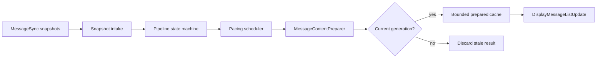

# Assistant message pipeline hardening plan

## Status

Complete. Phases 1–6 shipped on iOS and Android; acceptance gates below are
closed. The architecture document describes the implemented pipeline.

## Objective

Make assistant-message preparation a bounded, deterministic, latest-wins
pipeline on iOS and Android while preserving:

- SSE-first initial loading;
- revision-gated REST replacement;
- responsive format-first history scaffolds;
- responsive live streaming;
- finalized Markdown and syntax highlighting; and
- the existing `MessageRepository` display-message interface used by Session
  Chat.

The implemented architecture is
[assistant-message-pipeline.md](./assistant-message-pipeline.md).

## User-visible outcome

- Opening a large session produces a usable timeline quickly and does not reveal
  markdown one bubble at a time.
- Streaming assistant text continues at a bounded cadence even while older
  parsing work finishes.
- A stale prepared frame never replaces newer assistant text.
- Leaving or switching a session cannot produce a late frame in the newly bound
  timeline.
- Repeated session opens do not cause unbounded prepared-content retention.

## In scope

- `DisplayMessagePipeline` scheduling, generation tracking, cancellation, and
  publish policy.
- `MessageContentPreparer` preparation-mode interface.
- Cross-platform viewport plus remaining-history enrichment batching.
- Prepared-history cache ownership and eviction.
- Initial SSE event-intake capacity and authoritative overflow recovery.
- Interface-level pipeline tests, focused sync tests, logs, and feature docs.

## Out of scope

- Persistent message storage.
- Pagination or cursor-based history.
- Renderer redesign or new design-system components.
- Server protocol changes.
- Background execution or push delivery.
- Changing the public Session Chat repository interface unless implementation
  evidence proves it necessary.

## Architectural decisions

### Keep one external display seam

`MessageRepository.observeDisplayMessages` and `refreshDisplayMessages` remain
the Session Chat interface. Pipeline mechanics stay internal.

### Separate intake from preparation

Raw-snapshot collection must not await synchronous markdown work. Intake stores
the newest immutable snapshot and generation; a worker prepares scheduled work.

### Commit by generation

Cancellation is advisory because TextMate work may be synchronous. Every
completed result must pass a current-generation check before it:

- updates previous prepared rows;
- updates a warm cache;
- changes the last-published timestamp; or
- emits `DisplayMessageListUpdate.Messages`.

### Use a closed preparation mode

Replace independent `skipMarkdown` and
`reuseStreamingDocumentAsFinalPlaceholder` flags with a platform-native enum or
sealed type representing `streaming`, `historyPlainFirst`,
`historyEnrichment`, `finalPlaceholder`, and `final`.

### Align enrichment behavior

Both platforms publish no more than two enrichment frames after the
format-first scaffold:
the newest viewport batch and the remaining batch.

### Bound retained work

Prepared history and initial event intake require explicit capacities and
recovery behavior. Prepared-history capacity must account for character or
rendered-document cost rather than only message count. Event-intake capacity
must account for event count or byte cost and define authoritative recovery.

## Proposed internal module

The module remains deep: callers learn one observation interface while
generation, pacing, enrichment, caching, and fallback behavior remain inside.

## Implementation phases

### Phase 1 — Characterization and test seams

Status: **Complete**.

1. Add interface-level tests that collect real pipeline output from a
   controllable snapshot source.
2. Add a controllable preparation adapter that can suspend completion and
   report invocation mode.
3. Add a monotonic clock/scheduler adapter or configuration sufficient to
   advance quiet-window and maximum-batch behavior deterministically.
4. Characterize current full-load, streaming, finalization, failure, and
   teardown behavior before restructuring.

Expected result: tests can reproduce an old parse completing after a newer
snapshot without using wall-clock sleeps.

### Phase 2 — Latest-wins state machine

Status: **Complete**. Blockers: none.

Decision locked for this phase: a finalized non-streaming snapshot uses **one
generation**; `finalPlaceholder` then `final` are two prepares of that same
generation. A newer live snapshot increments generation and discards both.

1. Introduce observation-local generations.
2. Split raw-snapshot intake from preparation work.
3. Keep only the newest pending streaming snapshot.
4. Apply generation checks before every cache mutation and publish.
5. Invalidate enrichment and streaming generations when finalization or a newer
   snapshot begins.
6. Define teardown as cancellation and drop, not flush.

Expected result: deliberately completing generation N after N+1 never emits N
or changes a cache used by N+1.

### Phase 3 — Preparation-mode interface

Status: **Complete**. Blockers: none.

Decision locked: closed mode enum/sealed type with the cache-commit policy in
[decisions.md](./decisions.md#pipeline-hardening--preparation-modes-phase-3).
Only `historyPlainFirst` skips a full prepared-cache replace.

1. Introduce the closed preparation mode on both platforms.
2. Move threshold and placeholder behavior behind that mode.
3. Remove boolean combinations from pipeline call sites.
4. Add safe plain-text fallback when parsing fails or streaming text exceeds
   the configured threshold.

Expected result: every preparation request has one named semantic purpose and
invalid flag combinations are impossible.

### Phase 4 — Cross-platform history batching

Status: **Complete**. Blockers: none.

1. Adopt the shared viewport batch policy from the existing iOS
   message-count and character-budget constants (3 messages / 12k chars) on
   both platforms.
2. Change Android from per-message publication to viewport plus remaining
   batch.
3. Keep both batches generation-gated.
4. Preserve newest-first preparation inside a batch.
5. Confirm timeline apply coalescing does not hide the final fully styled frame.

Expected result: large cold history publishes a format-first scaffold, then at
most two enrichment frames on either platform.

Android `SessionChatTimeline` already `.conflate()`s the display flow, so a
busy apply keeps the latest enrichment snapshot (the remaining / fully styled
frame) rather than dropping it in favor of an older viewport-only frame.

### Phase 5 — Bounded caches and event intake

Status: **Complete**. Blockers: none.

Decision locked: capacity and recovery policy in
[decisions.md](./decisions.md#pipeline-hardening--bounds-and-overflow-phase-5).

1. Add a total-cost policy to iOS prepared-history retention
   (`512_000` chars / `8` sessions, LRU).
2. Key retained history by connection profile, directory, and session ID to
   prevent cross-profile reuse.
3. Evict on least-recent use, session deletion, cache reset, and memory
   pressure.
4. Cap per-observation event staging at `4_096` events (both platforms).
5. When capacity is exceeded, mark the observation dirty, reject stale
   authority, and enter an explicit authoritative-recovery path.
6. Log high-water marks, overflow, recovery, and cache eviction without message
   content.

Expected result: no pipeline-owned collection grows without a documented bound,
and overflow never silently loses accepted text.

### Phase 6 — Verification and documentation closeout

Status: **Complete**. Blockers: none.

Verification (2026-07-27):

- Android: `:app:testDebugUnitTest` for `dev.opencode.mobile.domain.message.*`
  and `MessageSyncTest` — passed.
- iOS: `DisplayMessagePipelineCharacterizationTests`,
  `DisplayMessagePipelinePacingTests`, `DisplayMessagePipelineWarmReopenTests`,
  `PreparedHistoryCacheTests`, `MessageSyncTests` — 44 passed.
- Measurement surface: existing prep/publish/staging/cache logs (no message
  text). Architecture document updated to implemented language.

1. Run focused domain, pipeline, timeline, and repository tests on each
   platform.
2. Exercise cold history, warm history, active streaming, failed idle
   reconciliation, reconnect, session switch, and observation teardown.
3. Measure time to first usable history, streaming publish age, preparation
   duration, enrichment frame count, and retained cache cost.
4. Update the architecture document from target language to implemented
   language only after both platforms pass.
5. Resolve the temporary parity gaps and update feature progress.

Expected result: the documented contract and both native implementations agree.

## Platform work

| Concern | iOS | Android |
| --- | --- | --- |
| Snapshot intake | Keep generation state on `MainActor`; do not await detached parsing in intake | Keep generation state in observation scope; do not `cancelAndJoin` parser work on intake path |
| Preparation worker | Detached `userInitiated`; commit on MainActor after generation check | `Dispatchers.Default`; commit in pipeline scope after generation check |
| Preparation mode | Swift enum | Kotlin sealed type or enum |
| Enrichment | Retain viewport plus remaining batches | Same two-batch viewport + remaining policy |
| Warm prepared history | Bounded LRU cache (512k chars / 8 sessions) | No warm cache; format-first scaffold + enrich on reopen (intentional) |
| Store atomicity | MainActor confinement | Per-store synchronization |
| Timeline conversion | Cooperative MainActor yields | Worker structural conversion, then Main publish |

## Acceptance criteria

### Correctness

- [x] Initial SSE subscription still precedes initial REST loading.
- [x] Every REST replacement remains revision-gated.
- [x] Only the current pipeline generation may publish or mutate prepared
  caches.
- [x] A final snapshot cannot be replaced by an older streaming snapshot.
- [x] Session switch and observation teardown produce no late visible frame.
- [x] Event-intake overflow has a tested authoritative-recovery path.

### Responsiveness

- [x] Streaming uses the configured quiet window and maximum batch age under a
  deterministic clock.
- [x] Snapshot intake continues while preparation is blocked.
- [x] Large streaming text uses plain text until finalization.
- [x] Large cold history publishes format-first scaffold before full enrichment.
- [x] Enrichment publishes at most two frames after that scaffold.

### Boundedness

- [x] Prepared-history retention has a documented total cost limit.
- [x] Initial event intake has a documented capacity.
- [x] Cache and buffer eviction/recovery are observable without logging message
  text.

### Parity

- [x] iOS and Android use the same preparation modes and observable state
  transitions.
- [x] Both platforms satisfy the same publish ordering and enrichment-count
  guarantees.
- [x] Any remaining mechanism difference is non-observable or recorded as an
  intentional parity gap.

### Tests

- [x] iOS pipeline tests cover stale completion, pacing, finalization,
  enrichment, teardown, and cache eviction.
- [x] Android pipeline tests cover the same behavior.
- [x] Both message-sync suites cover startup buffering, overflow recovery,
  revision rejection, and failed-idle recovery.
- [x] Session Chat tests confirm optimistic rows and explicit-refresh
  completions survive live-frame coalescing.

## Risks and mitigations

| Risk | Mitigation |
| --- | --- |
| Synchronous parser work continues after cancellation | Allow work to finish but generation-gate every side effect |
| Conflation drops a required terminal state | Treat the newest immutable store snapshot as authority; test streaming-to-final transitions explicitly |
| Bounded event intake loses non-replayed deltas | Never silently drop; enter dirty/reconcile recovery and reject stale REST authority |
| Cache cost is underestimated by character count | Include rendered-document cost where measurable and respond to memory pressure |
| Test-only seams leak into the caller interface | Keep clock, source, and preparer adapters internal to the pipeline implementation |
| Platform mechanisms drift | Use the same behavior matrix and mirrored interface-level test cases |

## Documentation ledger

- `assistant-message-pipeline.md` — implemented architecture and invariants.
- `pipeline-hardening-plan.md` — phased implementation and acceptance gates.
- `pipeline-hardening-plan.html` — visual step board with per-step status.
- `plan.md` — feature-wide scope and links.
- `decisions.md` — durable feature-level architecture choices.
- `parity-gaps.md` — current observable implementation differences.
- `progress.md` — plan and hardening implementation complete.

When a phase or step starts or finishes, update the status badges in
[pipeline-hardening-plan.html](./pipeline-hardening-plan.html) and keep
`progress.md` / `parity-gaps.md` aligned. Markdown remains the source of truth
for scope and acceptance criteria.
