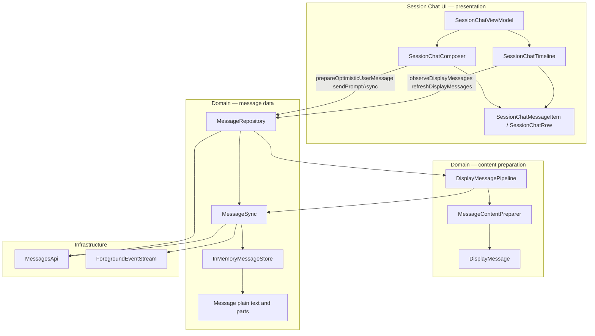

# Message Store

## User Goal

Session Chat reads messages through one repository API backed by an in-memory
store that REST history and SSE events keep up to date. Markdown parse and
tokenize run in a content-preparation layer so UI receives almost-ready rows.

## In Scope

- `MessageStore` / `InMemoryMessageStore` — per-session message state and SSE patches.
- `MessageSync` — bounded event staging, incremental SSE merge,
  selective reconciliation, revision-gated fingerprint polling, and
  `GapAuthority` catch-up. It does not own transport or lifecycle
  reconnect clocks. Policy: [decisions.md](decisions.md).
- `MessageContentPreparer` + `DisplayMessagePipeline` — parse, highlight, cache → `DisplayMessage`.
- `MessageRepository.observeDisplayMessages` / `refreshDisplayMessages` / `prepareOptimisticUserMessage`.
- Windowed history: newest 20-message seed, bounded split-turn backfill,
  200-message older pages, and tail-only authoritative reconciliation.
- Session Chat timeline depends on display-message APIs only (no UI-layer markdown mapper).

## Out Of Scope

- SQLite / Room / SwiftData persistence.
- Per-message `getMessage` reconcile on every SSE tick.
- Markdown in the raw message store.

## Server APIs Involved

- v1 `GET /session/:id/message` — `limit` / `before` windowed history.
- v2 `GET /api/session/:id/message` — `limit` / `order` / `cursor`
  windowed history.
- v1 `GET /global/event` and instance `GET /event?directory=`, v2
  `GET /api/event` (via `ForegroundEventStream` / `LiveConnection`) —
  ordered live patches, connection events, and reconnect signals.

## Expected Logs

- `MessageSync` records subscription, authoritative reload reason, SSE-derived
  publishes, changed-fingerprint polls, and recoverable reload failures without
  logging message text.
- `MessageContentPreparer` records preparation counts, cache reuse, markdown
  counts, and elapsed time without logging message text.
- The foreground stream owns connection lifecycle and parsed-event logging; the
  store does not duplicate transport logs.

## Domain Objects

- `Message`, `MessagePatch`, `MessageListUpdate`, `MessageStore`, `MessageSync`, `MessageRepository`.
- `DisplayMessage`, `DisplayMessageListUpdate`, `MessageContentPreparer`, `DisplayMessagePipeline`.
- Reuses `ForegroundEventStream`, `LiveConnection`, and `GapAuthority`
  for transport occupancy and unpaid-revision catch-up.

## Architecture

Domain messages (`Message` with plain text/parts) flow from the store through
sync into a **content-preparation pipeline** that emits list-shaped
`DisplayMessage` rows. Per-text-block Markdown lives in `BlockDecorationCache`
(keyed by `blockID` + `contentRevision`); `DisplayMessage.renderedMarkdown` is
only a residual sole-text bridge. Session Chat projects internal `DisplayFrame`
→ `TimelineFrame` and views paint per-block documents.

### Where markdown runs

Full load vs part-streaming flow, ordering guarantees, and execution contexts
are documented in [assistant-message-pipeline.md](./assistant-message-pipeline.md).
The implemented ViewModel-to-native-pixels architecture, including row
projection, structured blocks, native markdown painting, and timeline scroll
ownership, is documented in
[message-display-rendering-pipeline.md](./message-display-rendering-pipeline.md).
The latest-wins, bounded cross-platform hardening is complete in
[pipeline-hardening-plan.md](./pipeline-hardening-plan.md).
The next reliability and responsiveness slice is planned in
[message-display-rendering-hardening-plan.md](./message-display-rendering-hardening-plan.md).

| Step | Layer | What happens |
|------|--------|----------------|
| REST + SSE | `MessageSync` → `SessionMessageEngine` / store | Raw server messages kept as domain `Message`; engine is reducer facade |
| Observe | `DisplayMessagePipeline` | Dual-lane text + decoration; calls preparer |
| **Prepare** | **`MessageContentPreparer`** | Detect markdown, parse, highlight → per-block docs in `BlockDecorationCache` (sole-text `DisplayMessage.renderedMarkdown` residual bridge only) |
| Structural merge | Pure projector + `SessionChatTimeline` | `DisplayFrame` → `TimelineFrame`; optimistic inputs; declared ID sets |
| Screen state | `SessionChatViewModel` | `timelineFrame` on UiState; combine composer, info, review, commands |
| Render | Session Chat views / hosts | Declared-ID apply; paint Markdown from text blocks |

Composer uses `prepareOptimisticUserMessage` for the **optimistic send bubble**
before the server row appears. Streaming text updates re-prepare on each
display pipeline emit (debounced while parts are streaming).

Observation registers for foreground events before requesting initial history,
so events that arrive during the REST request are buffered and merged after the
snapshot. Initial REST loads the newest 20 messages and fetches at most three
additional 20-message pages when the first page starts mid-turn. The store keeps
the resulting chronological history window and loads one 200-message older page
per user scroll toward its oldest edge.

Tail REST applies only when the store revision still matches the revision
captured before the request; an intervening SSE patch makes that response stale
and it is discarded. An accepted tail updates its overlap and newer rows while
preserving loaded rows older than the overlap. A non-empty tail with no overlap
resets the window instead of joining an unproven gap. Poll, refresh, reconnect,
and recovery use the same bounded tail and never drain complete history.
Failed or discarded REST does not acknowledge the current `GapAuthority`
revision; accepted merge or equality confirmation does. A newer gap during REST
stays pending.
`session.idle` with an incomplete last assistant, and `sse.parse.failed`,
are authoritative REST barriers. Failed idle authority stays recovering.

REST mapping retains stable part identities so selective updates do not consume
the event loop with a reload or lose subsequent deltas. Legacy parts without a
server ID use the bounded tail-authority fallback. A newer live snapshot must
never wait for stale history enrichment to finish.

**Not in scope for the store:** tokenizer, parser, or highlighter — those live
in `MessageContentPreparer` (backed by KMP markdown on Android and the native
bridge on iOS).

## Screen Model State And Actions

- Session Chat receives loading, ready, empty, and load-failed outcomes through
  the existing timeline state.
- Timeline state exposes whether older history exists and whether an older page
  is loading. Scrolling toward the oldest loaded row requests one page.
- Explicit refresh uses `refreshDisplayMessages`; send uses
  `prepareOptimisticUserMessage` followed by the repository send API.
- Live and watchdog updates are quiet timeline updates and must not clear an
  in-flight optimistic bubble or `isSending`.

## Navigation Entry Points

- Android: `SessionChatTimeline` observes the repository while the scoped
  Session Chat ViewModel is alive.
- iOS: `SessionChatTimeline` starts observation on appearance and stops it on
  the existing delayed-disappear/back lifecycle.

## Error States

- Initial history failure produces a load-failed update.
- Older-page failure keeps the loaded window and allows another user-scroll
  attempt.
- Explicit refresh failure is returned to the caller.
- SSE or reconciliation failure keeps the last good snapshot.
- Failed idle or parse-failure authority stays recovering until accepted
  REST acknowledges the gap. Catch-up policy is in
  [decisions.md](decisions.md).

## Permission Behavior

Not applicable; permission requests use their own foreground-event subscriber.

## Design-System Components

No new component. Session Chat continues to use
`OpenCodeRenderedMarkdown`; the display pipeline supplies its prepared document
and streaming state.

## Validation

- Android: `MessageSyncTest`, `DisplayMessagePipelinePacingTest`,
  `MessageSyncWindowedHistoryTest`, `MessageWindowMergeTest`,
  `MessageListOlderHistoryTest`, `MessageContentPreparerTest`, and
  `SessionChatViewModelTest`.
- iOS: `MessageSyncTests`, `DisplayMessagePipelinePacingTests`, and
  `MessageSyncWindowTests`, `MessageHistoryMergeTests`,
  `MessageListTimelineHostOlderScrollTests`, and `SessionChatViewModelTests`.
- Both message-sync suites cover events buffered during initial REST, stale
  in-flight poll rejection, and event → store → display streaming/final
  behavior.
- Shared SSE recovery traces under `shared/sse-recovery/` assert
  user-visible catch-up outcomes on both platforms. They do not pin REST
  counts or gap-reason machinery. Do not check transient run logs into the
  repo.
