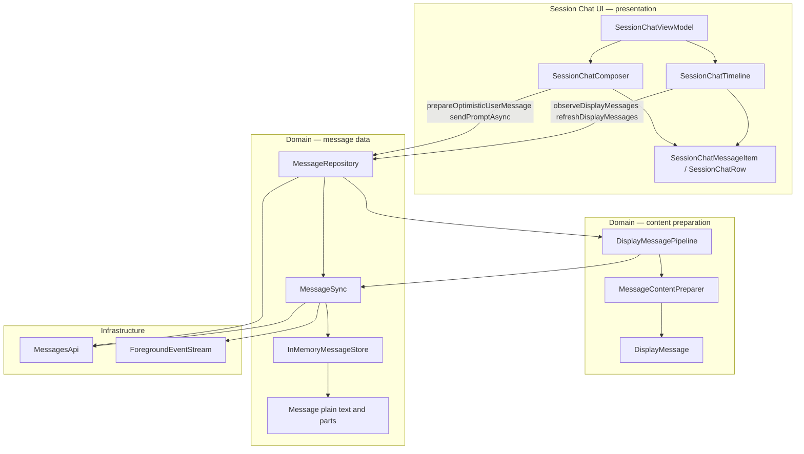

# Message Store

## User Goal

Session Chat reads messages through one repository API backed by an in-memory
store that REST history and SSE events keep up to date. Markdown parse and
tokenize run in a content-preparation layer so UI receives almost-ready rows.

## In Scope

- `MessageStore` / `InMemoryMessageStore` — per-session message state and SSE patches.
- `MessageSync` — initial load, SSE merge, reconnect reload, fingerprint poll.
- `MessageContentPreparer` + `DisplayMessagePipeline` — parse, highlight, cache → `DisplayMessage`.
- `MessageRepository.observeDisplayMessages` / `refreshDisplayMessages` / `prepareOptimisticUserMessage`.
- Session Chat timeline depends on display-message APIs only (no UI-layer markdown mapper).

## Out Of Scope

- SQLite / Room / SwiftData persistence.
- Paginated history (`limit` / `before` / `x-next-cursor`).
- Per-message `getMessage` reconcile on every SSE tick.
- Markdown in the raw message store.

## Server APIs Involved

- `GET /session/:id/message` — seed and reload history.
- `GET /global/event` (via `ForegroundEventStream`) — live patches.

## Domain Objects

- `Message`, `MessagePatch`, `MessageListUpdate`, `MessageStore`, `MessageSync`, `MessageRepository`.
- `DisplayMessage`, `DisplayMessageListUpdate`, `MessageContentPreparer`, `DisplayMessagePipeline`.

## Architecture

Domain messages (`Message` with plain text/parts) flow from the store through
sync into a **content-preparation pipeline** that emits `DisplayMessage` rows
(message + optional `MarkdownDocument`). Session Chat timeline merges those into
UI rows; views render spans only.

### Where markdown runs

| Step | Layer | What happens |
|------|--------|----------------|
| REST + SSE | `MessageSync` → `InMemoryMessageStore` | Raw server messages kept as domain `Message` |
| Observe | `DisplayMessagePipeline` | Debounced streaming; calls preparer |
| **Prepare** | **`MessageContentPreparer`** | Detect markdown, parse, highlight code → `DisplayMessage.renderedMarkdown` |
| Structural merge | `SessionChatTimeline` | Ordering, quiet refresh, optimistic merge → UI rows |
| Render | Session Chat views | SwiftUI / Compose read spans from prepared documents |

Composer uses `prepareOptimisticUserMessage` for the **optimistic send bubble**
before the server row appears. Streaming text updates re-prepare on each
display pipeline emit (debounced while parts are streaming).

**Not in scope for the store:** tokenizer, parser, or highlighter — those live
in `MessageContentPreparer` (backed by KMP markdown on Android and the native
bridge on iOS).

## UI States

Unchanged from Session Chat: loading, ready, empty, error; quiet refresh during send.

## Validation

- Android: `MessageSyncTest`, `MessageContentPreparerTest`, `SessionChatViewModelTest`.
- iOS: `MessageSyncTests`, `SessionChatViewModelTests`.
