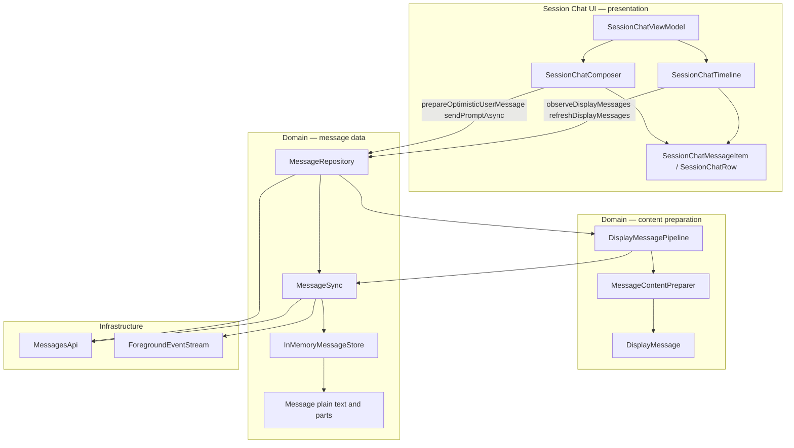

# Message Store

## User Goal

Session Chat reads messages through one repository API backed by an in-memory
store that REST history and SSE events keep up to date. Markdown parse and
tokenize run in a content-preparation layer so UI receives almost-ready rows.

## In Scope

- `MessageStore` / `InMemoryMessageStore` — per-session message state and SSE patches.
- `MessageSync` — event subscription before initial load, incremental SSE merge,
  selective reconciliation, reconnect reload, and revision-gated fingerprint
  polling.
- `MessageContentPreparer` + `DisplayMessagePipeline` — parse, highlight, cache → `DisplayMessage`.
- `MessageRepository.observeDisplayMessages` / `refreshDisplayMessages` / `prepareOptimisticUserMessage`.
- Session Chat timeline depends on display-message APIs only (no UI-layer markdown mapper).

## Out Of Scope

- SQLite / Room / SwiftData persistence.
- Paginated history (`limit` / `before` / `x-next-cursor`).
- Per-message `getMessage` reconcile on every SSE tick.
- Markdown in the raw message store.

## Server APIs Involved

- `GET /session/:id/message` — seed and reload history.
- `GET /global/event` (via `ForegroundEventStream`) — ordered live patches,
  connection events, and reconnect signals.

## Expected Logs

- `MessageSync` records subscription, authoritative reload reason, SSE-derived
  publishes, changed-fingerprint polls, and recoverable reload failures without
  logging message text.
- `MessageContentPreparer` records preparation counts, cache reuse, markdown
  counts, and elapsed time without logging message text.
- The foreground stream owns connection lifecycle and parsed-event logging; the
  store does not duplicate transport logs.

## Domain Objects

- `Message`, `MessagePatch`, `MessageListUpdate`, `MessageStore`, `MessageSync`, `MessageRepository`.
- `DisplayMessage`, `DisplayMessageListUpdate`, `MessageContentPreparer`, `DisplayMessagePipeline`.

## Architecture

Domain messages (`Message` with plain text/parts) flow from the store through
sync into a **content-preparation pipeline** that emits `DisplayMessage` rows
(message + optional `MarkdownDocument`). Session Chat timeline merges those into
UI rows; views render spans only.

### Where markdown runs

| Step | Layer | What happens |
|------|--------|----------------|
| REST + SSE | `MessageSync` → `InMemoryMessageStore` | Raw server messages kept as domain `Message` |
| Observe | `DisplayMessagePipeline` | Debounced streaming; calls preparer |
| **Prepare** | **`MessageContentPreparer`** | Detect markdown, parse, highlight code → `DisplayMessage.renderedMarkdown` |
| Structural merge | `SessionChatTimeline` | Ordering, quiet refresh, optimistic merge → UI rows |
| Render | Session Chat views | SwiftUI / Compose read spans from prepared documents |

Composer uses `prepareOptimisticUserMessage` for the **optimistic send bubble**
before the server row appears. Streaming text updates re-prepare on each
display pipeline emit (debounced while parts are streaming).

Observation registers for foreground events before requesting initial history,
so events that arrive during the REST request are buffered and merged after the
snapshot. REST responses replace the store only when its revision still matches
the revision captured before the request; an intervening SSE patch makes that
response stale and it is discarded.

REST mapping retains stable part identities so selective updates do not consume
the event loop with a reload or lose subsequent deltas. Legacy parts without a
server ID use the safe full-reload fallback. A newer live snapshot must never
wait for stale history enrichment to finish.

**Not in scope for the store:** tokenizer, parser, or highlighter — those live
in `MessageContentPreparer` (backed by KMP markdown on Android and the native
bridge on iOS).

## Screen Model State And Actions

- Session Chat receives loading, ready, empty, and load-failed outcomes through
  the existing timeline state.
- Explicit refresh uses `refreshDisplayMessages`; send uses
  `prepareOptimisticUserMessage` followed by the repository send API.
- Live and watchdog updates are quiet timeline updates and must not clear an
  in-flight optimistic bubble or `isSending`.

## Navigation Entry Points

- Android: `SessionChatTimeline` observes the repository while the scoped
  Session Chat ViewModel is alive.
- iOS: `SessionChatTimeline` starts observation on appearance and stops it on
  the existing delayed-disappear/back lifecycle.

## Error States

- Initial history failure produces a load-failed update.
- Explicit refresh failure is returned to the caller.
- SSE or reconciliation failure keeps the last good snapshot.
- If authoritative `session.idle` reconciliation fails, streaming flags are
  cleared and the watchdog poll resumes so a later REST response can recover.

## Permission Behavior

Not applicable; permission requests use their own foreground-event subscriber.

## Design-System Components

No new component. Session Chat continues to use
`OpenCodeRenderedMarkdown`; the display pipeline supplies its prepared document
and streaming state.

## Validation

- Android: `MessageSyncTest`, `DisplayMessagePipelinePacingTest`,
  `MessageContentPreparerTest`, and `SessionChatViewModelTest`.
- iOS: `MessageSyncTests`, `DisplayMessagePipelinePacingTests`, and
  `SessionChatViewModelTests`.
- Both message-sync suites cover events buffered during initial REST, stale
  in-flight poll rejection, failed-idle recovery, and
  event → store → display streaming/final behavior.
