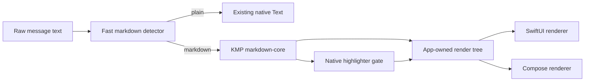

# Native Rendered Markdown

## Summary

Replace the Rendered Markdown WebView island with a native rendering path:
shared markdown parsing and render-tree contracts, SwiftUI rendering on iOS, and
Compose rendering on Android. The first shipped slice is Session Chat markdown,
code, tables, and fenced diff display; a dedicated session diff viewer remains a
later feature.

This document is the source-of-truth plan.

## Goals

- Preserve the product/design-system term **Rendered Markdown**.
- Keep surrounding screens, chat rows, controls, and state native.
- Remove WebView runtime cost, bridge ownership, and height feedback loops.
- Render markdown-shaped message text natively when markdown markers exist.
- Keep plain text with no markdown markers on the existing native text path.
- Use original raw message text for copy, restore, and resend.

## In Scope

- Paragraphs, headings, emphasis, strong, links, lists, blockquotes, inline code,
  fenced code, tables, thematic breaks, and fenced `diff`.
- `assistantMessage`, `outgoingMessage`, and `standalone` variants.
- Native horizontal scrolling for code, diff, and table overflow.
- Link taps owned by native code and limited to `http`/`https`.
- Shared KMP render-tree model for Android and the iOS integration boundary.
- Native semantic fallback highlighting through a bounded single-pass scanner
  while the TextMate/Oniguruma feasibility gate remains open.

## Out Of Scope

- React Native, Compose Multiplatform UI, WebView, Shiki JS runtime, or generic
  browser behavior.
- Remote image loading.
- Full session diff viewer.
- Per-code-block copy controls.
- Editing markdown or code.

## Architecture

The shared module lives at `shared/markdown-core`. It defines `MarkdownDocument`,
`MarkdownBlock`, `MarkdownInline`, code spans, diff lines, diagnostics, and a
versioned JSON boundary. Android consumes the typed KMP API. iOS builds
`OpenCodeMarkdownCore` through Xcode and decodes `parseMarkdownJson` into native
Swift render structs before SwiftUI rendering.

## Rendering Policy

- Plain messages without markdown markers stay on native text.
- Inline markdown, links, lists, headings, tables, code fences, and diff fences
  use `OpenCodeRenderedMarkdown`.
- Raw HTML is not interpreted.
- Images render as alt text labels and are not fetched.
- Link destinations are opened only when the scheme is `http` or `https`.
- Streaming keeps the last visible native layout while newer content is parsed.

## Highlighter Gate

The target is Shiki-level breadth: TextMate JSON grammars, VS Code/Shiki-style
grammar metadata, and an Oniguruma-compatible regex backend bundled locally.

Milestone 0 must prove Kotlin, Swift, TypeScript, JavaScript, JSON, Markdown,
Shell, YAML, CSS, HTML, Python, Rust, Go, and diff highlighting on Android and
iOS against checked-in Shiki golden fixtures. The top-language pack extends
bundled TextMate coverage to Java, C#, C/C++, Ruby, PHP, SQL, TOML, XML, Scala,
Lua, Docker, Vue, Svelte, GraphQL, PowerShell, Perl, Haskell, Elixir, Erlang, R,
Zig, Make (`makefile` alias), Dart, MATLAB, Groovy, Objective-C, Clojure,
CoffeeScript, Fortran free/fixed form, Pascal, Visual Basic, Assembly, COBOL,
Julia, SAS, ABAP, Apex, Crystal, F#, AWK, Nim, Ada, Prolog, Smalltalk, OCaml,
and Common Lisp with smoke fixtures and manifest/alias coverage. Scratch is a
recognized plain-code fallback because Shiki 4.2.0 does not bundle a Scratch
grammar. Until full Shiki parity lands, native semantic fallback highlighting is
allowed only as an implementation scaffold and must emit/record a
`HighlighterFallback` diagnostic in the shared render tree.

Follow-up `OPE-29` tracks a stronger oracle-parity pass: generate trusted Shiki
or `vscode-textmate` fixtures for representative fenced code snippets, compare
the shared KMP highlighter spans against those fixtures, add CommonMark-capable
parser oracle fixtures for supported markdown constructs, and then decide
whether to keep the handwritten parser behind differential tests or migrate
render-tree construction to `jetbrains.markdown`.

The selected target is described in the
[TextMate Pipeline Architecture Proposal](./textmate-pipeline-architecture-proposal.md):
keep publication generation in the existing display pipeline and place bounded,
asynchronous block highlighting behind one reusable, single-owner engine
interface. The architecture choices are locked: Phase 1 may begin, while Phase
2 requires deterministic fence identity, exact-source validation, pure span
attachment, and an asynchronous platform-to-KMP seam. The six-phase execution
sequence is tracked separately in the
[TextMate Pipeline Improvement Plan](./textmate-pipeline-improvement-plan.md).

## Implementation Milestones

1. Native runtime replacement:
   - add `shared/markdown-core`;
   - remove WebView wrappers and static HTML resources;
   - render markdown blocks natively on Android and iOS;
   - update detectors so inline markdown uses Rendered Markdown.
2. KMP iOS boundary:
   - import `OpenCodeMarkdownCore` from Swift;
   - decode `parseMarkdownJson` into Swift render structs;
   - remove the interim Swift-only parser.
   - Status: done.
3. TextMate feasibility:
   - choose/fork the TextMate tokenizer;
   - add local grammar manifest generation. **Done for the Milestone 0
     language set.**
   - bundle local TextMate grammar JSON payloads. **Done for the Milestone 0
     language set.**
   - add shared grammar bundle loading and manifest/resource consistency tests.
     **Done.**
   - add typed TextMate grammar decoding and Android resource packaging tests.
     **Done for the Milestone 0 grammar payloads.**
   - add a shared syntax highlighter pipeline and tokenizer interface. **Done.**
   - add an injectable tokenizer scaffold for includes, `match` rules,
     `begin`/`end` rules, captures, and nested patterns. **Done.**
   - add line-state scaffolding and backend fallback diagnostics. **Done.**
   - add `begin` capture substitution in `end` patterns. **Done.**
   - add `while` rule continuation state. **Done.**
   - add repository pattern container expansion and external scope includes
     through the loaded grammar bundle. **Done.**
   - add nested capture-pattern tokenization. **Done.**
   - preserve parent match-rule scopes around capture holes. **Done, including
     bundled diff grammar inserted/deleted content coverage on Android/Joni.**
   - scan begin/end rule content by comparing child rules with the active end
     pattern so nested delimiters can be consumed before outer zero-width end
     lookaheads. **Done.**
   - add `applyEndPatternLast` ordering. **Done.**
   - add basic TextMate injection selector support. **Done.**
   - add Android/JVM Oniguruma-compatible backend. **Done with Joni.**
   - wire Android runtime to bundled grammar resources and the TextMate/Joni
     highlighter path. **Done.**
   - add bundled grammar resource reader for iOS. **Done through app-bundle
     resource copy and `iosMain` bundle lookup.**
   - add native Oniguruma backend for iOS; **planned in
     `docs/features/ios-oniguruma-backend/plan.md`.**
   - complete full TextMate rule state, injections, embedded grammars, and
     incremental reuse;
   - add Shiki golden token tests. **Fixture coverage is active for Milestone 0
     plus the top-language pack; Android/Joni `diff`, `json`, `yaml`, `css`, and
     `html` parity are active; `java-basic` regression and per-language smoke
     tests are active; Scratch is the explicit plain fallback; the full native
     comparison is present and ignored until the engine exists.**
   - add oracle-driven highlighter and parser parity coverage for high-risk
     snippets and supported markdown constructs. **Planned in OPE-29.**
4. Chat polish:
   - tune outgoing collapse/expand thresholds;
   - verify streaming parse debounce;
   - confirm follow-latest never pulls the user down after manual scroll.

## Test Plan

- Shared KMP tests for block parsing, inline parsing, safety behavior, tables,
  code, diff, JSON schema, highlighter diagnostics, and large snippets.
- Android detector tests, renderer compile checks, link handling, copy/restore
  raw text behavior, and Session Chat scrolling manual checks.
- iOS detector tests, Swift renderer build checks, link handling, copy/restore
  raw text behavior, and Session Chat scrolling manual checks.
- Manual light/dark review in both component galleries.

## Acceptance Criteria

- No `WebView`, `WKWebView`, JavaScript bridge, or rendered-markdown HTML asset
  remains in the app runtime.
- Android and iOS render the same safe markdown subset with the same variants.
- Plain text remains native.
- Code, diff, and tables overflow horizontally instead of resizing chat rows.
- The TextMate highlighter gap is visible in docs and diagnostics until closed.
