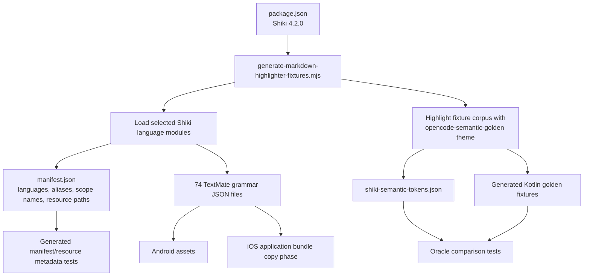
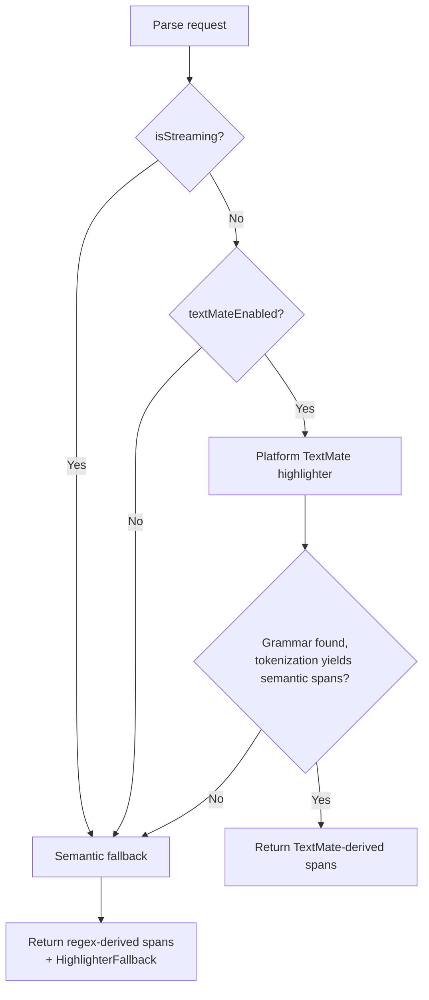
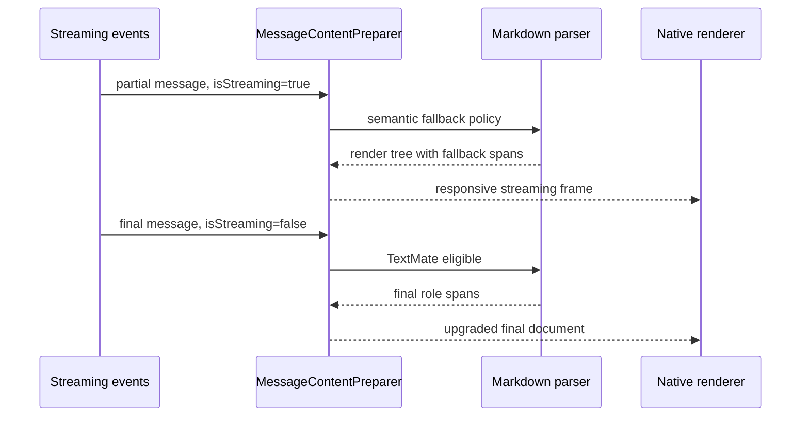
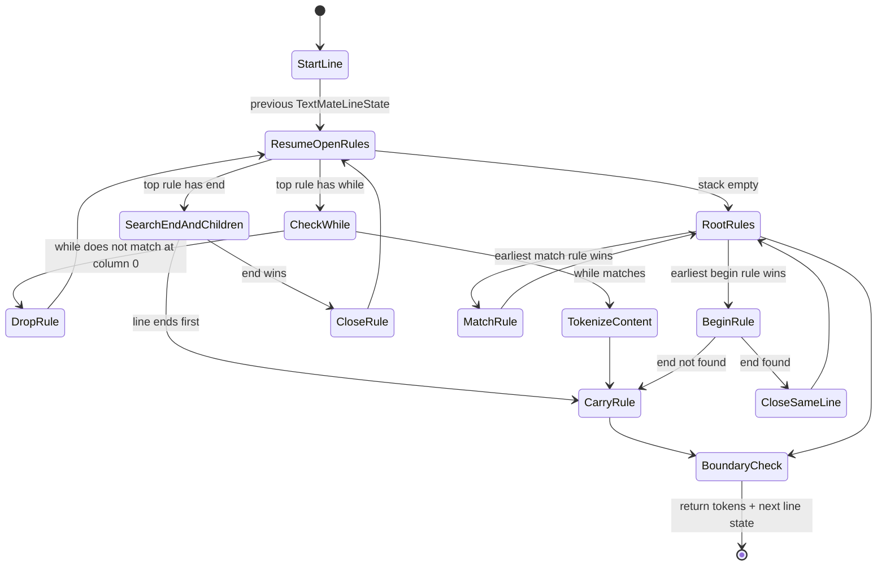
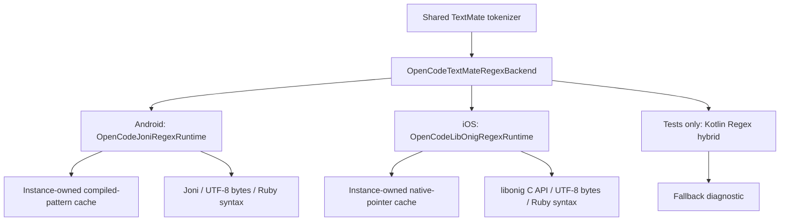
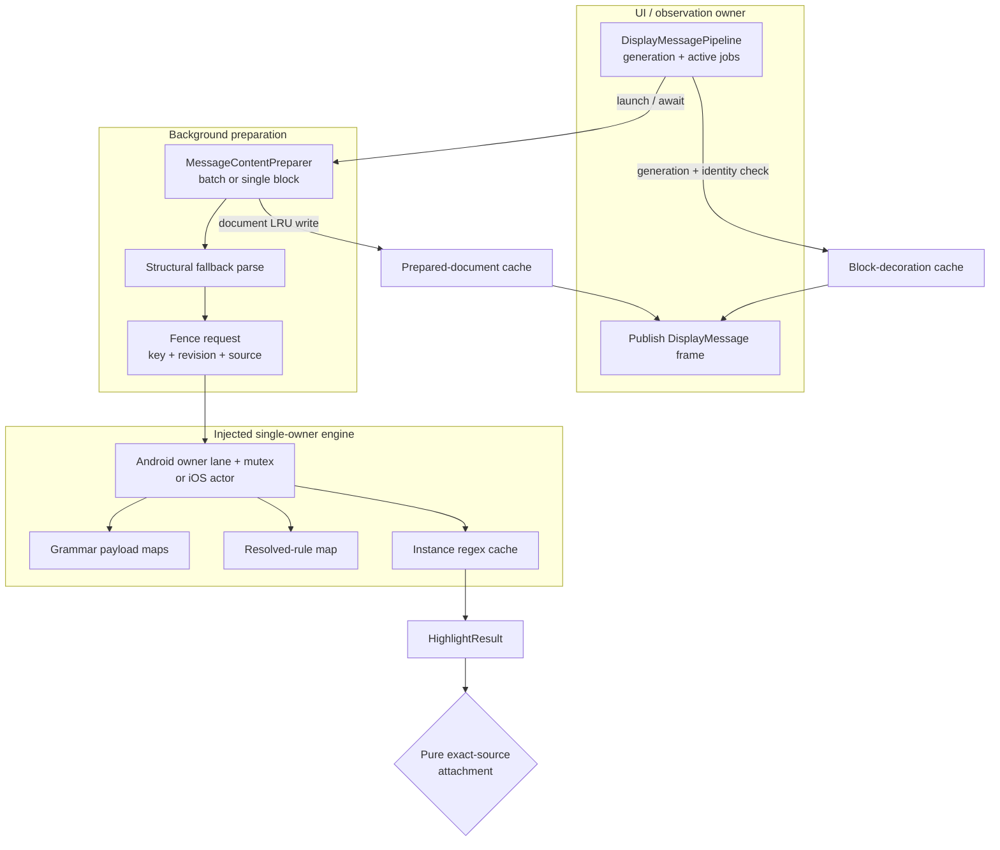
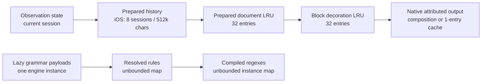
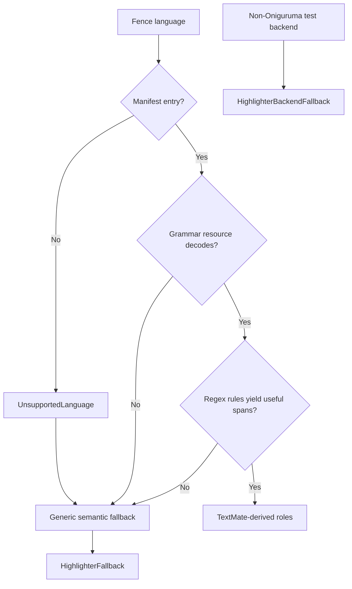
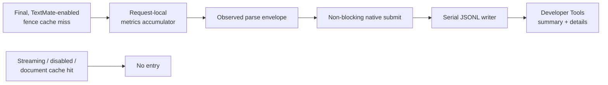

# TextMate Markdown Highlighter Architecture Report

**Date:** 2026-07-29
**Implementation status:** Phases 1–5 closed; Phase 6 next
**Scope:** fenced code blocks in opencode-mobile's native Rendered Markdown path
**Evidence:** current repository source and tests, TextMate's grammar manual,
Shiki documentation, and `vscode-textmate` source

## Executive summary

opencode-mobile does not embed Shiki, JavaScript, a browser, or
`vscode-textmate` at runtime. It uses Shiki only at development time to produce
two pinned inputs:

1. a bundle of TextMate grammar JSON resources; and
2. semantic golden fixtures used as an oracle.

At runtime, a custom Kotlin Multiplatform interpreter,
`OpenCodeTextMateNativeTokenizer`, executes those grammars. Android supplies the
Joni Oniguruma implementation; iOS links native libonig. The tokenizer emits
full TextMate scope stacks, but the app immediately compresses them into 18
app-owned `CodeTokenRole` values. Compose and SwiftUI then map those roles to
native theme colors.

The architecture is therefore:

> **Shiki-derived grammar data + custom TextMate interpreter + native semantic
> theme**, not "Shiki on mobile."

The design has three deliberate product boundaries:

- TextMate highlighting is opt-in and disabled by default.
- streaming messages use a cheaper regex-based semantic fallback and upgrade
  after finalization;
- full Shiki theme fidelity is not carried into the render tree.

The strongest current correctness claim is narrow but concrete: the ten
`*-basic` language fixtures for JavaScript, TypeScript, Python, Kotlin, Swift,
JSON, YAML, Shell, Rust, and Go match the Shiki semantic oracle on Android/Joni
and iOS/libonig. The broad generated corpus remains behind an ignored test, and
some languages still depend on post-tokenization repairs or smoke coverage.

Thread and memory ownership are now symmetric at the engine boundary. Both
platforms structurally parse a complete semantic-fallback document, then send
individual finalized fences through one injected asynchronous
`TextMateHighlightingEngine`. Android owns a lazy KMP/Joni instance on one
dispatcher lane behind a mutex; iOS owns a lazy KMP/libonig instance behind a
Swift actor. Joni and libonig compiled-pattern caches are instance state rather
than process-global or thread-local production state. Prepared documents and
block decorations remain 32-entry LRUs, while weighted grammar/rule/regex
budgets and trim policy remain Phase 4 work.

A developer-only TextMate logbook now makes real finalized fence attempts
inspectable across launches. Each engine result emits a content-free,
request-scoped observation; native bounded JSONL stores persist it off the UI
thread, and Developer Tools shows outcomes, sizes, spans, total latency, and
aggregate stage timings. It is diagnostic evidence, not a scheduler or budget
enforcement mechanism.

## Current snapshot

| Area | Current implementation |
| --- | --- |
| Markdown entry point | Shared structural KMP parser followed by injected fence-level engine |
| Runtime tokenizer | Custom `OpenCodeTextMateNativeTokenizer` |
| Android regex backend | Joni 2.2.7, Oniguruma-compatible |
| iOS regex backend | libonig 6.9.9 through Kotlin/Native C interop |
| Grammar source | Shiki 4.2.0 language modules |
| Bundled coverage | 62 language entries, 74 grammar JSON resources, about 4.8 MiB |
| Token output | `TextMateScopeToken(start, end, scopes)` |
| App render contract | 18 `CodeTokenRole` values |
| TextMate default | Disabled |
| Streaming policy | Semantic fallback; final frame is eligible for TextMate |
| Exact semantic oracle | Top-10 `*-basic` fixtures on Android and iOS |
| Broad oracle | Present but ignored |
| Incremental reuse | State is carried between lines inside one parse; not reused between message revisions |
| Preparation threads | Android `Dispatchers.Default`; iOS detached user-initiated tasks |
| Highlighter ownership | One lazy instance-owned KMP runtime: Android owner lane + mutex; iOS Swift actor |
| Bounded document caches | 32 prepared documents + 32 block decorations per platform |
| Compiled regex lifetime | Instance-owned Joni map; instance-owned libonig pointer map with allocation/free accounting |
| Persisted diagnostics | Developer-only native JSONL logbook; newest 500 actual finalized fence attempts |

## 1. End-to-end runtime pipeline

```mermaid
flowchart LR
    A["Markdown message"] --> B["MessageContentPreparer<br/>background worker + 32-entry LRU"]
    B --> C["Structural KMP parse<br/>complete semantic fallback"]
    C --> D{"TextMate enabled<br/>and finalized?"}
    D -->|No| O["Publish fallback document"]
    D -->|Yes| E["Deterministic fence locator<br/>key + revision + exact source"]
    E --> F["Injected TextMateHighlightingEngine"]
    F --> G["Single-owned KMP runtime"]
    G --> H["Grammar lookup + lazy decode"]
    H --> I["OpenCodeTextMateNativeTokenizer"]
    I --> J["Instance-owned Joni/libonig backend"]
    J --> K["Scope mapper + repairs"]
    K --> L["HighlightResult"]
    L --> M{"Pure identity +<br/>exact-source attachment"}
    M -->|current| N["Decorated MarkdownDocument"]
    M -->|stale/failed| O
    N --> P["Outer generation gate + publish"]
    O --> P
    P --> Q["Compose / SwiftUI native painting"]
```



The pipeline crosses four architectural boundaries:

1. **message preparation** decides when work may run and whether a cached
   document is reusable;
2. **Markdown projection** finds a fence and assigns deterministic identity;
3. **syntax analysis** resolves a grammar, executes TextMate rules, and maps
   scopes to semantic roles;
4. **native painting** applies platform theme colors to the semantic ranges.

Keeping these boundaries separate is valuable: the highlighter knows nothing
about chat rows, and native views know nothing about TextMate scopes or regex
engines.

## 2. Build-time grammar and oracle supply chain

The runtime inputs are generated by
[`scripts/generate-markdown-highlighter-fixtures.mjs`](../../../scripts/generate-markdown-highlighter-fixtures.mjs).
The checked-in script imports Shiki's bundled languages, constructs a synthetic
theme with one unique color per `CodeTokenRole`, highlights representative
fixtures, and exports both grammar data and expected semantic ranges.



The command is:

```text
npm run markdown:highlighter:golden
```

The generator removes and rewrites the grammar resource directory before
writing:

- [`manifest.json`](../../../shared/markdown-core/src/commonMain/resources/textmate-grammars/manifest.json);
- `textmate-grammars/grammars/*.json`;
- the JSON semantic golden corpus;
- generated Kotlin fixture metadata for goldens, manifest entries, and grammar
  resources.

### Why the synthetic theme works

Shiki is based on TextMate grammars and themes. In the generator, each semantic
role is assigned a distinct artificial color. `codeToTokens` returns Shiki's
themed tokens; the generator reverses the color assignment to recover the
expected role. This compares mobile against Shiki at the app's **semantic role
boundary**, not at full theme-color or full scope-stack fidelity.

Shiki itself describes its engine as TextMate grammar and theme based
([Shiki introduction](https://shiki.style/guide/)). Its guidance also recommends
reusing expensive highlighter instances and choosing fine-grained bundles for
resource-constrained environments
([Shiki performance guide](https://shiki.style/guide/best-performance)).
opencode-mobile follows the reuse principle but takes a different runtime
approach: it checks in the needed grammar data and executes it without Shiki.

## 3. Markdown fence detection and dispatch

[`OpenCodeMarkdownParser.parseFence`](../../../shared/markdown-core/src/commonMain/kotlin/dev/opencode/mobile/markdown/OpenCodeMarkdown.kt)
does the following:

1. matches a backtick or tilde fence;
2. extracts the first word after the opening marker;
3. lowercases it;
4. collects lines until the first valid closing marker;
5. joins the code with `\n`;
6. calls the selected `OpenCodeCodeHighlighter`;
7. places returned ranges into a `MarkdownBlock.CodeBlock`.

Unknown labels produce `UnsupportedLanguage`, while the fallback highlighter
also emits `HighlighterFallback`.

### Diff is a separate projection

`diff` and `patch` fences do not use the generic semantic spans in the final
render tree. The parser classifies each line as added, deleted, header, or
context and gives the whole line one diff role. It currently calls the generic
highlighter before making that choice, keeps its diagnostics, and discards its
spans. This is functionally correct for the current diff UI but does unnecessary
highlighting work when TextMate is enabled.

## 4. Runtime policy: TextMate, streaming, and fallback

The highlighter selector is intentionally simple:



Both platform preference stores default `textMateEnabled` to `false`. The
preference is persisted and has an epoch. Changing it clears the preparer's
document cache, and the epoch prevents already prepared documents from being
settle-reused under a different highlighting policy.

While streaming:

- TextMate is bypassed before the mutable tokenizer is reached;
- messages of 8,000 or more characters can remain entirely plain until the
  final parse;
- code fences of 2,000 or more characters can keep prepared spans but paint
  plain text for the streaming frame;
- a final placeholder may temporarily retain streaming fallback spans;
- `awaitingTextMateUpgrade` prevents final preparation from treating that
  placeholder as the finished document.

This turns highlighting into a two-quality pipeline:



## 5. Grammar registry and lazy loading

`TextMateGrammarManifest` indexes canonical language names and aliases.
`entryFor` trims and lowercases the label, then checks the canonical map followed
by the alias map.

`TextMateGrammarBundle` separates **descriptors** from **loaded payloads**:

- descriptors come from the manifest;
- payloads contain the original JSON plus a typed `TextMateGrammar`;
- primary lookup loads only the grammars required by a requested language;
- external scope includes can load another grammar through
  `grammarForScope(scopeName)`;
- failed resource paths are remembered so repeated lookups do not repeat the
  same failed load.

Primary selection prefers a grammar descriptor whose name or aliases match the
requested/canonical language. This matters for manifest entries that also list
embedded dependency grammars.

The typed model supports the subset used by the custom interpreter:

- `match`;
- `begin` / `end`;
- `while`;
- `name` and `contentName`;
- all capture maps;
- nested `patterns`;
- grammar and pattern repositories;
- `$self`, `$base`, `#repository`, and external-scope includes;
- grammar-local injections;
- `applyEndPatternLast`;
- embedded-language metadata.

The decoder normalizes alternate JSON shapes that occur in real grammar
packages, including capture arrays and shorthand capture strings.

TextMate's official manual defines the same core rule model and explains that
regexes are applied one line at a time; multi-line constructs are expressed by
carrying `begin`/`end` state
([TextMate language grammars](https://macromates.com/manual/en/language_grammars)).

## 6. The custom tokenizer

The core implementation is
[`OpenCodeTextMateNativeTokenizer`](../../../shared/markdown-core/src/commonMain/kotlin/dev/opencode/mobile/markdown/OpenCodeTextMateTokenizer.kt).
It is an interpreter for grammar rules, not a wrapper around Microsoft's
tokenizer.

### 6.1 Line-oriented state machine



`tokenizeLines` splits the fence into physical lines. Each call to
`tokenizeLine` receives the previous `TextMateLineState`, which is a stack of
`TextMateOpenRule` values. An open rule retains:

- the grammar and pattern;
- resolved dynamic `end` or `while` pattern;
- rule and content scope stacks;
- include-resolution context.

This is the mobile equivalent of passing `ruleStack` from one
`vscode-textmate.tokenizeLine` call to the next. Microsoft's public contract
requires exactly that
([`vscode-textmate` API](https://github.com/microsoft/vscode-textmate/blob/b63b5949500dad97a8bbd41edfc81e2fdd28a3cd/src/main.ts#L219-L301)).

### 6.2 Rule resolution

For the current scope context, `resolveRules`:

1. expands includes recursively;
2. prevents include cycles;
3. flattens pattern containers;
4. adds matching left-priority injections;
5. adds normal rules;
6. adds matching right-priority injections;
7. caches the resulting ordered rules.

At a cursor, every candidate asks the regex backend for its next match. The
tokenizer chooses the earliest start, breaking ties by grammar order. Inside a
`begin`/`end` region, the active end pattern competes with child rules;
`applyEndPatternLast` decides ties.

Injection selectors support a deliberately limited subset: `L:`/`R:` priority,
positive space-separated scope terms, wildcard scope segments, and
comma-separated exclusions.

### 6.3 Captures and scope coverage

For `match`, `begin`, `end`, and `while` captures, a numeric capture can:

- append a scope name to its exact range; or
- recursively tokenize that capture with nested patterns.

After nested tokens are emitted, `scopedHoles` fills uncovered portions with
the parent scope. This is essential: punctuation captures must not cause the
rest of a string, diff line, or declaration to lose its enclosing semantic
scope.

Capture recursion is capped at 48 levels to avoid `$self`-style grammar loops
overflowing the stack.

### 6.4 Dynamic ends and line boundaries

The tokenizer resolves back-references such as `\1` in `end` and `while`
patterns from the `begin` match. This supports constructs such as here-docs,
matching HTML tags, and grammar-defined fences.

Each line is tokenized without its newline, so the implementation supplies a
boundary suffix containing `\n` and the next line. This lets zero-width
end-of-line rules observe the physical boundary without consuming text from the
next line.

### 6.5 Output normalization

Raw tokens are:

- clamped to valid code ranges;
- sorted by start/end;
- merged when adjacent tokens have identical scope stacks.

Offsets are absolute within the complete fence body.

## 7. Regex abstraction and platform backends

The tokenizer depends on a small `OpenCodeTextMateRegexBackend` interface:
find the next match in a range and return capture ranges. This is the principal
platform seam.



### Shared compatibility helpers

Both production backends apply the same compatibility layer:

- two known variable-width negative-lookbehind shapes are rewritten into
  fixed-width assertions;
- TextMate's contiguous `\G` semantics are enforced explicitly;
- a top-level alternation can be decomposed if the combined regex fails to
  compile;
- failed patterns are cached;
- `Utf8IndexMap` converts Oniguruma byte ranges back to Kotlin `String`
  UTF-16 indices, including surrogate pairs.

### Android

`OpenCodeJoniRegexRuntime` uses Joni with UTF-8 encoding, Ruby syntax,
multiline mode, and capture groups. Its compiled-pattern cache is a
per-engine `ConcurrentHashMap`. Compilation is serialized because Joni prints large
numbers of grammar warnings to `System.err`; the backend temporarily swaps in a
no-op stream during compilation.

The Android adapter lazily constructs the highlighter from app assets through
`OpenCodeBundledJoniMarkdownHighlighter` on its single owner lane.

### iOS

`OpenCodeLibOnigRegexRuntime` calls libonig through Kotlin/Native C interop with
the same UTF-8, Ruby, multiline, and capture-group configuration. Compiled regex
pointers are stored in the actor-owned runtime instance.

The module pins Oniguruma 6.9.9. A Gradle task builds static archives for device,
Apple Silicon simulator, and x86_64 simulator. On a clean machine the build
script downloads the pinned source if the ignored source tree is absent.

The Xcode build phase:

1. builds and embeds `OpenCodeMarkdownCore`;
2. copies the checked-in `textmate-grammars` directory into the app bundle.

The iOS platform provider searches the main bundle, loaded bundles, and
framework bundles for each resource.

### Why Oniguruma compatibility matters

TextMate grammars use the Oniguruma dialect, and `vscode-textmate` also receives
an Oniguruma implementation through a small scanner/string interface
([`vscode-textmate` README](https://github.com/microsoft/vscode-textmate/blob/b63b5949500dad97a8bbd41edfc81e2fdd28a3cd/README.md)).
The old Kotlin `Regex` hybrid cannot execute every grammar expression and
therefore emits `HighlighterBackendFallback`; it remains only for regression
comparison.

## 8. Scope stacks become app semantic roles

TextMate tokens carry ordered scope stacks such as:

```text
source.js
meta.function.js
entity.name.function.js
```

`OpenCodeTextMateScopeMapper` inspects scopes from innermost to outermost and
selects the first matching role. Special handling covers shebangs and string
delimiter scopes. The primary mappings are:

| TextMate scope family | App role |
| --- | --- |
| `comment` | `Comment` |
| `string` | `String` |
| `constant.numeric` | `Number` |
| other language/character constants | `Constant` |
| `keyword.operator`, operator storage | `Operator` |
| other `keyword` / `storage` | `Keyword` |
| property scopes | `Property` |
| class/type/support type scopes | `Type` |
| function scopes | `Function` |
| tag and attribute scopes | `Tag`, `Attribute` |
| `variable` | `Variable` |
| punctuation / braces | `Punctuation` |
| inserted/deleted/changed/invalid | diff and error roles |

Plain scopes are discarded from the span list; native base text color supplies
their appearance.

### Post-tokenization repair pipeline

The initial role spans are not returned directly. `OpenCodeSyntaxHighlighter`
then:

1. partitions overlaps into non-overlapping ranges;
2. consolidates split identifier fragments;
3. repairs JavaScript/TypeScript private fields;
4. applies remaining web-role normalization;
5. applies Java-specific normalization;
6. lexically enhances C/C++;
7. lexically enhances PHP;
8. partitions and consolidates again;
9. merges adjacent compatible roles;
10. repairs Python triple-quoted strings.

This layer is useful but architecturally significant: some visible correctness
comes from language-specific heuristics after TextMate, not solely from grammar
interpretation. C/C++ and PHP enhancements are broader lexical overlays; the
retained JavaScript and Python passes cover focused regressions.

If a grammar exists but the completed pipeline yields no semantic spans,
`OpenCodeSyntaxHighlighter` falls back to the regex semantic highlighter.

## 9. Native render-tree and painting boundary

The shared wire contract contains only:

```text
CodeSpan(start, end, CodeTokenRole)
```

It does not expose:

- the source grammar;
- the raw TextMate scope stack;
- Shiki theme colors;
- font style or font weight;
- embedded-language identifiers.

This is an intentional lossy boundary. It keeps native theme APIs small and
stable, but it prevents exact reproduction of arbitrary Shiki themes without a
future render-tree/schema change.

### Android

Android consumes the typed KMP `MarkdownDocument`. `buildCodeAnnotatedString`
appends the complete code once, clamps every span, and applies Compose
`SpanStyle` colors. Roles map to semantic design tokens such as
`syntax-keyword`, `syntax-variable`, `syntax-operator`, and
`syntax-punctuation`.

### iOS

iOS encodes a parse request, calls the KMP JSON bridge, and decodes a native
mirror of the render tree. Code spans are UTF-16 offsets, matching Kotlin
`String` indices and `NSRange`. The renderer can build attributed code through
SwiftUI or UIKit; the UIKit route allows large attributed strings to be built
off the main actor.

Both platforms render fenced code in horizontally scrolling, non-wrapping,
monospaced native views.

## 10. Thread and memory management

Thread management here means more than "run parsing in the background." The
system coordinates outer observation jobs, an asynchronous fence engine, one
mutable runtime owner, native regex allocations, and UI publication. Memory
management still spans several cache layers, but grammar/tokenizer/regex
mutation now has one instance owner on each platform.

### 10.1 Execution and publication ownership



The pipeline owns **publication correctness**:

- every observation has a monotonically increasing generation;
- debounce, prepare, decoration, and enrichment jobs/tasks are cancelled when
  a newer authoritative snapshot invalidates them;
- cancellation is advisory, so results are checked against the current
  generation before publication;
- streaming decoration also checks block identity—session, block ID, text
  hash, length, and streaming state—before mutating the block-decoration cache.

One distinction matters: `MessageContentPreparer` writes its 32-entry document
LRU before the outer pipeline can perform its generation check. A cancelled but
already-running parse can therefore populate that LRU. The entry is content-
revision and exact-source keyed, so this is bounded memory churn rather than
stale UI publication. The block-decoration cache has the stronger rule:
generation and identity are checked before its write.

### 10.2 Platform thread model

| Stage | Android | iOS |
| --- | --- | --- |
| Observation owner | `channelFlow` child jobs hold observation-local generation and prepared state | `@MainActor DisplayMessagePipeline` owns generation, tasks, prepared history, and publication |
| Preparation hop | `withContext(Dispatchers.Default)` | `Task.detached(priority: .userInitiated)` |
| Batch behavior | One worker context processes messages sequentially | One detached task processes a batch sequentially |
| UI publication | Flow send after generation check | Main-actor `AsyncStream` yield after generation check |
| Document-cache synchronization | `synchronized(cacheLock)` | `NSLock` inside an `@unchecked Sendable` cache |
| TextMate synchronization | Injected lazy engine on one dispatcher lane plus mutex | Injected lazy KMP engine behind one Swift actor |
| Regex-cache synchronization | Instance-owned map, reached only on the owner lane; compilation also guards temporary `System.err` redirection | Instance-owned mutable map, reached only through the actor |
| Renderer work | Compose `remember`; large annotations may be built on `Dispatchers.Default` | UIKit-backed large annotation construction can run off main actor |

Final and history preparation jobs may run concurrently outside the engine.
Streaming uses the stateless semantic fallback and does not wait for TextMate.
The adapter creates grammar, tokenizer, resolved-rule, and regex state lazily
on its owner and serializes every engine call. The Phase 2 first-use tests cover
24 concurrent Android requests and parallel iOS requests without overlapping
runtime mutation or losing source.

### 10.3 Cache hierarchy, bounds, and lifetime



| Memory owner | Key / contents | Bound | Lifetime and clearing |
| --- | --- | --- | --- |
| Observation-local prepared state | message ID → `DisplayMessage` | Current session size | Released when observation ends; replaced or merged by preparation mode |
| iOS prepared-history cache | profile + directory + session → prepared messages | 8 sessions and 512,000 source characters | Main-actor LRU; cleared on session deletion, explicit reset, or iOS memory warning |
| Prepared-document cache | session + block + hash + length + exact source + streaming + TextMate flag + policy epoch → parsed document | 32 entries on each platform | Application preparer lifetime; explicit settings/profile reset |
| Block-decoration cache | session + block + revision + streaming → parsed block document | 32 entries on each platform | Shared application lifetime; cleared on reset and selected pipeline/timeline transitions |
| Grammar payload cache | resource path → decoded JSON object and typed grammar | No explicit eviction; physically limited by the 74-resource bundle | Engine-instance lifetime |
| Failed grammar set and diagnostics | resource paths and diagnostic objects | No explicit eviction; limited by attempted bundled resources | Engine-instance lifetime |
| Resolved-rule cache | grammar scope + pattern signature + include/base-scope context → flattened rules | No explicit bound or clearing | Engine-instance lifetime; data-dependent key count |
| Android regex cache | normalized pattern → compiled, decomposed, or failed entry | No explicit bound | Engine-instance lifetime; failed patterns are retained too |
| iOS regex cache | same logical entries, containing native `OnigRegexType*` pointers | No explicit bound | Actor-owned engine-instance lifetime; explicit clear exists for the runtime |
| Android painted code | code + spans + colors in Compose `remember` | Composition-scoped | Released with the relevant composition/key change |
| iOS painted code | code + spans → `AttributedString` | One global entry | Process lifetime until replaced; protected by `NSLock` |

The 32-entry LRUs are entry-count bounded, not byte- or character-weighted. One
large document can contain the complete source, render-tree objects, and many
span lists, so 32 entries is not a predictable memory ceiling. The iOS
prepared-history cache uses source-character count as a proxy but does not
measure retained render-tree, span, dictionary, or attributed-string cost.

The prepared-document key retains hash and length for cheap identity evidence
but now also compares the exact source and policy epoch. Hash collision alone
cannot return a document for different text.

### 10.4 Native regex ownership

Android compiled `Regex` objects are JVM-managed. The engine instance retains
them while it lives, and the runtime owns their eventual memory.

iOS is different:

- successful `onig_new` results are raw native pointers stored in the
  actor-owned runtime map;
- match regions are correctly paired with `onig_region_free`;
- cache clear pairs every retained compiled pointer with `onig_free`;
- successful alternation-decomposition probes are freed immediately; and
- Phase 1 allocation/free counters and the 30-minute simulator soak verify
  stable live ownership for the accepted fixture.

Phase 3 still needs to connect memory-pressure trim requests to the engine, and
Phase 4 needs weighted admission/eviction. The native pointers themselves are
no longer ownerless or duplicated per worker thread.

### 10.5 Allocation behavior inside one fence

The hot path creates more transient memory than the cache diagram suggests:

1. `tokenizeLines` creates current-line and look-ahead substrings;
2. every Joni/libonig `search` constructs a new `Utf8IndexMap`, which allocates
   UTF-8 bytes plus UTF-16→UTF-8 and UTF-8→UTF-16 integer arrays;
3. TextMate scanning invokes regex search repeatedly across rules and cursor
   positions, so the same line can be encoded and indexed many times;
4. tokens, scope stacks, captures, overlap partitions, identifier repairs, and
   merged semantic spans allocate intermediate lists;
5. iOS then serializes the full render tree to JSON and decodes a Swift mirror;
6. native attributed-string construction sorts spans and builds another styled
   representation.

Reusing one UTF-8 index map per input line—or passing a prepared search buffer
through the regex interface—would remove a high-multiplicity allocation source.
The existing 8,000-character streaming cutoff and staged history policy limit
when this cost can block the user, but they do not reduce final-parse peak
memory.

### 10.6 Renderer-cache correctness

Android's painted-code cache is scoped by Compose to code, spans, and resolved
colors. iOS's single-entry `CodeAttributedCache` is lock-protected, but its key
contains only code and spans. It does not include the palette, theme/highlight
epoch, or whether the value was built through the SwiftUI or UIKit path.
Consequently, an identical block can reuse attributed colors created for a
previous palette. This is a cache-key correctness risk in addition to a memory
management concern.

### 10.7 Memory-pressure behavior

iOS observes `UIApplication.didReceiveMemoryWarningNotification`, but currently
clears only `PreparedHistoryCache`. The 32-entry document cache, block
decorations, grammar payloads, resolved rules, actor-owned native regex
pointers, and one-entry attributed cache remain resident. Android exposes
explicit document/block cache clearing through settings and some lifecycle
paths, but this highlighter slice has no trim-memory policy for grammar,
tokenizer, or regex caches.

### 10.8 Incrementality boundary

The tokenizer carries rule state from one line to the next during one fence
parse. It does not persist line states between successive streaming revisions
or final reparses. Each eligible final code block is tokenized from the
beginning. This differs from editor-oriented incremental TextMate use, where
saved rule stacks allow retokenization from an affected line.

## 11. Failure and diagnostic behavior



### What is visible

- unknown language: `UnsupportedLanguage` plus fallback;
- semantic fallback: `HighlighterFallback`;
- non-Oniguruma backend: `HighlighterBackendFallback`;
- Swift/KMP bridge exception: a Swift-side literal-text fallback document.

### What is currently quiet

- grammar bundle load diagnostics are retained on `TextMateGrammarBundle` but
  are not promoted into `MarkdownDocument.diagnostics`;
- a regex that cannot compile is cached as failed and treated as no match,
  without recording its content-bearing pattern;
- a known language whose grammar fails to load still appears supported because
  support checks the manifest;
- partial grammar behavior can therefore degrade into generic fallback without
  identifying the missing resource or failed expression in the render tree.

### Persisted developer logbook



One entry represents one actual fence attempt, not one message render or UI
frame. It stores the timestamp, requested and canonical language, UTF-16 message
and fence character counts, fence lines and position, outcome, backend, final
span count, total measured duration, aggregate stage counts/totals/maximums,
and diagnostic kinds. Nested stage totals can overlap, so they must not be
summed to reconstruct total latency.

The journal intentionally excludes source text, app identity, session/message
or fence IDs, file paths, regex patterns, grammar payloads, and diagnostic
messages. Android and iOS each serialize writes off the UI thread, bound the
pending queue to 64 batches, retain the newest 500 entries, compact after 550
entries or 2 MiB, ignore corrupt records on read, and expose dropped-entry and
storage-error health. Clear is available on the screen and through Clear All
Data.

This keeps rendering resilient while making aggregate runtime degradation
durable and inspectable. Detailed content-bearing regex or grammar failures
remain intentionally quiet.

## 12. Correctness evidence

The test strategy has several layers:

| Layer | What it proves |
| --- | --- |
| Generator metadata tests | Manifest, aliases, grammar paths, scope names, and resource byte sizes stay synchronized |
| Grammar decoder tests | Real alternate grammar JSON shapes decode |
| Tokenizer unit tests | includes, captures, nested patterns, begin/end, while, injections, back-references, zero-width ends, and line state |
| Backend tests | named captures, `\G`, UTF-8 offsets, Oniguruma compatibility, and failed-pattern caching |
| Span invariants | final semantic spans do not overlap or duplicate ranges |
| Regression fixtures | known JavaScript, C/C++, PHP, diff, and other failures remain fixed |
| Exact semantic goldens | selected native output equals Shiki role/range output |
| Rendering tests | role spans survive the platform bridge and paint contract |

The top-10 exact fixtures pass on both production regex backends. The broad
`nativeHighlighterMatchesShikiSemanticGoldenFixtures` test is still ignored.
That ignored test also calls the parser's default highlighter path, which remains
the fallback scaffold, so its old "gate pending" comment should not be read as
evidence that Joni/libonig are absent.

## 13. Architectural strengths

1. **Native UI remains native.** There is no WebView/JavaScript island for code
   highlighting.
2. **Platform-specific regex engines sit behind one small seam.**
3. **Grammars and oracle outputs share one generator**, reducing version drift.
4. **The render tree is stable and product-owned**, rather than exposing
   generated or engine-specific types.
5. **Streaming has an explicit quality/performance policy**, rather than
   accidentally running the expensive path on every delta.
6. **Fallbacks preserve complete source text.** Highlighting failure does not
   lose or truncate a code fence.
7. **Focused oracle gates are executable claims**, not subjective screenshots.

## 14. Architectural limitations and risks

### High priority

1. **TextMate is disabled by default.** The custom engine is present but is not
   the default Session Chat experience.
2. **Broad correctness is not proven.** Sixty-two language entries represent
   bundle breadth, not exact tokenizer parity.
3. **There is no engine queue/backpressure policy yet.** Phase 2 serializes
   ownership; Phase 3 must add priority, coalescing, deadlines, and work limits.
4. **There is no tokenizer time budget or inner cancellation check.** Once a
   synchronous fence parse begins, cancellation cannot interrupt the tokenizer.
5. **Physical-device release calibration is still pending.** Simulator and host
   measurements are diagnostic and cannot establish mobile guardrails.

### Medium priority

6. **The 18-role projection is intentionally lossy.** It cannot reproduce full
   TextMate theme specificity, font styles, or embedded-language metadata.
7. **Language repair passes obscure engine fidelity.** A green visible sample
   may be partly grammar-driven and partly heuristic.
8. **Grammar and regex failures are only aggregate-observed at runtime.** The
   logbook deliberately omits content-bearing patterns and diagnostic messages.
9. **No cross-revision incremental tokenization exists.**
10. **Diff performs avoidable highlighter work before using line-level roles.**
11. **Compiled-regex and resolved-rule caches are unbounded and have no
    memory-pressure clearing contract.**
12. **A new UTF-8 index map is allocated for every regex search**, multiplying
    transient allocation by rule and cursor count.
13. **The logbook measures but does not enforce budgets or cancellation.**

### Operational

14. **The grammar bundle is about 4.8 MiB before application packaging.**
15. **A clean iOS native build can require downloading pinned Oniguruma source.**
16. **Some feature docs/comments predate libonig or the expanded grammar pack.**
    Current source and `progress.md` are more reliable than older "future
    highlighter" wording.

## 15. Recommended next steps

Phase 1 lifetime safety and Phase 2 single ownership are complete. The most
valuable remaining sequence is:

1. add Phase 3 priority, coalescing, deadlines, work limits, trim handling, and
   queue/cancellation metrics behind the existing engine interface;
2. reuse a per-line UTF-8 search buffer/index map instead of rebuilding it for
   every regex search;
3. give grammar, resolved-rule, and compiled-regex caches observable counts,
   weighted budgets, and memory-pressure clearing behavior;
4. turn the logbook evidence into explicit per-language release guardrails and
   versioned promotion decisions;
5. add aggregate grammar-load and regex-compile failure classification without
   persisting source-derived patterns or messages;
6. remove the redundant generic highlighter call for diff/patch projection;
7. introduce a per-fence time/cancellation budget before enabling TextMate by
   default;
8. promote real Session Chat samples language by language into exact oracle
   gates;
9. measure bundle size, retained cache cost, cold grammar decode, regex
   compile, allocation count, and warm tokenize costs by language;
10. decide deliberately between the current role model and a future
   scope/theme-carrying render contract before pursuing full visual Shiki
   parity.

Physical low- and mid-tier release-build latency, memory-pressure, bridge,
thermal, cancellation, and soak calibration remains mandatory in Phase 6 before
TextMate remains disabled by default. Simulator evidence closes the Phase 1
architecture/lifetime gate, and interface/ownership evidence closes Phase 2;
neither is a shipping performance claim.

## 16. File map

| Responsibility | Source |
| --- | --- |
| Markdown models, policy selector, fence parser | [`OpenCodeMarkdown.kt`](../../../shared/markdown-core/src/commonMain/kotlin/dev/opencode/mobile/markdown/OpenCodeMarkdown.kt) |
| Manifest, descriptors, scope-to-role mapper | [`OpenCodeTextMate.kt`](../../../shared/markdown-core/src/commonMain/kotlin/dev/opencode/mobile/markdown/OpenCodeTextMate.kt) |
| Typed grammar model/decoder | [`OpenCodeTextMateGrammar.kt`](../../../shared/markdown-core/src/commonMain/kotlin/dev/opencode/mobile/markdown/OpenCodeTextMateGrammar.kt) |
| Lazy grammar bundle | [`OpenCodeTextMateGrammarBundle.kt`](../../../shared/markdown-core/src/commonMain/kotlin/dev/opencode/mobile/markdown/OpenCodeTextMateGrammarBundle.kt) |
| Custom tokenizer and regex interface | [`OpenCodeTextMateTokenizer.kt`](../../../shared/markdown-core/src/commonMain/kotlin/dev/opencode/mobile/markdown/OpenCodeTextMateTokenizer.kt) |
| Scope projection and repair pipeline | [`OpenCodeSyntaxHighlighter.kt`](../../../shared/markdown-core/src/commonMain/kotlin/dev/opencode/mobile/markdown/OpenCodeSyntaxHighlighter.kt) |
| Shared engine contract, fence identity, and pure attachment | [`TextMateHighlightingEngine.kt`](../../../shared/markdown-core/src/commonMain/kotlin/dev/opencode/mobile/markdown/TextMateHighlightingEngine.kt) |
| Android Joni backend | [`OpenCodeJoniRegexBackend.kt`](../../../shared/markdown-core/src/androidMain/kotlin/dev/opencode/mobile/markdown/OpenCodeJoniRegexBackend.kt) |
| iOS libonig backend | [`OpenCodeLibOnigRegexBackend.kt`](../../../shared/markdown-core/src/iosMain/kotlin/dev/opencode/mobile/markdown/OpenCodeLibOnigRegexBackend.kt) |
| Grammar/oracle generator | [`generate-markdown-highlighter-fixtures.mjs`](../../../scripts/generate-markdown-highlighter-fixtures.mjs) |
| Android preparation/cache/threading | [`MessageContentPreparer.kt`](../../../android/app/src/main/java/dev/opencode/mobile/domain/message/MessageContentPreparer.kt) |
| iOS preparation/cache/threading | [`MessageContentPreparer.swift`](../../../ios/OpenCode%20Mobile/OpenCode%20Mobile/Domain/Message/MessageContentPreparer.swift) |
| Android engine owner adapter | [`AndroidTextMateHighlightingEngine.kt`](../../../android/app/src/main/java/dev/opencode/mobile/domain/textmate/AndroidTextMateHighlightingEngine.kt) |
| iOS engine owner adapter | [`TextMateHighlightingEngine.swift`](../../../ios/OpenCode%20Mobile/OpenCode%20Mobile/Domain/TextMate/TextMateHighlightingEngine.swift) |
| Android generation/task ownership | [`DisplayMessagePipeline.kt`](../../../android/app/src/main/java/dev/opencode/mobile/domain/message/DisplayMessagePipeline.kt) |
| iOS generation/task ownership | [`DisplayMessagePipeline.swift`](../../../ios/OpenCode%20Mobile/OpenCode%20Mobile/Domain/Message/DisplayMessagePipeline.swift) |
| Android block-decoration LRU | [`BlockDecorationCache.kt`](../../../android/app/src/main/java/dev/opencode/mobile/domain/message/BlockDecorationCache.kt) |
| iOS block-decoration LRU | [`BlockDecorationCache.swift`](../../../ios/OpenCode%20Mobile/OpenCode%20Mobile/Domain/Message/BlockDecorationCache.swift) |
| iOS prepared-history budget | [`PreparedHistoryCache.swift`](../../../ios/OpenCode%20Mobile/OpenCode%20Mobile/Domain/Message/PreparedHistoryCache.swift) |
| Shared UTF-8 index allocation | [`Utf8IndexMap.kt`](../../../shared/markdown-core/src/commonMain/kotlin/dev/opencode/mobile/markdown/Utf8IndexMap.kt) |
| Android native painting | [`OpenCodeRenderedMarkdown.kt`](../../../android/app/src/main/java/dev/opencode/mobile/ui/components/OpenCodeRenderedMarkdown.kt) |
| iOS bridge | [`OpenCodeRenderedMarkdownParser.swift`](../../../ios/OpenCode%20Mobile/OpenCode%20Mobile/UI/Markdown/OpenCodeRenderedMarkdownParser.swift) |
| iOS native painting and wire models | [`OpenCodeRenderedMarkdown.swift`](../../../ios/OpenCode%20Mobile/OpenCode%20Mobile/Components/OpenCodeRenderedMarkdown.swift) |
| Exact top-10 assertion helper | [`Top10GoldenFixtureAssertions.kt`](../../../shared/markdown-core/src/commonTest/kotlin/dev/opencode/mobile/markdown/Top10GoldenFixtureAssertions.kt) |

## 17. Primary external sources

- [TextMate Language Grammars manual](https://macromates.com/manual/en/language_grammars)
  — rule model, captures, includes, scopes, and line-oriented matching.
- [`vscode-textmate` README at reviewed commit](https://github.com/microsoft/vscode-textmate/blob/b63b5949500dad97a8bbd41edfc81e2fdd28a3cd/README.md)
  — registry, Oniguruma integration, and line-by-line rule-stack usage.
- [`vscode-textmate` public API](https://github.com/microsoft/vscode-textmate/blob/b63b5949500dad97a8bbd41edfc81e2fdd28a3cd/src/main.ts)
  — token results, state stack, embedded-language metadata, and registry loading.
- [`vscode-textmate` tokenizer core](https://github.com/microsoft/vscode-textmate/blob/b63b5949500dad97a8bbd41edfc81e2fdd28a3cd/src/grammar/tokenizeString.ts)
  — stateful rule execution, injections, captures, and time-limit behavior.
- [Shiki introduction](https://shiki.style/guide/)
  — TextMate grammar/theme architecture.
- [Shiki performance guide](https://shiki.style/guide/best-performance)
  — highlighter reuse, fine-grained bundles, and regex-engine trade-offs.
- [Oniguruma 6.9.9 API](https://github.com/kkos/oniguruma/blob/v6.9.9/doc/API)
  — `onig_new` creates regex objects and `onig_free` releases the memory used
  by them.

## Related project documentation

- [Web vs mobile highlighter](./web-vs-mobile-highlighter.md)
- [Layer 5 top-10 tokenizer sync](./tokenizer-layer5-top10-sync-plan.md)
- [Shiki visual parity paths](./shiki-visual-parity-paths-plan.md)
- [Native Rendered Markdown progress](./progress.md)
- [Native Rendered Markdown parity gaps](./parity-gaps.md)
- [Visual companion to this report](./textmate-markdown-highlighter-architecture-report.html)
