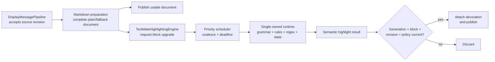
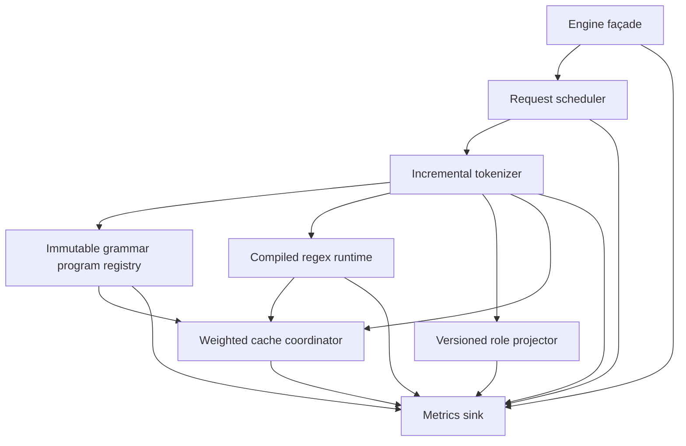
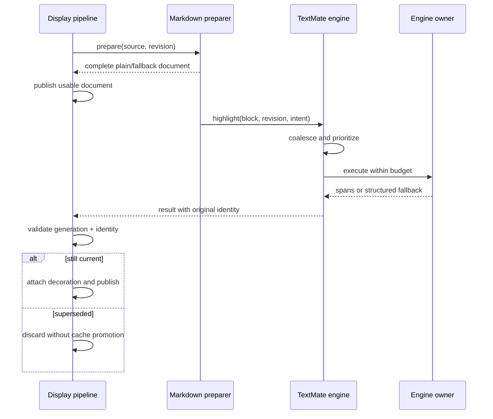
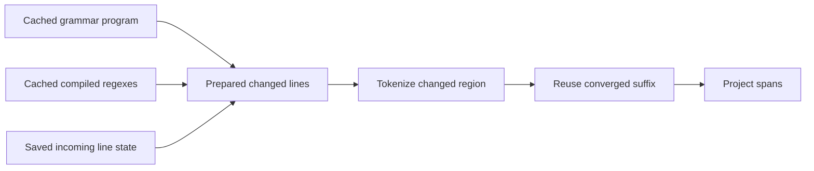

# TextMate Pipeline Architecture Proposal

**Status:** accepted target; Phases 1–4 implemented; Phase 5 next;
physical-device calibration remains in Phase 6
**Date:** 2026-07-29
**Applies to:** Android/Joni and iOS/libonig through
`shared/markdown-core`
**Implementation companion:**
[TextMate Pipeline Improvement Plan](./textmate-pipeline-improvement-plan.md)
**Current-state evidence:**
[TextMate Markdown Highlighter Architecture Report](./textmate-markdown-highlighter-architecture-report.md)

## Proposed architecture

Create one asynchronous `TextMateHighlightingEngine` in
`shared/markdown-core` that upgrades individual fenced code blocks after
structural Markdown parsing has already produced a complete plain or
semantic-fallback document.

The engine has one owner for all mutable grammar, rule, regex, incremental, and
cache state. It schedules interactive work ahead of history, coalesces obsolete
revisions, reuses compatible line state, owns native regex lifetime, enforces
memory and work budgets, and measures every expensive stage.

The existing `DisplayMessagePipeline` remains the publication authority. An
engine result can become visible only when the outer observation generation,
block identity, content revision, streaming state, and policy epoch are still
current.

This is the proposal. The current synchronous parser-owned TextMate path is not
the target architecture.

### Implemented foundation

Phase 2 now implements the proposal's deep boundary and ownership foundation:

- structural Markdown produces the complete semantic-fallback document first;
- finalized code fences enter an injected asynchronous
  `TextMateHighlightingEngine` one fence at a time;
- deterministic locators plus opaque keys, monotonic revisions, policy epochs,
  and exact source make each result independently rejectable;
- pure attachment replaces spans only after every identity check passes;
- Android owns one lazily initialized KMP/Joni runtime on an injected
  single-lane dispatcher; iOS owns one lazily initialized KMP/libonig runtime
  behind a Swift actor; and
- compiled-regex caches are instance state, not process-global or thread-local
  production state.

Priority scheduling, coalescing, deadlines, bounded queues, and trim policy are
still Phase 3. Compiled rule programs and weighted caches remain Phase 4.

## Architecture at a glance



The plain document and the decorated result are two quality levels of the same
content. Highlighting may improve presentation, but it never owns or delays the
source of truth.

## What changes

| Concern | Current direction | Proposed architecture |
| --- | --- | --- |
| TextMate entry point | synchronous work inside fenced Markdown parsing | asynchronous block upgrade behind one engine interface |
| First usable output | may depend on expensive final highlighting | complete plain/fallback document is publishable first |
| Mutable state | distributed platform preparation and caches | one engine owner per platform |
| Work ordering | determined by detached preparation timing | interactive final, visible history, background history |
| Revisions | full block re-tokenization | bounded unchanged-prefix reuse, then safe suffix convergence |
| Regex input | repeated string-to-UTF-8 index construction | one prepared UTF-8 buffer and offset map per line |
| iOS regex lifetime | raw thread-local pointers | leased executor-owned `OwnedOnigRegex` values |
| Cache policy | entry-oriented or unbounded | weighted budgets with pressure trimming |
| Cancellation | mostly outer task cancellation | inner checkpoints plus mandatory outer stale-result gate |
| Performance evidence | aggregate preparation timings | queue, grammar, compile, tokenize, repair, cache, and memory metrics |

## System boundary

The proposed public seam is intentionally small:

```kotlin
interface TextMateHighlightingEngine {
    suspend fun highlight(request: HighlightRequest): HighlightResult
    suspend fun trim(level: MemoryPressure)
}

data class HighlightRequest(
    val key: CodeBlockKey,
    val revision: HighlightRevision,
    val language: String?,
    val source: String,
    val intent: HighlightIntent,
    val policyEpoch: Long,
)

enum class HighlightIntent {
    InteractiveFinal,
    VisibleHistory,
    BackgroundHistory,
}
```

`HighlightRevision` is a caller-owned monotonic token, not the existing
32-bit hash-plus-length content hint. `HighlightResult` echoes the request
identity and returns canonical language, semantic spans, diagnostics, and an
all-or-nothing upgrade outcome: highlighted, unsupported, cancelled, failed,
or budget-exceeded. Timing goes to the internal metrics sink. The result does
not expose grammar objects, rule stacks, regex handles, native pointers,
executor mechanics, cache keys, or queue controls.

### Caller responsibilities

- provide stable block identity and content revision;
- choose intent from the three closed priority classes;
- publish complete plain/fallback content independently;
- attach spans to the matching fence through a pure document operation;
- validate the completed result against current outer generation, fence key,
  revision, exact source, streaming state, and policy epoch;
- discard a result safely when it is stale.

### Engine responsibilities

- resolve and compile bundled grammar programs;
- schedule, coalesce, budget, and cancel work;
- tokenize prepared line buffers with incremental state;
- project scopes into the shared semantic-role contract;
- own cache mutation, eviction, and native disposal;
- return deterministic all-or-nothing upgrade outcomes;
- emit bounded, content-free measurements.

## Internal architecture



### Request scheduler

Maintains one active TextMate job initially and coalesces pending requests by
block key. Interactive-final deadlines take strict priority. Visible history
ages so it cannot starve, and `8:2:1` deficit service applies only while no
interactive deadline is at risk. Background work is dropped first under queue,
memory, thermal, or low-power pressure.

### Grammar program registry

Decodes bundled grammar JSON once and compiles includes, injections, captures,
and rule identities into immutable versioned plans. Raw JSON is not retained
after compilation unless a bounded diagnostic policy requires it.

### Incremental tokenizer

Processes one prepared physical-line buffer at a time and carries immutable
outgoing rule state into the next line. A compatible revision resumes from the
last safe unchanged prefix. Suffix reuse is allowed only when both exact line
text and incoming-state identity converge.

### Compiled regex runtime

Owns normalized compiled patterns and searches a prepared line containing UTF-8
bytes plus UTF-8/UTF-16/source offset maps. The prepared line is built once and
reused across every candidate search on that line.

### Versioned role projector

Maps scopes into the product-owned semantic roles and runs repair passes. Mapper
and repair versions are part of incremental and result-cache identity so a
semantic change cannot reuse stale projected spans.

### Weighted cache coordinator

Coordinates grammar, rule-plan, compiled-regex, and incremental-state budgets.
Eviction changes performance only; it cannot change semantic output or free an
active native regex lease.

## Thread and ownership model

One serial engine runtime owns all mutable engine state on each platform. Jobs
do not mutate shared tokenizer state outside that owner. A Swift actor may be
an adapter, but it is not sufficient ownership for mutable Kotlin/Native state.

| Contract | Android mechanism | iOS mechanism |
| --- | --- | --- |
| Engine owner | injected single-lane coroutine dispatcher | serial KMP executor/worker; optional Swift actor adapter |
| Active full TextMate work | one job initially | one job initially |
| Job-local state | mutable line traversal, not shared | same |
| Published entries | immutable values | immutable values |
| Regex implementation | Joni managed handle | leased `OwnedOnigRegex` |
| Visible publication | outer generation gate | outer MainActor generation gate |

The proposal deliberately starts with one owner instead of maximizing
parallelism. Full TextMate jobs share a large grammar and regex working set; one
owner avoids duplicate native caches, unpredictable eviction, cache races, and
foreground tail-latency contention. A second isolated engine shard is allowed
only after device measurements demonstrate a throughput need.

## Request lifecycle



Cancellation is cooperative inside the engine and advisory outside it. The
engine checks before each line, after the earlier of 64 regex searches or 2 ms,
and before capture recursion or repair work. Because a native regex search may
not be interruptible, its longest individual duration is measured separately
and every completed result still passes the outer latest-generation and exact
identity gate before any visible cache mutation or publication.

## Fast path

The proposal improves latency by eliminating repeated work rather than relying
on unconstrained parallelism:

1. publish complete plain/fallback content without waiting for TextMate;
2. compile grammar programs and regexes once within bounded caches;
3. prepare each line's UTF-8 bytes and offset maps once;
4. reuse unchanged-prefix line state across compatible revisions;
5. add suffix convergence only after multiline differential tests pass;
6. preempt background history when finalized visible code arrives;
7. keep all grammar decode, tokenization, and role repair off the UI executor.

The expected warm path is:



## Memory architecture

The initial retained-memory envelope is a pooled Phase 1 hypothesis:

| State | Provisional planning share or guardrail |
| --- | --- |
| Decoded grammar programs | 12 MiB |
| Compiled regexes | 8 MiB or 4,096 entries |
| Resolved rule plans | 4 MiB |
| Incremental block state | 8 MiB or 64 blocks |
| Aggregate engine-owned retained state | 24 MiB eviction threshold; 32 MiB admission ceiling |

The category figures are telemetry shares, not independently reservable
budgets. The pooled accounting includes decoded grammar objects, resolved
plans, compiled native regex objects, incremental checkpoints, and cached
highlight results. Packaged grammar files are tracked separately. Active-job
source, prepared-line buffers, bridge copies, and active leases are measured as
peak working set rather than retained cache.

On iOS, every successful `onig_new` receives one `OwnedOnigRegex` owner and one
eventual `onig_free`. Searches lease an entry, so eviction cannot release it
while active. Successful decomposition probes are either promoted into owned
cache entries or freed immediately.

Crossing 24 MiB evicts cold and background state. Before a retained allocation
would cross 32 MiB, the engine evicts unleased entries and, if still over,
rejects cache promotion or background admission. Active leases may temporarily
overshoot and are reported separately. Critical pressure cancels background
work, clears incremental/result state, and releases every non-leased regex.
The manifest and active leases remain.

## Reliability model

1. Structural Markdown and complete fallback content never wait for TextMate.
2. Highlighting changes decoration only, never source or block structure.
3. The outer display pipeline is the only visible-publication authority.
4. Cancellation is not a correctness mechanism; generation and exact identity
   validation are mandatory.
5. Only current generation, fence key, revision, exact source, streaming state,
   and policy epoch may update visible decoration or publish.
6. Content-dependent incremental/result state commits only while the request is
   latest for its fence key.
7. Superseded work may warm only immutable, content-independent caches whose
   keys are complete and whose budgets permit it.
8. A 32-bit hash plus length is an index hint, never proof of source equality.
9. Deadlines and limits return no upgrade, never partial or corrupt spans.
10. Mutable tokenizer and regex state is engine-instance scoped, never
    process-global or thread-local.
11. Every successful `onig_new` has one owner and one eventual `onig_free`;
    active leases cannot be evicted.
12. Metrics contain no source, session ID, block ID, or unbounded dimensions.

## Failure behavior

| Failure | Engine outcome | User-visible behavior |
| --- | --- | --- |
| Unsupported or missing language | `Unsupported` | complete plain/fallback code |
| Invalid grammar or regex compile failure | `Fallback` with reason | complete fallback code |
| Superseded revision | `Cancelled` or discarded stale result | newer content remains authoritative |
| Queue pressure | background request dropped | plain content remains visible |
| Time/search/size budget exceeded | `BudgetExceeded` | complete fallback code |
| Memory pressure | background cancellation and eviction | visible source remains intact |
| Native adapter failure | structured fallback and diagnostic | no partial or corrupt spans |

## Measurement architecture

Every stage emits bounded dimensions: platform, canonical language, intent,
size bucket, cold/warm state, and outcome.

Required latency histograms are queue wait, grammar load, rule resolution, regex
compile, tokenize, repair, total highlight, and cancellation response.

Required operational signals are characters, lines, regex searches, spans,
reused/retokenized lines, fallback reasons, cache hit/miss/eviction and retained
bytes, native allocations/frees/live/peak, queue high-water marks, stale
results, and rejected stale cache writes.

Initial device hypotheses and their owners:

| Scenario | Owner | Provisional target |
| --- | --- | --- |
| Plain/fallback publication | Display pipeline | p95 ≤ 50 ms; p99 ≤ 100 ms |
| Interactive-final queue wait | Engine scheduler after Phase 3 | p95 ≤ 8 ms; p99 ≤ 16 ms |
| Warm 2,000-character highlight | Engine | p95 ≤ 12 ms |
| Warm 8,000-character highlight | Engine | p95 ≤ 40 ms |
| Final 8,000-character upgrade | Product end to end | p95 ≤ 75 ms; p99 ≤ 150 ms |
| Cancellation request to next checkpoint | Engine, excluding an active native call | p95 ≤ 8 ms |
| Longest individual native regex call | Native adapter | separately measured safety distribution |
| UI-executor TextMate work | All layers | zero |
| Thirty-minute mixed-language soak | Engine | no positive retained-memory growth after five warm-up cycles |

Phase 1 freezes named Android emulator and iOS Simulator configurations,
fixtures, test build mode, bridge inclusion, cold/warm definitions, sample
counts, and a mixed-language soak. Those runs establish correctness, lifetime,
and reproducible architectural baselines; they do not establish shipping
latency, thermal, or peak-memory guarantees. Phase 6 freezes representative
physical low- and mid-tier devices and release builds before default enablement.
Values may change before becoming release gates only through an evidence-backed
entry in `decisions.md`. Material backend, grammar, repair, scheduler, or
compiler changes require an explicit rebaseline rather than silently inheriting
old numbers.

## What this proposal does not change

- the shared Markdown render-tree contract;
- native SwiftUI and Compose rendering;
- the outer `DisplayMessagePipeline` observation and publication authority;
- the 18 shared semantic token roles;
- bundled local grammar resources;
- the plain/fallback streaming lane;
- language correctness gates against checked-in Shiki fixtures.

It also does not introduce a WebView, JavaScript runtime, unbounded worker pool,
or concurrent mutation of shared caches.

## Locked architecture decisions

The architecture triage accepted these policies on 2026-07-29:

1. use one deep asynchronous `TextMateHighlightingEngine` after structural
   Markdown has produced a complete fallback document;
2. use one active, instance-owned serial KMP runtime per platform initially;
   no process-global or thread-local mutable production caches;
3. use 24 MiB as the provisional pooled eviction threshold and 32 MiB as the
   retained-cache admission ceiling, subject to simulator evidence in Phase 1
   and physical release calibration in Phase 6;
4. keep the documented latency numbers as owned hypotheses until the applicable
   implementation phase and device evidence make them enforceable;
5. keep one global user preference but enable TextMate through a versioned
   language allowlist after per-language correctness, performance, fallback,
   native-lifetime, memory, and soak gates pass on Joni and libonig.

Phases 1 and 2 are closed with the correctness, ownership, lifetime, simulator,
and interface evidence in the
[implementation plan](./textmate-pipeline-improvement-plan.md). Physical release
calibration remains mandatory in Phase 6 before default enablement. Phase 3 is
next and owns priority, coalescing, work limits, deadlines, trim handling, and
queue/cancellation metrics.
