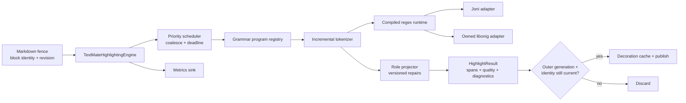
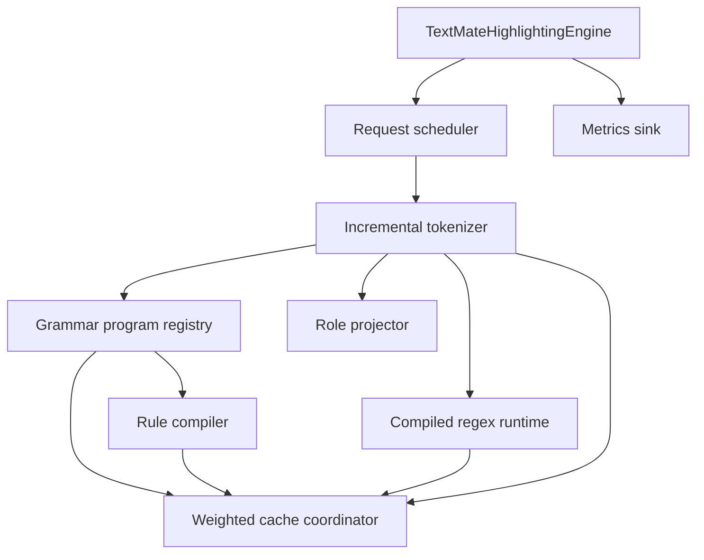
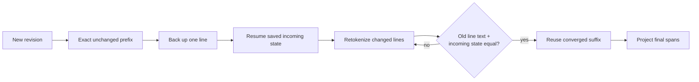

# TextMate Pipeline Implementation Plan

**Status:** architecture locked; Phase 1 closed on simulated backends;
physical-device release calibration remains in Phase 6; Phase 2 not started
**Date:** 2026-07-29
**Scope:** reusable fenced-code highlighting in `shared/markdown-core`, including
Android/Joni and iOS/libonig adapters
**Architecture dependency:**
[TextMate Pipeline Architecture Proposal](./textmate-pipeline-architecture-proposal.md)
**Starting evidence:**
[TextMate highlighter architecture report](./textmate-markdown-highlighter-architecture-report.md)

## Goal

Make TextMate highlighting efficient, reliable, responsive, reusable, capable
of becoming very fast, robust under cancellation and memory pressure, and
measurable on real devices.

The plan improves the highlighter module itself. It does not replace the
broader Session Message Engine, timeline projection, or native renderer
architecture documented under `docs/features/message-store/`.

## Architecture dependency

This plan implements the selected design from the
[architecture proposal](./textmate-pipeline-architecture-proposal.md): one deep
`TextMateHighlightingEngine` module between Markdown fence discovery and
semantic code decoration.

The module should hide:

- grammar loading and rule compilation;
- Joni/libonig adapters and native lifetime;
- line tokenization and incremental state;
- priority, coalescing, deadlines, and cancellation;
- weighted caches and memory-pressure response;
- semantic-role projection and versioned repair passes;
- fallback selection; and
- metrics.

Callers provide an opaque fence key, a caller-owned monotonic revision token,
language, exact source, intent, and policy epoch. They receive semantic spans,
diagnostics, an all-or-nothing upgrade outcome, and the same identity. Timing
goes to the internal metrics sink. No caller understands grammars, rule stacks,
regex objects, worker ownership, cache keys, or queue controls.

This is a deep module: a small interface provides substantial leverage to
Session Chat, history enrichment, Component Gallery, tests, and future
code-block consumers. Deleting it would force concurrency, caching, fallback,
and native-memory complexity back into every caller.

## Evidence classification

### Source-derived facts

- Markdown preparation already runs away from the UI executor.
- Android serializes the shared stateful highlighter; iOS detached tasks can
  reach shared mutable grammar and resolved-rule maps.
- `Utf8IndexMap` is recreated for every native regex search.
- grammar, resolved-rule, and compiled-regex caches have no weighted budget.
- iOS `onig_new` pointers have no `onig_free` ownership path, and successful
  decomposition probes discard compiled pointers.
- line state is preserved inside one parse but not across content revisions.
- streaming has a plain/fallback lane and final TextMate upgrade.
- outer publication is generation- and content-identity-gated.

### Measured facts

- Existing docs record that TextMate tokenization is the dominant Markdown
  preparation cost on large fenced-code histories.
- The top-ten exact semantic fixtures pass on Joni and libonig.
- The previous full-history Big Session measurement was about 2.5 seconds, but
  it predates the current staged pipeline and is not a current performance
  baseline.

### Hypotheses to verify

- one UTF-8 buffer/index per line will materially reduce allocation and CPU;
- unchanged-prefix line reuse will make streaming finalization and small
  revisions much faster;
- one owned TextMate executor will improve tail latency by reducing cache
  duplication and contention;
- weighted caches can keep retained TextMate memory below the proposed mobile
  budget without harming warm latency;
- whole-document repair passes may become the dominant cost after tokenizer
  improvements.

## Alternatives considered

### Alternative A: lock the current highlighter

Put one global lock around grammar loading, rule resolution, and tokenization.

**Benefit:** smallest safety fix; removes the immediate iOS shared-cache race.

**Rejected as the target:** it does not create a reusable seam, incremental
reuse, bounded memory, deadlines, lower allocation, backpressure, or coherent
measurement. Use it only as an interim safety phase.

### Alternative B: concurrent shared caches

Run several full TextMate jobs concurrently against shared concurrent maps.

**Benefit:** higher apparent throughput on large histories.

**Rejected:** mobile highlighting is latency- and memory-sensitive. This design
duplicates iOS thread-local native regexes, raises peak allocation, makes
eviction/disposal harder, and risks foreground head-of-line interference. If
one owner proves insufficient, add a second independently owned engine shard
after measurement rather than arbitrary shared mutation.

### Alternative C: Shiki in a WebView or JavaScript runtime

**Benefit:** closer engine and theme parity with opencode web.

**Rejected:** it reintroduces a JavaScript runtime, bridge, startup cost, and
rendering island while leaving scheduling, publication, backpressure, and
mobile memory ownership unsolved.

## Target architecture



The outer `DisplayMessagePipeline` remains responsible for observation
generation and visible publication. The engine is responsible for bounded
highlighting and internal cache correctness. This avoids duplicating the
Session Message Engine while making highlighting reusable outside chat.

## External interface

Conceptual shared contract:

```kotlin
interface TextMateHighlightingEngine {
    suspend fun highlight(request: HighlightRequest): HighlightResult
    suspend fun trim(level: MemoryPressure)
}

data class HighlightRequest(
    val key: CodeBlockKey,
    val revision: HighlightRevision,
    val language: String?,
    val source: String,
    val intent: HighlightIntent,
    val policyEpoch: Long,
)

enum class HighlightIntent {
    InteractiveFinal,
    VisibleHistory,
    BackgroundHistory,
}
```

`HighlightResult` contains:

- request key, revision, canonical language, and policy epoch;
- non-overlapping semantic role spans;
- `Highlighted`, `Unsupported`, `Cancelled`, `Failed`, or `BudgetExceeded`;
- structured diagnostics; and
- no raw grammar, regex, line-state, cache, worker, or native-pointer type.

The performance part of the interface is an invariant:

- `highlight` never executes on the UI executor;
- the engine may coalesce an older request for the same block;
- fallback always preserves complete source;
- a result is safe to discard;
- internal memory is bounded;
- `trim` never invalidates an active leased native object.

## Internal modules and seams



The regex runtime is a real internal seam because two production adapters exist:
Joni and libonig. Clock, metrics, and resource readers are internal test seams,
not additions to the caller-facing interface.

### Grammar program registry

- decode each grammar once;
- resolve includes and injections into immutable, versioned rule plans;
- assign compact stable grammar/rule IDs;
- discard raw JSON after typed compilation unless retained for a bounded
  diagnostic sample;
- replace string-built pattern signatures with grammar/rule/context identities.

### Prepared search buffers

Change the regex seam from `pattern + String` per search to:

1. compiled pattern handle;
2. prepared line buffer containing UTF-8 bytes and both offset maps; and
3. search range plus contiguous anchor.

Construct one prepared buffer per physical line and reuse it for every
candidate search on that line.

### Role projection

Keep the 18 product-owned semantic roles. Give the mapper and repair pipeline
explicit versions so incremental state and cached results invalidate when
semantics change. Make repair passes line-local where correct; measure
document-wide C/C++, PHP, and Python repair work separately before changing it.

## Threading, cancellation, and ownership

Use one dedicated serial KMP runtime as the sole owner of grammar, rule-plan,
regex, and incremental-state caches on both platforms. A Swift actor may adapt
calls but does not own mutable Kotlin/Native state.

| Contract | Android mechanism | iOS mechanism |
| --- | --- | --- |
| Engine ownership | injected single-lane coroutine dispatcher | serial KMP executor/worker with optional Swift actor adapter |
| Active TextMate jobs | initially one | initially one |
| Job-local state | mutable line traversal, never shared | same |
| Published cache entries | immutable | immutable |
| Native regex lifetime | JVM-managed compiled handle | executor-owned leased `OwnedOnigRegex` |
| UI publication | outer generation gate | outer MainActor generation gate |

Cancellation must be cooperative:

- check before every line;
- check after the earlier of 64 regex searches or 2 ms;
- check before capture recursion and repair passes;
- stop when superseded by a newer revision for the same block;
- apply intent-specific wall-clock and search-count budgets.

A single native regex call may remain non-interruptible. Initial safety limits:

- 100,000 characters per highlighted block;
- 20,000 characters per physical line;
- backend retry/time limits where supported;
- safe fallback when any limit is exceeded.

## Incremental line-state reuse



Persist a weighted `IncrementalBlockState` keyed by:

- code-block identity;
- canonical language and grammar version;
- role-mapper and repair-pipeline versions; and
- policy epoch.

Each line record contains exact text or a strong digest verified against text,
incoming-state fingerprint, immutable outgoing state, relative scope tokens,
projected spans, and estimated retained cost.

Migration rules:

1. implement exact unchanged-prefix reuse first;
2. back up one line because appended text can change end-of-line interpretation;
3. retokenize forward from the saved incoming state;
4. add suffix convergence only when line text and incoming state both match;
5. invalidate completely on language, grammar, engine, mapper, repair, or
   policy-version change.

Correctness fixtures must cover multiline strings, heredocs, dynamic end
captures, `while`, injections, embedded grammars, and zero-width boundaries
before suffix convergence ships.

## Memory and native lifetime

iOS must replace the thread-local raw-pointer map with executor-owned
`OwnedOnigRegex` entries:

- every successful `onig_new` has exactly one owner;
- every owner eventually calls `onig_free`;
- successful decomposition probes become owned cached candidates or are freed
  immediately;
- active searches hold a lease so eviction cannot free an in-use expression;
- allocation/free/live/peak counts are measurable.

Provisional pooled retained-cache planning shares:

| Cache | Planning share or guardrail |
| --- | --- |
| Decoded grammar programs | 12 MiB |
| Compiled regexes | 8 MiB or 4,096 entries |
| Resolved rule plans | 4 MiB |
| Incremental block state | 8 MiB or 64 blocks |
| Aggregate engine-owned retained state | 24 MiB eviction threshold; 32 MiB admission ceiling |

The category figures are telemetry shares rather than independently reservable
limits. These numbers are hypotheses until measured on reference devices.
Packaged resources are tracked separately; active-job and bridge allocations
are peak working-set metrics.

Moderate pressure evicts background incremental states and cold rule plans.
Critical pressure cancels background work, clears incremental/result state,
frees non-leased compiled regexes, and retains only the manifest and active
leases.

Cache hits must verify source equality. A 32-bit hash plus length is an index,
not a correctness boundary.

## Scheduling and backpressure

Use three priorities:

1. interactive final;
2. visible history;
3. background history.

Interactive-final deadlines take strict priority. Visible history ages so it
cannot starve. Weighted `8:2:1` deficit service applies only while no
interactive deadline is at risk.

Initial limits:

- one active full TextMate job;
- eight pending interactive blocks;
- 24 pending history blocks;
- 256,000 total queued source characters;
- latest request wins per block key;
- background work drops first under pressure;
- low-power, thermal, or memory pressure disables speculative background work;
- plain/fallback publication never waits for TextMate.

Finalization preempts queued history and cooperatively cancels obsolete work.
Existing viewport-first history enrichment and bounded publication counts stay
unchanged.

## Measurement contract

Do not record source text, session IDs, or block IDs. Dimensions are bounded:
canonical language, intent, size bucket, platform, cold/warm state, and outcome.

Required histograms:

- `queue_wait_ms`;
- `grammar_load_ms`;
- `rule_resolve_ms`;
- `regex_compile_ms`;
- `tokenize_ms`;
- `repair_ms`;
- `total_highlight_ms`;
- `cancel_requested_to_stop_ms`;
- `native_search_max_ms`.

Required counts/gauges:

- source characters, lines, maximum line length, regex searches, output spans;
- reused and retokenized lines;
- cancellation, supersession, deadline, and search-budget outcomes;
- fallback counts by reason;
- cache hit, miss, eviction, entries, and retained estimated bytes;
- native regex allocations, frees, live count, and peak live bytes;
- pending queue count/character high-water marks;
- stale results and rejected stale cache writes.

### Provisional performance budgets

| Scenario | Gate on representative release devices |
| --- | --- |
| Plain/fallback publication after accepted snapshot | p95 ≤ 50 ms; p99 ≤ 100 ms |
| Interactive-final queue delay | p95 ≤ 8 ms; p99 ≤ 16 ms |
| Warm full highlight, 2,000 characters | p95 ≤ 12 ms |
| Warm full highlight, 8,000 characters | p95 ≤ 40 ms |
| Final 8,000-character upgrade end to end | p95 ≤ 75 ms; p99 ≤ 150 ms |
| Cancellation request to next checkpoint | p95 ≤ 8 ms, excluding an active native regex call |
| Longest individual native regex call | separately measured safety distribution |
| UI executor work | zero grammar decode, tokenization, or role repair |
| Thirty-minute mixed-language soak | no retained growth after five warm-up cycles |

Phase 1 freezes named simulator/emulator configurations, fixtures, test build
mode, bridge inclusion, cold/warm definitions, and sample counts. Simulator
results are reproducible architectural baselines, not shipping latency, thermal,
or peak-memory guarantees. Phase 6 freezes the representative physical-device
matrix and release configuration before any default enablement. Budgets may be
revised before becoming release gates only through an evidence-backed entry in
`decisions.md`. Material engine, backend, grammar, repair, scheduler, or compiler
changes require an explicit rebaseline.

## Reliability invariants

1. Structural Markdown and complete fallback content never wait for TextMate.
2. The outer display pipeline is the only visible-publication authority.
3. Cancellation is not a correctness mechanism; generation and exact identity
   validation are mandatory.
4. Only current generation, fence key, revision, exact source, streaming state,
   and policy epoch may write visible decoration or publish.
5. Content-dependent incremental/result state commits only while the request is
   latest for its fence key.
6. Superseded work may warm only immutable content-independent caches with
   complete keys and available budget.
7. A 32-bit hash plus length is an index hint, never proof of source equality.
8. Queue pressure, deadlines, and limits produce no upgrade, never partial or
   corrupt spans.
9. Mutable production tokenizer and regex state is engine-instance scoped.
10. Every successful `onig_new` has one owner and one eventual `onig_free`;
    active leases cannot be evicted.
11. Final spans are ordered, in range, non-overlapping, and deterministic.
12. Metrics contain no source, user/session identity, fence identity, or
    unbounded dimensions.

## Phased migration

### Phase 1 — Baseline and lifetime safety

- freeze named simulated benchmark targets, test build configuration, fixtures,
  size buckets, sample counts, and cold/warm definitions;
- define retained-cache accounting separately from peak working set;
- instrument current queue, grammar, regex, tokenize, repair, cache, and native
  allocation behavior;
- measure the longest individual native regex call;
- add iOS parallel first-use and cancellation stress tests;
- fix decomposition-probe leaks;
- add native allocation/free accounting;
- fix the iOS attributed-code palette/epoch cache key.

**Gate:** current correctness unchanged; every `onig_new` is accounted for;
the baseline matrix and any revised guardrail are recorded in `decisions.md`.

#### Phase 1 implementation evidence — 2026-07-29

- Added bounded stage metrics for grammar load/lookup, rule resolution, regex
  compile/search, exact native search duration, total tokenization, repair,
  cache hit/miss outcomes, backend, source-size buckets, and longest individual
  native regex call. Disabled metrics skip timing work. Metrics contain no
  source text or source identity.
- Added a request-scoped observed parse envelope and persisted native developer
  logbooks. One entry represents one actual finalized fence attempt; it records
  UTF-16 size/fence metadata, outcome, span count, backend, total duration,
  aggregate stage timings, and diagnostic kinds without source or app
  identity. Streaming, disabled TextMate, and prepared-document cache hits do
  not log.
- Android and iOS submit observations without blocking rendering to serial
  JSONL writers with a 64-batch pending bound, newest-500 retention, 550-entry
  or 2 MiB compaction, corrupt-record recovery, clear integration, and visible
  drop/I/O health. Developer Tools exposes matching summary and expandable
  detail screens.
- Added libonig allocation/free counters, explicit cache reset, and a regression
  proving successful decomposition probes are released immediately and all
  cached native regexes are freed on reset.
- Added the iOS palette revision to attributed-code cache identity.
- Added iOS parallel first-use, repeated-cancellation, exact-source, native
  lifetime, and palette-cache regression coverage.
- Replaced the semantic fallback's combined recursive `Regex.findAll` with a
  bounded single-pass scanner after a 3,968-character unterminated JavaScript
  string reproduced an iOS stack-guard crash. The crash-specific iOS regression
  and the original 12-row Session Chat replay now pass.
- The complete shared Android and iOS simulator test suites pass. Focused
  Android display-pipeline/preparer tests and 12 focused Swift tests also pass.
- The fixed debug reference fixture is 20 finalized messages and 3,000
  TypeScript code lines. On the 2026-07-29 arm64 macOS 26.5.2 host, the
  Android/Joni JVM test took 2,542 ms with a 3.934 ms maximum native search; on
  an iPhone 17 Pro iOS 26.5 simulator, iOS/libonig took 55,388 ms with a
  50.324 ms maximum native search. The nested stage totals identify regex
  search and repair as the dominant iOS cost. These values are diagnostic and
  are not release gates.

The accepted Phase 1 closure matrix is:

| Field | Android/Joni | iOS/libonig |
| --- | --- | --- |
| Named target | Pixel 9a AVD, Android 17 / API 37, arm64, 4 configured cores, 2 GiB configured RAM | iPhone 17 Pro simulator, iOS 26.5, arm64 |
| Build | Debug app plus Android instrumentation test | Kotlin/Native debug simulator test binary |
| Reference fixture | 20 finalized TypeScript messages, 3,000 total code lines | Same |
| Cold/warm | One fresh-process cold fixture sample, then five same-process warm fixture samples | One post-cache-clear cold fixture sample, then five same-process warm fixture samples |
| Soak | 30 minutes; TypeScript, Kotlin, Swift, Python, JSON, and shell; 40 lines per language per cycle | Same |
| Retained-state check | Process PSS after forced GC/finalization, with an 8 MiB simulator-noise tolerance | Stable live compiled-regex count after warm-up; allocations equal frees after explicit cache clear |
| Peak check | Highest sampled process PSS, diagnostic only | Highest live compiled-regex count plus test-process peak RSS, diagnostic only |
| Bridge | Shared parser through Joni included; Compose publication excluded | Shared parser through libonig included; Swift JSON/UI publication excluded |
| Thermal | Not meaningful for an AVD; host state is recorded only as context | Not meaningful for Simulator; host state is recorded only as context |

The opt-in soak and five-warm-sample calibration harnesses are excluded from
normal CI unless explicit arguments are supplied.

#### Phase 1 closure evidence — 2026-07-29

| Target | 30-minute soak | Retained/peak evidence | Reference fixture |
| --- | --- | --- | --- |
| Pixel 9a AVD, Android 17 / API 37 | 457 cycles; 1,801.760 s; 55,537,020 native searches; 62.573 ms longest native search | 131,491 → 131,849 KiB post-warm-up PSS (+358 KiB); 143,815 KiB peak PSS | 117.713 s cold; five warm samples 91.938–140.374 s |
| iPhone 17 Pro, iOS 26.5 simulator | 1,128 cycles; 1,800.941 s; 136,197,930 native searches; 5.794 ms longest native search | 464 retained/peak live regexes; 465 allocations = 465 frees after clear; 97,697,792-byte maximum RSS | 52.735 s cold; five warm samples 52.891–53.074 s |

The rebuilt Android short soak, focused iOS libonig class, and both harness
builds pass. Phase 1 is closed. The reference fixture shows inconsistent or
absent warm improvement, so it is a baseline for the Phase 2–5 architecture
work rather than evidence that the current synchronous parser-owned path is
fast. Physical low- and mid-tier release-build latency, memory pressure, bridge,
thermal, cancellation, and soak calibration remains a mandatory Phase 6 gate
before TextMate is enabled by default.

### Phase 2 — Deep module and single ownership

- define the deterministic fence locator, opaque monotonic revision token,
  exact-source check, pure span-attachment operation, and asynchronous
  platform-to-KMP adapter;
- introduce `TextMateHighlightingEngine` behind the current parser/preparer path;
- put mutable engine state on one owner per platform;
- retain existing semantic fallback and final upgrade behavior;
- test through the engine interface, not through new public internal seams.

**Gate:** no race under first-use/concurrent request stress; no UI-executor
work; all production and test entry points use an injected engine instance.

### Phase 3 — Scheduling, deadlines, and backpressure

- move priority, coalescing, work limits, deadlines, and trim handling into the
  engine;
- preserve outer generation gating and existing viewport-first history;
- expose queue and cancellation metrics.

**Gate:** plain publication budgets hold under a blocked/pathological highlighter.

### Phase 4 — Compiled programs and prepared line buffers

- compile immutable grammar/rule programs;
- use compact stable IDs;
- reuse one UTF-8 index map per line;
- introduce weighted grammar/rule/regex caches and owned libonig leases.

**Gate:** exact oracles pass; allocation/search metrics show the intended reuse.

### Phase 5 — Incremental reuse

- add bounded unchanged-prefix state reuse;
- measure repair/tokenizer proportions;
- add suffix convergence only after multiline correctness fixtures pass.

**Gate:** incremental output equals full reparse across differential fixtures.

### Phase 6 — Default enablement

- run device benchmark, memory-pressure, thermal, cancellation, and 30-minute
  mixed-language soak matrices;
- promote languages only when correctness and latency gates pass;
- reconsider a second independent engine shard only if one owner misses
  throughput goals without foreground-latency or memory regressions.

**Gate:** all acceptance criteria below pass on both platforms.

## Verification matrix

| Area | Required evidence |
| --- | --- |
| Interface | request/result behavior tests with in-memory clock, metrics, and regex adapters |
| Correctness | top-ten exact oracle plus promoted real Session Chat fixtures |
| Incremental | full-reparse differential tests for insert/delete/append and multiline states |
| Cancellation | supersession before line, during searches, during repair, and before publication |
| Memory | weighted eviction, pressure trim, lease safety, and native allocation/free equality |
| Scheduling | priority fairness, latest-wins coalescing, queue bounds, foreground preemption |
| Failure | missing grammar, invalid grammar, failed regex, deadline, search limit, OOM/pressure |
| Performance | cold/warm size buckets on representative low- and mid-tier devices |
| Soak | 30 minutes of streaming/final/history/mixed languages with stable retained memory |
| Parity | mirrored interface-level scenarios and identical quality/fallback classification |

## Acceptance criteria

- one reusable highlighter interface serves both native apps and non-chat callers;
- exact top-ten oracle parity remains green on Joni and libonig;
- every language enabled by default has representative promoted fixtures;
- no stale result publishes or becomes the current block cache entry;
- queues and retained memory remain within configured bounds;
- native regex allocations equal frees after eviction/reset, with zero
  decomposition-probe leak;
- performance budgets pass on representative release devices;
- a pathological fence cannot delay plain text or indefinitely occupy the engine;
- incremental output is byte-for-byte equal to a full reparse at the semantic
  role/range contract;
- metrics identify queueing, grammar, compile, tokenize, repair, fallback,
  cache, cancellation, and retained-memory cost without user content;
- iOS and Android share policy, metric names, limits, outcomes, and tests while
  retaining native executor and regex adapters.

## Locked implementation decisions

These architecture choices are explained in the
[proposal report](./textmate-pipeline-architecture-proposal.md):

1. Use the deep asynchronous `TextMateHighlightingEngine` after a complete
   fallback document exists.
2. Use one active instance-owned serial KMP runtime initially; a second isolated
   shard requires measured need and independent mutable/native state.
3. Use 24 MiB as the provisional pooled eviction threshold and 32 MiB as the
   retained-cache admission ceiling.
4. Treat latency values as owned hypotheses until their implementation phase
   and Phase 6 physical-device evidence make them enforceable.
5. Promote TextMate through a versioned language allowlist beneath the global
   user preference.

Phase 1 is closed on the named simulator/emulator correctness, lifetime, and
soak matrix above. Physical-device release calibration remains in the Phase 6
default-enablement gate. Phase 2 additionally requires a deterministic fence
locator, opaque monotonic revision token, exact-source validation, pure span
attachment, and an asynchronous platform-to-KMP adapter.
