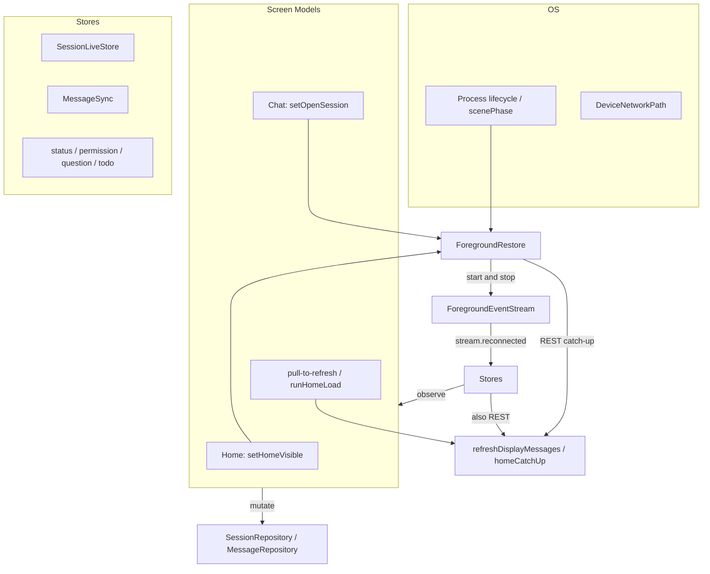
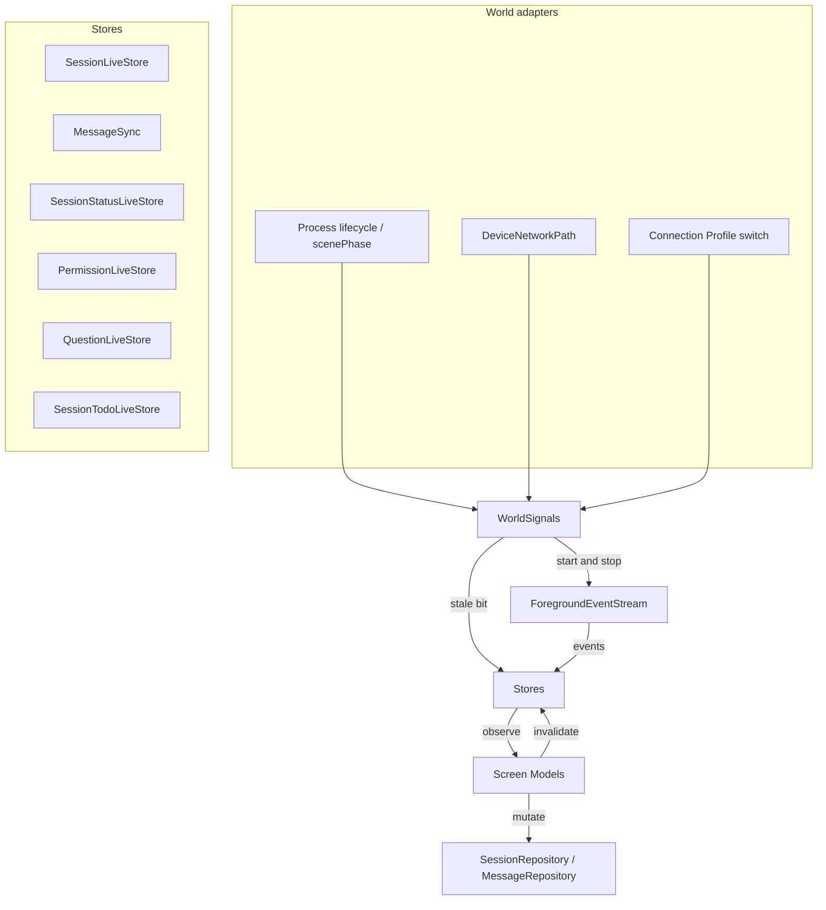

# Reactive data layer

## User Goal

Returning to the app, recovering a network path, or pulling to refresh updates
the visible screen from its store. Screens subscribe. They do not register with
a restore object.

## Now

World signals, store stale bits, and observe-only Screen Models are wired on
Android and iOS. `ForegroundRestore` and the home catch-up registry are
deleted. Screens subscribe and mutate; process adapters start and stop SSE.

## In Scope

- World signals from one process adapter per platform: `Foreground`,
  `Background`, `BackgroundStop`, `PathReady`, `PathLost`, `ProfileSwitched`.
  Expected: logs `world signal=<name>`. Screens never emit these.
- Interest is the observe subscription. Home collecting
  `SessionLiveStore.observeSessions` is interested in that directory's list.
  Session Chat collecting `MessageRepository.observeDisplayMessages` is
  interested in that session's messages. Same rule for
  `SessionStatusLiveStore`, `PermissionLiveStore`, `QuestionLiveStore`, and
  `SessionTodoLiveStore`. Expected: deleting `setOpenSession` /
  `setHomeVisible` does not drop catch-up while those collects are alive.
- Each of those stores keeps a stale bit. `Background` and `PathLost` set it
  on running observations even if SSE is still up for the picker grace.
  Dirty plus interested plus path ready plus an active Connection Profile
  runs REST catch-up. Expected log: `reason=background-return` or
  `reason=path-ready` on the store's fetch, then the UI shows server state.
- SSE patches while `ForegroundEventStream` is live. REST covers the gap.
  Expected: a `message.part.delta` after catch-up still merges; a missed
  background turn appears from REST, not from a replayed SSE buffer.
- Pull-to-refresh marks that store dirty and uses the same fetch path.
  Expected: `reason=pull-to-refresh`, not a `clearCache` plus
  `MainScreenViewModel.refresh()` / `runHomeLoad()` probe.
- One transport owner: the world adapter starts and stops
  `ForegroundEventStream`. 5s `BackgroundStop` grace so pickers do not tear
  down SSE. `.inactive` / Android picker `onStop` within grace keeps the
  stream. 45s idle watchdog unchanged.
- Dual protocol on every Connection Profile: v1 `GET /global/event` and
  instance `GET /event`, v2 `GET /api/event`. Both carry session lifecycle,
  message/part, status, permissions, and questions. Heartbeat-only is a bug.
- In-flight REST must not overwrite a newer store revision. Expected: an SSE
  patch during `listSessions` / `GET …/message` discards that response.
- Profile switch keeps today's `clearCache` on live stores and `MessageSync`,
  pops session routes, and treats missing session as terminal. Expected: no
  5s 404 loop on the previous server's session ids.
- `reason=` on every store fetch, including initial subscribe.

## Out Of Scope

- A new reactive stack beside Live Stores. No `MessageLiveStore` type.
- `refreshEverything()` on unlock: no connection probe, no servers chrome
  reload, no `runHomeLoad()` from a world signal.
- Growing `ForegroundRestore` into a coordinator that picks REST targets.
- An app-event bus on Screen Models. No `onAppear` or `onStop` refresh.
- Background delivery, push, or promising sync while the process is frozen.
- Session Context, Changes / Review, Model Selection catalogs as live stores.
  Those stay snapshot-plus-manual-refresh until a later slice.
- Session Cache schema changes. Stale-while-revalidate on cold start stays.
- `InMemoryMessageStore` persistence.
- `SessionTodoLiveStore.setLive` meaning UI visibility. It still means the
  session is working; CONTEXT.md already defines force-GET when it becomes
  live.
- `SessionReadyStore.setFocusedSession`. That is Ready-chip focus, not
  catch-up interest.
- Secrets storage. Keychain / Keystore unchanged.

## Server APIs Involved

Catch-up uses the same REST the stores already call. World signals do not
add endpoints.

- v1 SSE: `GET /global/event` and instance `GET /event`.
- v2 SSE: `GET /api/event`.
- Home list: `GET` session list per added-project `directory`.
- Home / chat status: `GET /session/status` or v2 active-status equivalent
  behind `SessionRepository`.
- Chat history: `GET /session/:id/message`.
- Permissions: pending-permission list already used by
  `PermissionLiveStore`.
- Questions: pending-question list already used by `QuestionLiveStore`.
- Todos: session todo GET already used by `SessionTodoLiveStore`.

## Expected Logs

Never log credentials, prompts, message bodies, or authorization headers.

World adapter:

- `world signal=Background`
- `world signal=Foreground`
- `world signal=BackgroundStop`
- `world signal=PathLost`
- `world signal=PathReady`
- `world signal=ProfileSwitched`
- existing `foreground SSE stream starting` / `stopping` /
  `foreground SSE idle timeout; reconnecting`

Stores, every fetch:

```text
fullReload session=<id> reason=<reason> count=<n> ms=<ms>
sessionLiveStore refresh directory=<path> reason=<reason> count=<n>
statusLiveStore refresh directory=<path> reason=<reason>
permission refresh reason=<reason> count=<n>
question refresh reason=<reason> count=<n>
sessionTodoLiveStore fetch session=<id> reason=<reason>
```

Closed `reason=` values for this slice:

- `background-return`
- `path-ready`
- `pull-to-refresh`
- `initial-subscribe`
- `stream.reconnected`
- `server.connected`

Keep existing MessageSync reasons: `overflow-recovery`,
`message.part.updated-rest-seeded`, and the rest. Do not invent a second
key such as `trigger=` on new lines.

A catch-up that is skipped because the stale bit is already clear, or
because another signal in the same debounce already claimed the fetch,
logs skip with the same `reason=` it would have used.

## Domain Objects

Existing, keep: `ForegroundEventStream`, `DeviceNetworkPath`,
`MessageSync`, `InMemoryMessageStore`, `MessageRepository`,
`SessionRepository`, `SessionLiveStore`, `SessionStatusLiveStore`,
`PermissionLiveStore`, `QuestionLiveStore`, `SessionTodoLiveStore`,
`SessionReadyStore`, `Session Cache`, `ConnectionEpoch`,
`LiveStoreRefreshPolicy`, Screen Model.

Add: `WorldSignals` as the module interface, `WorldSignal` as the edge,
`ProcessWorldSignals` as the Android adapter, `SceneWorldSignals` as the iOS
adapter, `FakeWorldSignals` for tests.

Deleted: `ForegroundRestore`, `DefaultForegroundRestore`,
`ForegroundRestorePhase`, `ForegroundHomeCatchUp`,
`ForegroundHomeCatchUpRegistry`, `FakeForegroundRestore`,
`ForegroundEventLifecycleCoordinator`.

Internal to stores, not a domain glossary term: the stale bit.

## Architecture

The module interface callers learn is small.

Screen Models collect observe streams, call repository mutations, and for
pull-to-refresh call `invalidate` on the store they are showing. Chat may
keep `refreshDisplayMessages` as the await form of that invalidate. They
do not start or stop SSE. They do not tell a restore object which session
is open or whether home is visible.

Process adapters publish `WorldSignal` and start or stop
`ForegroundEventStream`. They do not call `listSessions`,
`refreshDisplayMessages`, or `MainScreenViewModel.refresh()`.

Hidden behind the stores: the stale bit, `LiveStoreRefreshPolicy` debounce
of 300 ms or 500 ms, `ConnectionEpoch` claim so `Foreground` and
`stream.reconnected` do not double-fetch, observation generation,
`WhileSubscribed` / `LiveStoreRefreshPolicy.SUBSCRIBER_STOP_TIMEOUT_MS` at
5s, which REST path to fire, revision gating.

`WorldSignals` is the invalidation clock. Depth sits in the stores. Adding
a store does not grow the world adapter.

Opencode REST and SSE stay behind existing remotes. That dependency is
remote but owned. Process lifecycle and Device network path are
true-external. Two adapters each, prod and test, justify those seams.

**Before.** Three owners of catch-up. Lifecycle told `ForegroundRestore` to
start SSE and REST. Screens also registered which UI was open. Live Stores
and `MessageSync` REST'd again on `stream.reconnected`. That is how
`missedSessionCatchUp` and generation races happened.



**After.** One clock. Screens subscribe and mutate. World signals mark
stores stale and own SSE occupancy. The store that is being watched
fetches.



`SessionReadyStore` does not grow a new REST catch-up. It follows
`SessionStatusLiveStore`.

Home collecting while Session Chat is open is interest. Android
`MainScreenViewModel` already stays alive under chat. Leave that collect
running so home rows are current on back. Do not rebuild `setHomeVisible`.
To pause home later, cancel the collect.

iOS `startObserving` / delayed `stopObserving` stay as collect lifetime so
a parent re-render does not drop interest. They stop calling
`setOpenSession`.

Cold start must still start SSE when a Connection Profile exists and the
scene is already active. Today's `AppRootViewModel.enterHome()` calls
`restore()` because `onChange(of: scenePhase)` may miss the first active
phase. `SceneWorldSignals` needs that same explicit start. Android
`ProcessLifecycleOwner` `onStart` already covers first foreground.

## Screen Models

One immutable UI state plus explicit actions, unchanged. Home and Session
Chat keep collecting Live Store / Message Repository streams. Optimistic
send and quiet merge stay in the Session Chat Screen Model. Catch-up is
quiet: it must not clear an in-flight optimistic bubble or `isSending`.
Screen Models may `markBusy` / `clearLocalBusy` / `markIdle` on
`SessionStatusLiveStore`. They still do not REST status themselves.

Pull-to-refresh remains a user action on the Screen Model. The action
invalidates the store. It does not implement a second fetch policy.

## UI States

No new screen. Existing home rows, Session Chat timeline, and
`live` / `connecting` / `offline` chrome from `LiveUpdates` (path × world
occupancy × SSE). Session Cache Syncing chrome unchanged.

Catch-up does not flash a full-screen spinner on return from background.

## Error States

Failed catch-up keeps the last good snapshot, including Session Cache
seed. Log a warning with `reason=` and the failure. Chrome follows
`LiveUpdates` (path × occupancy × SSE), not a restore phase enum.

Pull-to-refresh failure stays a caller-visible refresh error, same as
today's `refreshDisplayMessages` throw / home refresh failure.

`ForegroundRestorePhase` goes away. Do not replace it with a Screen Model
connection state.

## Permission Behavior

No new permission UX. Allow-once and deny stay. `PermissionLiveStore`
follows dirty plus interest so a `permission.asked` missed during a gap
shows after `reason=background-return` / `reason=path-ready` REST, without
the composer calling refresh on `onAppear`.

## Design-System Components

None. Reuse existing list rows, chat chrome, and status bar.

## Navigation Entry Points

- Android world adapter: `ProcessWorldSignals` from
  `ProcessLifecycleOwner` plus `ConnectivityDeviceNetworkPath` plus
  `ConnectionSessionCoordinator` profile events. Wired from app start
  where `ForegroundEventLifecycleCoordinator.register()` is today.
- iOS world adapter: `SceneWorldSignals`. `AppRootView` `scenePhase`
  feeds `Foreground` / `Background` / `BackgroundStop`. Path from
  `SystemDeviceNetworkPath`. Profile from `ConnectionSessionCoordinator`.
- Android home: `MainScreenViewModel` collects `observeSessions` /
  `observeStatuses` / `observeReadyIds`. Drop `setHomeVisible` and
  `ForegroundHomeCatchUpRegistry.setHandler`.
- iOS home: `ProjectListHomeViewModel` same collects. Drop the same
  registry calls. `markHomeHidden` / `onHomeRevealed` stay for scroll pin
  only.
- Android chat: `SessionChatTimeline.startLiveObservation` →
  `observeDisplayMessages`. `SessionChatViewModel.bind` / `onCleared`
  drop `setOpenSession`.
- iOS chat: `SessionChatView.startObserving` still starts the collect.
  Drop `setOpenSession` from `SessionChatViewModel.startObserving` /
  `stopObserving`.

## Remaining

Path roam debounce stays out of scope until Wi-Fi roam needs it.
Session Context and Changes stay snapshot-plus-manual-refresh.

Keep: `ForegroundEventStream`, Device network path adapters, all Live
Stores, `MessageSync`, `ConnectionEpoch`, `LiveStoreRefreshPolicy`,
Session Cache, Screen Models, `setLive` on todos, `setFocusedSession` on
Ready.
