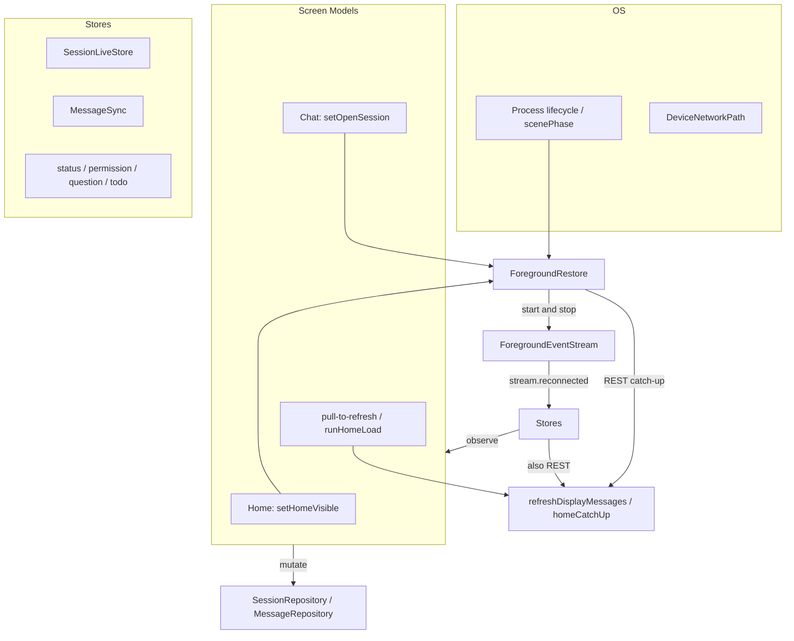
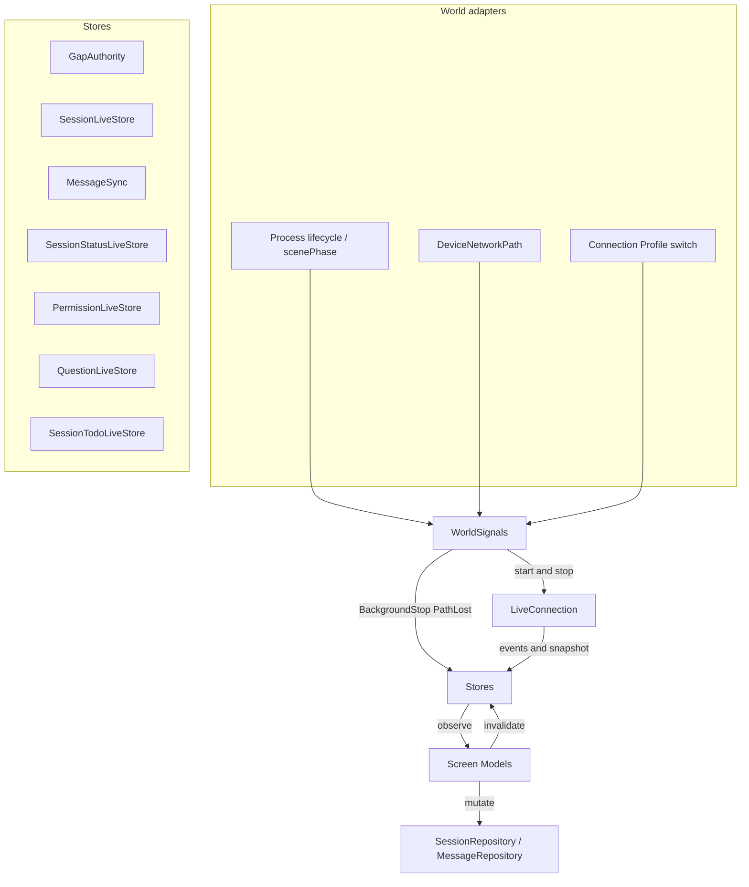

# Reactive data layer

## User Goal

Returning to the app, recovering a network path, or pulling to refresh updates
the visible screen from its store. Screens subscribe. They do not register with
a restore object.

## Now

World signals, `GapAuthority` revisions, and observe-only Screen Models are
wired on Android and iOS. Screens subscribe and mutate.
`ProcessWorldSignals` / `SceneWorldSignals` own desired occupancy and start
or stop SSE. Stores treat observe subscription as interest and reconcile
REST by gap revision. Non-force catch-up waits for Active occupancy and
every required lease. Reconnect and `connection-snapshot` only wake that
evaluation.

## In Scope

- World signals from one process adapter per platform: `Foreground`,
  `Background`, `BackgroundStop`, `PathReady`, `PathLost`, `ProfileSwitched`.
  Expected: logs `world signal=<name>`. Screens never emit these.
- Interest is the observe subscription. Home collecting
  `SessionLiveStore.observeSessions` is interested in that directory's list.
  Session Chat collecting `MessageRepository.observeDisplayMessages` is
  interested in that session's messages. Same rule for
  `SessionStatusLiveStore`, `PermissionLiveStore`, `QuestionLiveStore`, and
  `SessionTodoLiveStore`. Expected: cancelling those collects is the only
  way to drop interest.
- Each of those stores keeps a `GapAuthority`. `BackgroundStop` and
  `PathLost` invalidate it. `Background` grace does not. Dirty plus
  interested plus Active occupancy and a fully live `LiveConnection`
  snapshot (every required lease up) runs non-force REST catch-up for
  the current obligation. Expected log: `reason=background-return`,
  `reason=path-ready`, or `reason=connection-snapshot` on the store's
  fetch, then the UI shows server state. A skip log uses the same
  `reason=` when the revision is already acknowledged or when occupancy
  / leases are not yet live. Background-return status reconciliation
  uses the same `GapAuthority` and `canCatchUp` gate; it does not
  bypass them for optimistic Working.
- SSE patches while `ForegroundEventStream` is live. REST covers a gap
  revision. Expected: a `message.part.delta` after catch-up still merges; a
  missed `BackgroundStop` turn appears from REST, not from a replayed SSE
  buffer.
- Pull-to-refresh invalidates that store's authority and uses the same
  fetch path. Expected: `reason=pull-to-refresh`, not a `clearCache` plus
  `MainScreenViewModel.refresh()` / `runHomeLoad()` probe.
- One occupancy owner: the world adapter starts and stops
  `ForegroundEventStream`. 5s `BackgroundStop` grace so pickers do not tear
  down SSE. `.inactive` / Android picker `onStop` within grace keeps the
  stream. Grace is not a data gap. 45s idle watchdog is per lease on the
  stream.
- Dual protocol on every Connection Profile: v1 `GET /global/event` and
  every current instance `GET /event?directory=`, v2 `GET /api/event`. Both
  carry session lifecycle, message/part, status, permissions, and
  questions. Heartbeat-only is a bug. Connected requires every required
  lease.
- Failed or discarded REST does not acknowledge. Successful accepted or
  equality confirmation does. A newer gap during REST stays pending and
  must reconcile again. The four small stores still collapse duplicate
  in-flight GETs through `LiveStoreRefreshGate`. Expected: `session.idle`
  landing during a status reload wins, and out-of-order permission
  responses still leave the newest list last.
- `stream.reconnected` / `server.connected` and `LiveConnection` snapshot
  changes only wake current-gap evaluation. They are not new obligations.
- Clearing a store's cache tears its observations down rather than orphaning
  them: the upstream is cancelled and every subscriber stream is completed, so
  consumers re-subscribe instead of hanging. Expected: after a profile switch
  or Clear All Data, Ready chips reappear and no directory carries two
  upstreams.
- The pull-to-refresh ack is bounded, never unbounded. Expected: a collector
  cancelled mid-refresh still releases the spinner, and the next
  pull-to-refresh works. The ack means "stop waiting", never "data is fresh".
- Stores do not re-emit an unchanged list. `*.asked` / `*.replied` stay
  undebounced so a blocking prompt is never delayed. Session-tree fetches
  happen only for a request whose session is neither the root nor cached.
- Profile switch keeps today's `clearCache` on session, status, message,
  permission, question, and todo stores, pops session routes, and treats
  missing session as terminal. `SessionReadyStore.bindProfile` parks Ready
  watches instead of wiping them. Expected: no 5s 404 loop on the previous
  server's session ids; a session that finishes on the other profile can
  still become Ready on return.
- `reason=` on every store fetch, including initial subscribe.

## Out Of Scope

- A new reactive stack beside Live Stores. No `MessageLiveStore` type.
- `refreshEverything()` on unlock: no connection probe, no servers chrome
  reload, no `runHomeLoad()` from a world signal.
- Growing a coordinator that picks REST targets.
- An app-event bus on Screen Models. No `onAppear` or `onStop` refresh.
- Background delivery, push, or promising sync while the process is frozen.
- Session Context, Changes / Review, Model Selection catalogs as live stores.
  Those stay snapshot-plus-manual-refresh until a later slice.
- Session Cache schema changes. Stale-while-revalidate on cold start stays.
- `InMemoryMessageStore` persistence.
- `SessionTodoLiveStore.setLive` meaning UI visibility. It still means the
  session is working; CONTEXT.md already defines force-GET when it becomes
  live.
- `SessionReadyStore.setFocusedSession`. That is Ready-chip focus, not
  catch-up interest.
- Secrets storage. Keychain / Keystore unchanged.

## Server APIs Involved

Catch-up uses the same REST the stores already call. World signals do not
add endpoints.

- v1 SSE: `GET /global/event` and instance `GET /event?directory=`.
- v2 SSE: `GET /api/event`.
- Home list: `GET` session list per added-project `directory`.
- Home / chat status: `GET /session/status` or v2 active-status equivalent
  behind `SessionRepository`.
- Chat history: `GET /session/:id/message`.
- Permissions: pending-permission list already used by
  `PermissionLiveStore`.
- Questions: pending-question list already used by `QuestionLiveStore`.
- Todos: session todo GET already used by `SessionTodoLiveStore`.

## Expected Logs

Never log credentials, prompts, message bodies, or authorization headers.

World adapter:

- `world signal=Background`
- `world signal=Foreground`
- `world signal=BackgroundStop`
- `world signal=PathLost`
- `world signal=PathReady`
- `world signal=ProfileSwitched`
- existing `foreground SSE stream starting` / `stopping` /
  `foreground SSE idle timeout`

Stores, every fetch:

```text
fullReload session=<id> reason=<reason> count=<n> ms=<ms>
sessionLiveStore refresh directory=<path> reason=<reason> count=<n>
statusLiveStore refresh directory=<path> reason=<reason>
permission refresh reason=<reason> count=<n>
question refresh reason=<reason> count=<n>
sessionTodoLiveStore fetch session=<id> reason=<reason>
```

Closed `reason=` values for this slice:

- `background-return`
- `path-ready`
- `pull-to-refresh`
- `initial-subscribe`
- `stream.reconnected`
- `server.connected`
- `connection-snapshot`

Keep existing MessageSync reasons: `overflow-recovery`,
`message.part.updated-rest-seeded`, and the rest. Do not invent a second
key such as `trigger=` on new lines.

A catch-up that is skipped because the current gap revision is already
acknowledged, or because another in-flight reconcile already claimed it,
logs skip with the same `reason=` it would have used.

## Domain Objects

Existing, keep: `ForegroundEventStream`, `LiveConnection`,
`DeviceNetworkPath`, `MessageSync`, `InMemoryMessageStore`,
`MessageRepository`, `SessionRepository`, `SessionLiveStore`,
`SessionStatusLiveStore`, `PermissionLiveStore`, `QuestionLiveStore`,
`SessionTodoLiveStore`, `SessionReadyStore`, `Session Cache`,
`LiveStoreRefreshPolicy`, `GapAuthority`, Screen Model.

Add: `WorldSignals` as the module interface, `WorldSignal` as the edge,
`ProcessWorldSignals` as the Android adapter, `SceneWorldSignals` as the iOS
adapter, `FakeWorldSignals` for tests.

Deleted: `ForegroundRestore`, `DefaultForegroundRestore`,
`ForegroundRestorePhase`, `ForegroundHomeCatchUp`,
`ForegroundHomeCatchUpRegistry`, `FakeForegroundRestore`,
`ForegroundEventLifecycleCoordinator`.

Internal to stores, not a domain glossary term: `GapAuthority`.

## Architecture

The module interface callers learn is small.

Screen Models collect observe streams, call repository mutations, and for
pull-to-refresh call `invalidate` on the store they are showing. Chat may
keep `refreshDisplayMessages` as the await form of that invalidate. They
do not start or stop SSE. They do not tell a restore object which session
is open or whether home is visible.

Process adapters publish `WorldSignal` and start or stop
`ForegroundEventStream`. They do not call `listSessions`,
`refreshDisplayMessages`, or `MainScreenViewModel.refresh()`. `AppRoot`
forwards scene edges into `SceneWorldSignals`; it is not a second stream
owner.

Hidden behind the stores: `GapAuthority` (gap revision plus local
invalidate), `LiveStoreRefreshPolicy` debounce of 300 ms or 500 ms,
observation generation, `WhileSubscribed` /
`LiveStoreRefreshPolicy.SUBSCRIBER_STOP_TIMEOUT_MS` at 5s on both
platforms, which REST path to fire, revision gating.

`WorldSignals` is the occupancy and invalidation clock. Depth sits in the
stores. Adding a store does not grow the world adapter.

Opencode REST and SSE stay behind existing remotes. That dependency is
remote but owned. Process lifecycle and Device network path are
true-external. Two adapters each, prod and test, justify those seams.

**Before.** Three owners of catch-up. Lifecycle told `ForegroundRestore` to
start SSE and REST. Screens also registered which UI was open. Live Stores
and `MessageSync` REST'd again on `stream.reconnected`. That is how
`missedSessionCatchUp` and generation races happened.



**After.** One clock. Screens subscribe and mutate. World signals own SSE
occupancy and invalidate only on real gaps. The store that is being
watched evaluates `GapAuthority` and fetches when the revision is unpaid.



`SessionReadyStore` does not grow a new REST catch-up. It follows
`SessionStatusLiveStore`. Profile parking stays on `bindProfile`.

Home collecting while Session Chat is open is interest. Android
`MainScreenViewModel` already stays alive under chat. Leave that collect
running so home rows are current on back. To pause home later, cancel the
collect.

iOS `startObserving` / delayed `stopObserving` stay as collect lifetime so
a parent re-render does not drop interest.

Cold start must still start SSE when a Connection Profile exists and the
scene is already active. `AppRootViewModel.enterHome()` calls
`SceneWorldSignals.onForeground()` because `onChange(of: scenePhase)` may
miss the first active phase. Android `ProcessLifecycleOwner` `onStart`
already covers first foreground.

## Screen Models

One immutable UI state plus explicit actions, unchanged. Home and Session
Chat keep collecting Live Store / Message Repository streams. Optimistic
send and quiet merge stay in the Session Chat Screen Model. Catch-up is
quiet: it must not clear an in-flight optimistic bubble or `isSending`.
Screen Models may `markBusy` / `clearLocalBusy` / `markIdle` on
`SessionStatusLiveStore`. They still do not REST status themselves.

Pull-to-refresh remains a user action on the Screen Model. The action
invalidates the store. It does not implement a second fetch policy.

## UI States

No new screen. Existing home rows, Session Chat timeline, and
`live` / `connecting` / `offline` chrome from `LiveUpdates` (path × world
occupancy × SSE). Session Cache Syncing chrome unchanged.

Catch-up does not flash a full-screen spinner on return from background.
Home shows the existing pull-to-refresh indicator and Session Chat shows the
**Syncing…** pill while MessageSync catch-up is in flight.

## Error States

Failed catch-up keeps the last good snapshot, including Session Cache
seed. Log a warning with `reason=` and the failure. Chrome follows
`LiveUpdates` (path × occupancy × SSE), not a restore phase enum.
Failed or discarded REST leaves the gap pending.

Pull-to-refresh failure stays a caller-visible refresh error, same as
today's `refreshDisplayMessages` throw / home refresh failure.

Do not add a Screen Model connection state that replaces occupancy chrome.

## Permission Behavior

No new permission UX. Allow-once and deny stay. `PermissionLiveStore`
follows dirty plus interest so a `permission.asked` missed during a gap
shows after `reason=background-return` / `reason=path-ready` REST, without
the composer calling refresh on `onAppear`.

## Design-System Components

None. Reuse existing list rows, chat chrome, and status bar.

## Navigation Entry Points

- Android world adapter: `ProcessWorldSignals` from
  `ProcessLifecycleOwner` plus `ConnectivityDeviceNetworkPath` plus
  `ConnectionSessionCoordinator` profile events. Wired from app start.
- iOS world adapter: `SceneWorldSignals`. `AppRootView` `scenePhase`
  feeds `Foreground` / `Background`. Cold `enterHome()` calls
  `onForeground()`. Path from `SystemDeviceNetworkPath`. Profile from
  `ConnectionSessionCoordinator`.
- Android home: `MainScreenViewModel` collects `observeSessions` /
  `observeStatuses` / `observeReadyIds`.
- iOS home: `ProjectListHomeViewModel` same collects. `markHomeHidden` /
  `onHomeRevealed` stay for scroll pin only.
- Android chat: `SessionChatTimeline.startLiveObservation` →
  `observeDisplayMessages`.
- iOS chat: `SessionChatView.startObserving` still starts the collect.

## Validation

Shared traces under `shared/sse-recovery/` assert user-visible recovery
outcomes: transcript, catch-up chrome, live versus required leases, and
published profile. They do not pin REST counts, generation, or gap-reason
machinery. Both platforms run the same oracle. Do not check transient run
logs into the repo.

## Remaining

Path roam debounce stays out of scope until Wi-Fi roam needs it.
Session Context and Changes stay snapshot-plus-manual-refresh.

Keep: `ForegroundEventStream`, `LiveConnection`, Device network path
adapters, all Live Stores, `MessageSync`, `GapAuthority`,
`LiveStoreRefreshPolicy`, Session Cache, Screen Models, `setLive` on
todos, `setFocusedSession` and `bindProfile` on Ready.
