# Session Ready

Ticket: [OPE-105](https://linear.app/opencode-mobile/issue/OPE-105/session-ready)

## User Goal

Show **Ready** on the home Session List when a session this device cares about
finishes a turn while the user is not in that session — without noisy cues for
desktop/TUI-only work.

## In Scope

- Client-local watched + Ready state owned by one deep domain module.
- Watch when this mobile client accepts a prompt send for a session, or observes
  `busy` / `retry` while Session Chat is focused on that session.
- On transition to idle for a watched session that is **not** focused in Session
  Chat → set Ready.
- Opening Session Chat for that session → clear Ready.
- Persist Ready **and** watched across process death / cold start; expire each
  entry **24 hours** after it was set. Restored watches catch up to Ready if
  the session is already idle after relaunch.
- Map Ready into the home Session List trailing status pill with product copy
  **Ready**.
- Row display priority: needs approval (when present) > Running (Working /
  Retrying) > Ready > idle.
- Unit tests on iOS and Android for Ready-owner behavior and home mapping.
- Manual smoke: mobile-started turn → Ready; desktop-only idle → no Ready; open
  clears.

## Out Of Scope

- Server or cross-client unread / last-visited sync.
- Ready from `session.time.updated` / last-visit heuristics.
- Rebuilding Ready from server history (only restore previously set local Ready).
- Unread counts, app-icon badges, push.
- Auto-sort Ready rows to the top.
- Letter-badge dots / title weight.
- In-chat scroll-to-end unread count.
- New server APIs.
- Shipping a home **Needs approval** pill in this slice (priority slot is
  reserved; see [decisions.md](decisions.md)).

## Server APIs Involved

None new. Reuses existing foreground status path:

- `GET /session/status` via `SessionStatusLiveStore`
- SSE `session.status` / `session.idle` (already refresh
  `SessionStatusLiveStore`)

## Expected Platform Logs

- Ready owner: watch started (reason: `prompt` | `focused-busy`), idle handled
  (`ready` | `suppressed-open` | `ignored-unwatched`), Ready cleared on focus,
  `clearCache`.
- Logs use session id and directory only — no prompt text, credentials, or full
  event payloads.

## Domain Objects

- **Ready** — client-local cue that a watched session became idle while Session
  Chat was not focused on it. Product copy is **Ready**, not Unread.
- **Watched session** — session this device currently cares about for one turn
  (one-shot; consumed when idle is handled).
- **`SessionReadyStore`** — deep module that owns watched + Ready + focus
  interplay (see Architecture).
- Reuses `SessionStatus`, `SessionStatusLiveStore`, `ForegroundEventStream`,
  home `SessionSummary.statusLabel`, Connection Profile scoping via
  `clearCache()`.

## Screen Model

Home Screen Models (`MainScreenViewModel`, `ProjectListHomeViewModel`) remain
the owners of Session List projection. They gain a Ready id set observation and
pass a composite status into existing Session List mapping.

Session Chat Screen Models call into `SessionReadyStore` on prompt accept and
focus bind/unbind. No new Ready chrome inside Session Chat.

| Surface | UI state addition | User actions |
| --- | --- | --- |
| Home Session List | Row may show pill **Ready** | Selecting the row opens Session Chat (existing); focus clears Ready |
| Session Chat | None for Ready | Send prompt (existing) may start watch; open/bind clears Ready |

## Native Navigation Entry Points

- Android: `MainScreen` Session List → `SessionChatViewModel.bind`; home mapping
  in `MainScreen.kt` `toSessionListStatus`.
- iOS: `ProjectListHomeView` Session List → `SessionChatViewModel`
  init / `startObserving`; home mapping in `ProjectListHomeView.swift` status
  switch.

## Error States

Not applicable. Ready is best-effort local cue. Missed idle while backgrounded
is acceptable. Status observation failures leave Ready unchanged (no speculative
set).

## Permission Behavior

Not applicable for approval UX in this slice. Composite home mapping reserves a
needs-approval input for a future home attention surface; this slice does not
observe `PermissionLiveStore` on home.

## Design-System Components

| Element | Classification |
| --- | --- |
| Session List trailing status pill | **Extend** existing Component Collection `SessionList` / `SessionListStatus` |
| `SessionListStatus` cases | Today `idle` \| `running`; **add** `ready` |
| Pill copy / tone | **Ready** with `success` tone (`OpenCodeListItemStatusTone.Success`) |
| Docs / gallery | Update `docs/design-system/components/session-list.md` and both Component Galleries |

Follow the design-system component workflow before home screens depend on the
new case. Domain `SessionReadyStore` may land in parallel; it does not depend
on the pill enum. Do not invent a second pill component.

## Architecture

### Recommended deep module

Prefer one deep **`SessionReadyStore`** under `domain/live` (same family as
`SessionStatusLiveStore`, `SessionTodoLiveStore`, `PermissionLiveStore`) over
scattering watched/Ready flags across home and Session Chat ViewModels.

**Interface** (everything callers and tests must know):

| Method | Role |
| --- | --- |
| `observeReadyIds(directory: String)` | Emits the set of session ids currently Ready for that worktree. Callers do not see storage shape. |
| `notifyPromptSent(sessionId, directory)` | Watch trigger (a): mobile prompt send accepted. |
| `setFocusedSession(sessionId: String?)` | Session Chat focus. Non-null focus on a Ready session clears Ready for that id. `null` means no Session Chat focus. |
| `clearCache()` | Drop watched + Ready + focus bookkeeping (Clear Data, Connection Profile switch). |

**Invariants** (part of the interface):

1. Ready is never rebuilt from history or `session.time.updated`. Previously
   set Ready entries are restored from device persistence until cleared or
   expired.
2. Ready is set only when a **watched** session transitions to idle (status
   `type` idle / non-busy) while it is **not** the focused Session Chat session.
3. Watched is **one-shot per turn**: consumed when idle is handled (Ready set or
   suppressed because focused). Watched and Ready both persist across launch
   with a **24h TTL**.
4. Watch starts only from `notifyPromptSent` **or** from observing `busy` /
   `retry` for the **currently focused** session (not from home-only status
   observation), including focused `session.status` SSE and leave-while-busy.
5. On relaunch, restored watches catch up to Ready if the session is already
   idle. `clearCache()` and open-session focus still clear immediately. Clear on
   Clear Data and on Connection Profile save/apply.
6. Directory-scoped observation matches other LiveStores.
7. Ready is not cleared when a Ready session becomes busy/retry again; Running
   mapping hides it until focus.

**Implementation** (hidden behind the interface):

- Subscribe to `SessionStatusLiveStore.observeStatuses(directory)` and diff
  previous → current status maps for busy/retry and idle transitions.
- Maintain `watchedIds`, `readyIds`, and optional `focusedSessionId`.
- When focused session shows busy/retry → add to watched.
- On idle for watched + not focused → add to ready, remove from watched.
- On idle for watched + focused → remove from watched, do not set Ready.
- On `setFocusedSession(id)` → remove `id` from ready.
- Also observe focused `session.status` / watched `session.idle` on
  `ForegroundEventStream` so busy→idle is not lost to status-map debounce
  coalescing (see decisions).
- Persist Ready + watched; restore and catch up on launch.

**Depth / leverage / locality:** Callers learn four methods; watch/idle/focus
interplay, one-shot watch, and Ready emission live in one place. Home and chat
ViewModels stay shallow adapters at the seam. Tests cross the same seam as
callers (fake `SessionStatusLiveStore` + drive notify/focus).

### Seam placement

```text
ForegroundEventStream
        │
        ▼
SessionStatusLiveStore  ──statuses──►  SessionReadyStore  ──ready ids──►  Home ViewModels
                                              ▲
                                              │ notifyPromptSent / setFocusedSession
                                       Session Chat ViewModels
```

- **Do not** extend `SessionStatusLiveStore` to own Ready (unrelated product
  concern; would widen that interface).
- **Do not** put Ready flags only in `MainScreenViewModel` /
  `ProjectListHomeViewModel` (duplicates logic; chat cannot clear/watch cleanly).
- Wire DI beside existing LiveStores (`LiveStoreModule`, iOS `AppContainer`).
  Include `clearCache()` in Clear Data orchestration (`SettingsViewModel`, iOS
  clear path) and on Connection Profile save/apply (`profileSaved`) so Ready
  cannot leak across servers.

### Watch / Ready state machine

```mermaid
stateDiagram-v2
  [*] --> Quiet: clearCache
  [*] --> Ready: restore persisted\n(under 24h TTL)
  Quiet --> Watched: notifyPromptSent\nor focused busy/retry
  Watched --> Ready: idle AND not focused
  Watched --> Quiet: idle AND focused\n(consume watch, no Ready)
  Ready --> Quiet: setFocusedSession(that id)\nor clearCache\nor 24h TTL
  Ready --> Ready: busy/retry again\n(Ready stays; Running hides)
  Ready --> Watched: notifyPromptSent\nor focused busy/retry\n(new turn; Ready stays until focus)
```



Notes:

- Running display outranks Ready on the row even if Ready is still set (mapping
  concern, not store concern).
- **Locked:** when a Ready session becomes busy again, leave Ready set until
  focus or `clearCache`; do not clear Ready on busy. Running pill hides it.

### Home composite status mapping

Pure mapping (keep next to today's `toSessionListStatus` /
iOS status switch; extract a shared helper per platform if tests want it):

| Priority | Condition | `SessionListStatus` | Pill |
| --- | --- | --- | --- |
| 1 | `hasPendingPermission` (when home supplies it) | *(future case or reuse)* | Needs approval — **deferred** |
| 2 | `statusLabel` in `Working`, `Retrying` | `running` | Running (`interactive`) |
| 3 | session id ∈ Ready set | `ready` | Ready (`success`) |
| 4 | else | `idle` | Idle (`info`) |

Today home does **not** observe `PermissionLiveStore`
(`MainScreenViewModel` / `ProjectListHomeViewModel` have no permission
subscription). This slice implements rows 2–4 and accepts an optional
`hasPendingPermission` parameter defaulting to false so approval can plug in
later without remapping Ready.

Prior art for status labels: `EventDomainAdapter.statusLabel` (`busy` →
Working, `retry` → Retrying); home maps those to `SessionListStatus.Running` in
`MainScreen.kt` and `ProjectListHomeView.swift`.

### Session Chat “open” detection

Recommend **explicit focus registration**, not navigation-graph inference:

- Android: `SessionChatViewModel.bind(sessionId, …)` →
  `setFocusedSession(sessionId)`; clear to `null` in `onCleared` or when bind
  targets a different session (bind already replaces identity).
- iOS: `SessionChatViewModel` init / `startObserving` →
  `setFocusedSession(sessionID)`; `stopObserving` (and teardown) →
  `setFocusedSession(null)`.

Watch on send: call `notifyPromptSent` from the existing `onSendAccepted`
path in `sendPrompt()` on both platforms (after the send is accepted, not merely
optimistic).

### Persistence and Connection Profile scoping

- Persist Ready **and** watched entries (id + directory + timestamp) locally;
  restore on launch; expire after **24 hours**. Restored watches catch up to
  Ready when the session is already idle after relaunch.
- Android: SharedPreferences; iOS: UserDefaults (small cue blob; not Room /
  SwiftData).
- Scope observations by `directory` (worktree), matching LiveStore norms.
- Call `clearCache()` on Clear Data (next to other LiveStores) **and** on
  Connection Profile save/apply (`profileSaved`), so Ready cannot leak across
  servers even though other LiveStores today primarily clear on Clear Data.

### Cross-platform parity

Shared product contract and module interface shape; separate native
implementations (Kotlin `interface` + Hilt singleton; Swift `@MainActor`
protocol + Factory). Same Feature Slice checklist as other LiveStore features:
identical watch triggers, Ready rules, pill copy/tone, and tests.

### Alternatives considered

| Option | Summary | Why not |
| --- | --- | --- |
| Scatter flags in ViewModels | Home sets Ready; chat clears | Shallow; duplicated state machine; hard to test consistently |
| Extend `SessionStatusLiveStore` | Piggyback Ready on status store | Couples unrelated concerns; widens status interface |
| Watch on any home-observed busy | Literal early ticket wording | Noisy Ready for desktop/TUI while home is open |
| Persist Ready across launch | Survive process death | **Chosen:** device persist + 24h TTL; not a history rebuild |
| Rebuild from `session.time.updated` | Catch missed idle | Noisy; conflicts with desktop-quiet |

### Test surface

Cross the `SessionReadyStore` seam (same as callers):

- Watch on `notifyPromptSent`; idle while unfocused → Ready.
- Focused busy/retry → watch; idle after leaving focus → Ready.
- Idle while focused → no Ready; watch consumed.
- Home-only busy (never focused, never sent) → no watch → idle stays quiet.
- `setFocusedSession` clears Ready.
- Running mapping suppresses Ready display when both present.
- Ready survives later busy until focus (Ready set unchanged on busy).
- `clearCache` empties Ready.
- Ready survives process restart via persistence; expires after 24h TTL.
- Home mapper: Working/Retrying > Ready > idle.

Prior art: `LiveStoreTest` / `SessionTodoLiveStoreTest`,
`MainScreenViewModelTest`, `ProjectListHomeViewModelTests`,
`EventDomainAdapter` status label tests.

## References

- Linear: [OPE-105 Session Ready](https://linear.app/opencode-mobile/issue/OPE-105/session-ready)
- Status live path: `SessionStatusLiveStore`, `DefaultSessionStatusLiveStore`
- Home mapping: Android `MainScreen.kt` `toSessionListStatus`; iOS
  `ProjectListHomeView` status switch
- Design system: `docs/design-system/components/session-list.md`
- Foreground stream: `docs/features/foreground-event-stream/`
- Clear Data LiveStore `clearCache` pattern: `docs/features/clear-data/`
